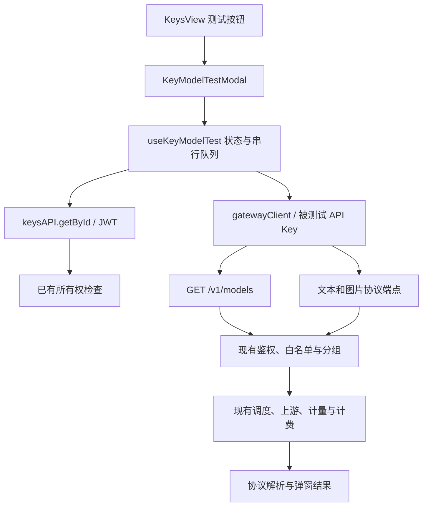

# API Key 模型测试功能技术方案

> 版本：v1.0。设计日期：2026-10-31。
>
> 状态：前端实现已落地并完成本地部署测试；验证结果见 §11.5 和 [本地验收记录](API_KEY_MODEL_TEST_LOCAL_ACCEPTANCE.md)。真实供应商、真实费用和生产部署仍待验收。
>
> 实施基线：`7090857956d6d7ec6a97dfc19a06688f025f4caf`，官方 v0.2.19 加 Fork 定制。
>
> 依据：[开发规范](DEVELOPMENT_RULES.md)、[架构指南](ARCHITECTURE_AND_MODIFICATION_GUIDE.md)、[定制与同步手册](SUB2API_CUSTOMIZATION_AND_UPSTREAM_SYNC_GUIDE.md)、[插件文档](PLUGIN_DEVELOPMENT.md)。章节组织参考本地 `REF_AUTH_TECHNICAL_PLAN.md`，不引入其数据库或鉴权实现。

## 设计原则速览

| 原则 | 实现 |
| --- | --- |
| 尽量减少核心改动 | 独立前端模块，KeysView 只接入按钮和懒加载弹窗 |
| 测试真实 Key 权限 | 浏览器使用被选中的 Key 调用现有网关 |
| 列表与网关一致 | 只读取 `/v1/models`，不在前端合成默认模型 |
| 不把 200 当成功 | 判断有效内容、错误字段、结束原因与流式终态 |
| 沿用计费 | 无测试免单、代付、特殊调度或账务分支 |
| 限制付费请求 | 串行队列、图片确认、不自动重试或切换端点 |
| 结果生命周期可控 | 仅当前弹窗，关闭取消请求并释放图片 |
| 可持续同步上游 | 不改后端协议、数据库、Wire 和插件协议 |

## 目录

1. 需求与范围
2. 当前系统与总体架构
3. 目录与变更边界
4. 存储及生命周期
5. 类型和模块接口
6. 模型发现与端点选择
7. 协议请求、解析和成功条件
8. 队列、限制与错误处理
9. 页面交互
10. 安全、计费和配置
11. 实施、测试、发布与回滚
12. 依赖、上游同步和验收标准

## 1. 需求与范围

### 1.1 业务需求

用户在 `/keys` 管理 API 密钥时，需要直接确认该 Key 可见的模型，以及某个模型是否能够真实调用。

操作列新增“测试”，打开“测试 API 密钥：{名称}”弹窗，提供：

- 模型目录、搜索和分页；
- 单模型测试及所选/筛选结果批量测试；
- 自动建议测试协议和逐行手动覆盖；
- 文本流式/非流式测试；
- 图片生成测试、费用确认和结果预览；
- 状态、耗时、HTTP 状态、请求 ID、用量和错误摘要；
- 停止、重新测试及关闭清理。

### 1.2 用户确认的决策

| 决策 | 首版行为 |
| --- | --- |
| 模型范围 | 文本＋图片 |
| 操作范围 | 单项＋批量，端点选择及文本流式开关 |
| 计费 | 当前 Key 正常计费 |
| 扩展方式 | 前端独立模块，现有网关 API |
| 未识别别名 | 用户手动指定协议 |
| 历史 | 只在当前弹窗保留；现有用量日志照常保存 |

### 1.3 角色与权限

普通用户只能操作自己在密钥页面拥有的 Key。管理员访问同一用户页面时仍遵循该页面所有权规则，不增加代测其他用户 Key 的权限。

按钮不是授权凭证。读取 Key 经过用户面板 JWT 和资源归属检查，模型发现与生成请求经过真实 API Key 网关鉴权。

### 1.4 可用性的定义

模型列表代表“网关对该 Key 声明可见的目录”。它可能来自映射、白名单、平台默认目录或固定 OpenAI 目录，不等于实时上游健康检查。

一次成功只证明测试时间、当前浏览器来源、该 Key、该模型、该协议与请求模板组合成功。它不证明所有端点、其他客户端来源、工具调用或未来请求都可用。

### 1.5 非目标

不支持音频、视频、Embedding、Realtime、图片编辑、工具执行、定时探测、后台任务、跨刷新历史、自定义 URL/请求头/JSON、免费测试或管理端代测。

已识别的其他模型类型仍展示，但自动模式不可执行。逐行明确覆盖是选择一种已支持的测试模板，不是新增该模型类型的原生测试能力。

## 2. 当前系统与总体架构

### 2.1 已有实现依据

| 功能 | 源码 | 复用边界 |
| --- | --- | --- |
| Key 页面 | `frontend/src/views/user/KeysView.vue` | 操作槽和弹窗挂载 |
| Key 用户 API | `frontend/src/api/keys.ts` | `getById` 读取最新 Key |
| 所有权 | `backend/internal/handler/api_key_handler.go` | `GetByID` 对跨用户读取返回 404 |
| API Key DTO | `backend/internal/handler/dto/mappers.go` | 现有用户 DTO 已包含 Key，未增加暴露面 |
| 模型列表 | `backend/internal/handler/gateway_handler.go` | `Models` 的分组、映射和白名单语义 |
| 固定 OpenAI 目录 | `backend/internal/handler/openai_models_handler.go` | 最终标准 `data[].id` 格式 |
| 网关 | `backend/internal/server/routes/gateway.go` | 现有生成路由与中间件 |
| URL | `frontend/src/api/url.ts` | `buildGatewayUrl` |
| 通用 UI | `frontend/src/components/common/` | BaseDialog、ConfirmDialog、DataTable、Pagination |

`/v1/models` 本身仍会检查计费资格。余额、有效期、配额、订阅、Key 状态和 IP 限制均可能让发现失败。前端展示真实错误，不用静态目录掩盖失败。

### 2.2 插件方案评估

`.s2plugin` 当前能力为 `openai.oauth.outbound_transport.v1`，UI Bridge 只提供配置加载/保存/测试和配置页面辅助消息。

它没有用户 Key 读取能力、KeysView 操作扩展点或用户页面注册机制。为此功能扩展宿主插件权限和协议比直接接入前端模块影响更大，因此本功能不是可上传安装的 `.s2plugin` 包。

管理员 `AccountTestService` 测试的是上游账户，不能证明用户 Key 的白名单、配额、IP 和计费路径，所以只参考交互，不调用管理员账户测试接口。

### 2.3 架构图



### 2.4 两类客户端

| 请求 | 传输 | 凭据 | 响应 |
| --- | --- | --- | --- |
| Key 读取 | 现有 keysAPI / apiClient | JWT | `{code,message,data}` |
| 模型发现和生成 | 专用 fetch | 选中的 API Key | 网关原生 JSON/SSE |

共享 `apiClient` 会注入 JWT，并有面板 envelope 和会话刷新语义；禁止把网关测试放到它上面。

网关 fetch 明确设置 `credentials: omit`、`cache: no-store`、`redirect: error` 和 AbortSignal。认证头由客户端统一构造，不接受外部请求头或外部 URL。

## 3. 目录与变更边界

### 3.1 新增模块

`frontend/src/features/key-model-test/`：

```text
index.ts                     对页面暴露开关与懒加载组件
config.ts                    开关、预算、固定提示词
types.ts                     模型、计划、结果、usage、图片类型
modelCatalog.ts              目录校验和规范化
testProfiles.ts              保守协议建议和覆盖优先级
gatewayClient.ts             认证、请求、时限、响应读取、错误转换
resultSanitizer.ts           错误脱敏、异常类型、诊断字段白名单
imagePreview.ts              图片格式校验、URL 和内存预算
useKeyModelTest.ts           所有权刷新、会话、串行队列与取消
protocols/types.ts           请求/解析接口
protocols/common.ts          文本结果、usage 和协议错误公共处理
protocols/responses.ts       Responses
protocols/chatCompletions.ts Chat Completions
protocols/messages.ts        Anthropic Messages
protocols/gemini.ts          Gemini 文本与图片
protocols/images.ts          Images
protocols/sse.ts             有界流读取和 SSE 分帧
components/                 弹窗、表格、结果详情
__tests__/                  目录、协议、传输、生命周期和 UI 测试
```

### 3.2 接入修改

- KeysView：按钮、一个 Key ID ref 和弹窗；不将明文 Key 传入弹窗 props。
- 双语 index：注册独立 `keyModelTest` 文案命名空间。
- `frontend/src/vite-env.d.ts`：构建开关声明。
- `frontend/.env.example`：开关样例。
- KeysView 测试：开关关闭、正确 ID、关闭卸载、无秘密 props。
- 架构指南：文档入口、前端调用边界和 §11 逐文件索引。

没有后端 API、SQL migration、Ent、Wire、插件协议或依赖锁文件变更。

## 4. 存储及生命周期

### 4.1 存储表

| 数据 | 位置 | 清理 |
| --- | --- | --- |
| Key 完整快照 | composable 私有闭包 | 关闭或切换 Key 时解除引用 |
| 名称、分组、掩码 | 弹窗浅响应状态 | 关闭清理 |
| 目录 | 弹窗内存 | 刷新或关闭清理 |
| 结果 | 模型 ID → 结果对象 | 同模型重测覆盖，关闭清理 |
| 当前批次计数 | 本批 ID 列表 | 新批次替换 |
| 图片 | Blob URL 或 HTTPS URL | 淘汰、重测、刷新、关闭释放 |
| 用量与费用 | 既有后端记录 | 现有策略 |

不使用本地存储、IndexedDB、URL、Redis 或新的数据库表。不新增持久化 Pinia store。

JavaScript 只能解除引用，不能承诺立即安全擦除运行时内存。

### 4.2 会话与并发隔离

每次打开生成新的会话编号，每次启动生成新的运行编号。异步响应发布前同时核对编号，防止旧 Key、旧目录、已停止任务覆盖新状态。

`keysAPI.getById` 沿用已有接口，没有独立取消参数；晚到响应通过会话编号忽略。网关 fetch 使用主动取消。

一个弹窗最多一个活动生成请求。不同标签页不共享前端锁，全局并发和费用正确性由现有后端负责。

## 5. 类型和模块接口

### 5.1 模型与计划

`TestProfile`：`responses | chat_completions | messages | gemini_text | images | gemini_image`。

`CatalogModel` 字段：

| 字段 | 类型 | 语义 |
| --- | --- | --- |
| id | string | 原始公开模型 ID，不转小写、不映射 |
| displayName | string | 显示名称，回退 id |
| kind | text/image/unsupported/unknown | 测试工具识别的类型 |
| suggestedProfile | TestProfile/null | 建议模板，不是服务端能力声明 |
| resolution | suggested/manual_required/unsupported | UI 操作提示 |

`TestPlan` 包含 selections、skipped、imageCount。selection 为 modelId/profile/stream，skipped 为 modelId/reason。调用 `start` 后复制 selections 和 skipped，不受后续 UI 引用修改影响。

### 5.2 结果实体

`ModelTestResult` 的完整权威类型位于模块 `types.ts`：

| 字段组 | 字段 | 规则 |
| --- | --- | --- |
| 请求 | modelId/profile/stream | 固定为本次执行选择 |
| 状态 | status/summary | summary 是本地 i18n 键，不是完整响应 |
| 时间 | startedAt/durationMs/firstContentMs | 首内容只计算有效文本，不等于网络 TTFB |
| 诊断 | httpStatus/gatewayRequestId/responseModel | 使用真实返回值；返回模型不覆盖请求模型 |
| 内容 | textPreview/partialOutput | 最大 4,000 字符，失败可保留部分输出 |
| 用量 | usage | 缺失保留缺失，显式 0 保留 0 |
| 图片 | imageCount/previewId | 结果不持有大 base64 |
| 错误 | errorCategory/errorCode/errorMessage | 分类、有限长度、脱敏 |

usage 使用 inputTokens、outputTokens、totalTokens、cachedInputTokens 可选数字；只接受有限非负数，不通过相加补造上游缺失字段。

### 5.3 协议适配器

```typescript
interface ProtocolAdapter {
  buildRequest(modelId: string, stream: boolean): TestRequestSpec
  parseResponse(response: Response, context: ParseContext): Promise<ParsedOutcome>
}
```

请求规格包含固定 path、受控 headers、body、json/sse、timeoutMs、maxResponseBytes。

解析上下文只包含 signal、字节预算和 onText 回调。适配器不获取 Key，不能自建上游调用。

### 5.4 页面接口

对 KeysView 仅暴露构建开关、懒加载弹窗，以及 `show`、`keyId` props 和 `close` 事件。队列和 Key 不进入页面共享状态。

## 6. 模型发现与端点选择

### 6.1 发现流程

打开 → 清理旧会话 → JWT 读取 Key → 检查本地状态 → Key 认证请求 `/v1/models` → 校验目录 → 未测试列表。

不携带 `client_version`，避免进入 Codex 专用 manifest。

发现不会发出生成请求，但仍可能触发现有目录读取、鉴权和最近使用等正常网关行为。

### 6.2 校验规则

- `data: []` 和 `data: null` 是空目录。
- 缺失 data、错误类型或其他 envelope 为格式错误。
- ID 必须是非空字符串，最多 1,024 字符，无控制字符。
- 显示名优先 display_name、name，再回退 ID；显示名长度同样有界。
- 精确 ID 去重，保留网关排序；大小写只用于筛选和模板建议。
- 非法条目计数提示，合法条目继续展示。
- 最大 2 MiB、5,000 项；超限失败，不静默截断成“完整目录”。

### 6.3 测试方式优先级

逐行覆盖 → 全局显式选择 → 模型命名与分组建议 → 需要手动配置。

先排除音频、视频、Embedding、Realtime 等，再匹配图片，最后匹配文本。不得把 gpt-image 当作普通 GPT 文本。

| 模型族 | 建议 |
| --- | --- |
| gpt-image / dall-e / grok-imagine 图片 | Images |
| Gemini image | Gemini 图片 |
| Claude | Messages |
| Gemini 文本 | Gemini 文本 |
| GPT / Codex / OpenAI 推理文本 | Responses |
| Grok / DeepSeek / Kimi / GLM / MiniMax / Qwen 文本 | Chat Completions |
| 已识别文本且为 Anthropic 分组 | Messages |
| 不明确的别名 | 手动选择 |

全局选择与已知模型模态冲突时跳过；逐行明确覆盖可以覆盖命名推断。该行为用于映射别名，不改变后端权限。

### 6.4 启动前刷新

每次单项/批量启动先刷新 Key。比较 id、user_id、key、name、group_id、group.updated_at、group.platform、status、expires_at、IP 白/黑名单、quota 和三个 rate_limit 配置。

Key 的 updated_at 同时被正常使用记录与用量结算更新，不是配置版本，不能用它判定配置变更；last_used_at、quota_used、usage 和窗口进度同样不参与比较。此行为已通过本地真实网关发现/调用流程发现并修正，后端仍对每次请求实时鉴权和检查额度。

发生变化就重新加载目录、清理结果并要求再次发起。刷新失败不发送生成请求。批量每项仍由网关实时检查，前端快照不冻结授权。

## 7. 协议请求、解析和成功条件

### 7.1 固定请求模板

文本提示词：`Reply with exactly OK.`

图片提示词：`Generate one simple blue circle on a plain white background.`

| 模板 | 路径 | 请求要点 |
| --- | --- | --- |
| Responses | `/v1/responses` | model、input_text、简短 instructions、store:false、stream |
| Chat | `/v1/chat/completions` | model、单条 user messages、stream |
| Messages | `/v1/messages` | model、max_tokens:256、user messages、stream、anthropic-version:2023-06-01 |
| Gemini 文本 | `/v1beta/models/{model}:generateContent` | contents.user.parts.text |
| Gemini 文本 SSE | `/v1beta/models/{model}:streamGenerateContent?alt=sse` | 相同 contents |
| Images | `/v1/images/generations` | model、prompt、n:1 |
| Gemini 图片 | `/v1beta/models/{model}:generateContent` | contents、responseModalities:[TEXT,IMAGE]、aspectRatio:1:1 |

Gemini 模型使用 encodeURIComponent，不能通过模型 ID 注入路径、查询参数或认证信息。

Responses/Chat 不统一添加 token 上限，避免 Fork strict/Codex 路径对 max 参数的兼容拒绝。Messages 使用协议必需的上限。短提示词和客户端超时不是上游费用硬上限。

Images 不强制 size/quality/response_format，兼容上游默认值和 URL/base64。图片首版不使用流式，单项发一次请求，不调用异步任务端点。

### 7.2 JSON 成功条件

- Responses：completed 状态和非空 output_text。
- Chat：非空文本、正常 finish_reason。
- Messages：非空 text、end_turn 或 stop_sequence。
- Gemini 文本：非空文本和 STOP。
- 图片：至少一个合法图片条目；纯文本回复不算生图成功。

HTTP 非 2xx、协议 error、HTML、拒绝/过滤、意外工具调用或模态输出均不能成功。输出无须逐字等于 OK。

### 7.3 SSE 成功条件

- Responses：response.completed 和正常状态。
- Chat：finish_reason=stop 且收到 `[DONE]`。
- Messages：正常 stop_reason 且收到 message_stop。
- Gemini：有效文本、STOP、正常读取结束。

max_tokens/length、Responses incomplete、缺终止事件或有内容后断开均保留不完整结果。失败后不自动换模型、端点或重新发送。

Responses 兼容网关协议转换在末尾附加的 `[DONE]`；该标记不替代 response.completed，只有标记或 incomplete 后跟标记仍不能成功。

### 7.4 有界读取

TextDecoder 流式处理 UTF-8，支持字节拆分、BOM、CRLF/LF、多行 data、注释心跳、跨 chunk、多事件和 EOF 残留。

总字节预算与单事件预算同时生效。所有结束、错误、取消路径取消 reader 并释放锁。总超时贯穿 fetch 和响应读取，心跳不延长时限。

文本进度最多每 100ms 发布一次，最后结果保留最终有限预览。

### 7.5 用量与错误协议

OpenAI prompt/input、completion/output、details.cached_tokens 分别映射到可选 usage 字段；Anthropic 合并 message_start 和 message_delta 用量；Gemini 使用 usageMetadata。

错误兼容 OpenAI/Anthropic error、Google status/message 和中间件 code/message。非 JSON 错误使用安全通用文案，不展示整段 HTML 或完整错误响应。

## 8. 队列、限制与错误处理

### 8.1 限制参数

| 项目 | 值 |
| --- | --- |
| 模型发现 | 30 秒、2 MiB、5,000 项 |
| 文本生成 | 90 秒、2 MiB |
| 图片生成 | 180 秒、32 MiB JSON |
| SSE 单事件 | 1 MiB |
| 活动生成请求 | 1 |
| 单批生成数 | 50 |
| 默认分页 | 30 |
| 文本预览 / 错误摘要 | 4,000 / 512 字符 |
| 解码图片 | 单张 16 MiB |
| 预览 | 最多 3 张、48 MiB 记账预算 |

超过预算表示工具限制，不等于模型不可用。远程 HTTPS 图片由浏览器 img 加载，无法从无 CORS 的远程响应可靠测量解码大小，因此为其保守预留 16 MiB 预算；这不构成远程图片真实解码内存的硬限制。

### 8.2 状态机

`untested → queued → running → success / failed / incomplete / timeout / cancelled`。

待执行项可进入 skipped；手动重测重新进入 queued。一个运行期间禁止新增单项或第二批次，防止双击重复提交。

### 8.3 批量语义

- 测试所选只包含当前筛选中的选择；筛选变化清空勾选。
- 测试筛选结果跨全部分页，不只测试当前页。
- 默认排除图片，开启包含图片后才纳入批量。
- 无法解析的模型保留 skipped 原因，不发请求。
- 超过 50 个可执行模型拒绝启动，不悄悄取前 50 个。
- 批量先确认请求数、图片数、跳过数和正常计费说明。
- 单项图片同样确认；单项文本不额外弹确认。
- 每轮结果只覆盖参与的模型，其他行结果保留；进度计数针对最新计划。

### 8.4 停队策略

| 情况 | 行结果 | 后续队列 |
| --- | --- | --- |
| 401/402、Key/用户失效 | 失败 | 停止 |
| 余额/订阅/配额/IP/分组限制 | 失败 | 停止 |
| 429 | 失败 | 停止，无自动重试 |
| 不明作用域 403 | 失败 | 保守停止 |
| 明确模型/端点拒绝 | 失败 | 继续 |
| 单模型 5xx | 失败 | 继续 |
| 超时 | 超时 | 继续 |
| 正常读取结束但缺终态 | 不完整 | 继续 |
| 网络断开 | 失败或保留部分输出的不完整 | 停止 |
| 用户停止 | 当前取消、待执行跳过 | 停止 |

后端现有安全故障切换仍然生效。前端不实现第二层自动生成重试。

### 8.5 取消与费用

停止使用 AbortController 取消等待，同时增加运行编号，阻止迟到结果回写。关闭、换 Key、离开组件均清理请求、计时器和图片。

停止不能保证上游未执行或退款。固定提示：已发送请求仍可能产生费用，请以使用记录为准。

## 9. 页面交互

### 9.1 密钥页入口

位置：使用密钥 → 测试 → 导入 CCS → 禁用 → 编辑 → 删除。

沿用现有图标＋文字按钮样式，仅启用构建开关时显示。点击传递 Key ID，打开时获取最新数据。

### 9.2 弹窗结构

1. 标题、分组和掩码 Key。
2. 模型声明可见性及计费提示。
3. 全局协议、文本流式开关。
4. 搜索及刷新。
5. 测试所选、测试筛选、停止和包含图片。
6. 模型、逐行协议、状态、结果/耗时、操作表格。
7. 最新计划统计与分页。
主弹窗不在列表底部渲染详情。“查看结果”按需打开独立的结果详情弹窗；单项/批量测试不自动打开。

BaseDialog 使用 extra-wide，DataTable 自动适配桌面表格与窄屏卡片；输入和新增主要操作最小高度 44px。状态同时有文字，不只依靠颜色。

### 9.3 结果详情

点击有结果行的“查看结果”，打开同级 `BaseDialog`（wide、z-index 60），标题为“测试结果详情”。复用 `ModelTestResult`，从当前会话的结果与图片存储读取最新状态，不新增 API 调用。

右上角、底部“关闭详情”和 Escape 只关闭详情，点击遮罩不关闭；保留主弹窗的筛选、分页、勾选、滚动位置及结果，焦点返回发起按钮。查看/关闭详情不停止批量，也不释放预览。刷新目录、切换 Key、关闭主弹窗或卸载时清除详情，沿用原有会话资源清理。实现与验证见 [详情弹窗方案](API_KEY_MODEL_TEST_RESULT_DIALOG_TECHNICAL_PLAN.md)。

显示请求/返回模型、协议端点、流式、时间、总耗时、首次有效内容耗时、HTTP 状态、网关 X-Client-Request-ID、usage、图片数及安全错误。

复制诊断仅包含白名单元数据。不复制正文、错误原文、认证头、Key、图片或签名 URL。

缺失 usage 显示“未返回”，不能推导免费。使用记录链接指向现有 `/usage`。

### 9.4 图片预览

base64 必须合法且满足 PNG/JPEG/WebP 文件特征与声明 MIME，不允许 SVG、HTML 或任意 data URL。验证后转换 Blob URL，替换和淘汰时 revokeObjectURL。

HTTPS 图片 URL 拒绝 userinfo、HTTP 和非 HTTPS scheme，使用 no-referrer，不附带 Key。预览失败不重复生成，结果仍保留已返回图片事实。

仅保留有限预览；淘汰后显示“生成成功，预览已释放”。

### 9.5 状态与可访问性

覆盖加载、空目录、失败、部分非法目录、Key 不可用、待手动配置、执行、完成、取消、超时、费用确认和运行中关闭。

运行中关闭主弹窗要求“停止并关闭 / 继续测试”；关闭详情不触发该流程。组件卸载直接清理。复用 BaseDialog 焦点管理与顶层 Escape，所有选择控件有 label，错误通过 role=alert，进度使用状态文字。

## 10. 安全、计费和配置

### 10.1 凭据边界

只允许 `buildGatewayUrl` 得到的固定网关来源，不提供任意 Base URL。请求头仅 Authorization、Accept、Content-Type 和需要时的 anthropic-version。

不发送 query Key，不发送 JWT，不伪造 IP/CLI 身份，不跟随重定向，不复用带认证头客户端加载图片。

普通日志、console、埋点和错误上报不增加完整请求、响应或凭据。错误清理明确 Key、Bearer、常见秘密字段、JWT、URL 和控制字符，随后截断。

UI 对模型返回内容使用纯文本，不使用 v-html。

### 10.2 计费

计费沿用现有运行模式、订阅、余额、Key 时间窗口、分组倍率、图片定价和用量记录。测试没有免费标志或新结算路径。

失败、超时、取消、图片预览失败均不等于未收费。前端不根据 token 或 n 计算费用，不伪造费用为零。

### 10.3 构建配置

```dotenv
VITE_KEY_MODEL_TEST_ENABLED=false
```

只有精确字符串 true 启用；缺省或其他值关闭。关闭时按钮和弹窗不挂载，无额外请求。

该配置只影响前端构建，不影响公共网关可调用性，不是权限开关。生产变更后须重建前端和嵌入发布产物，无后端热更新承诺。

## 11. 实施、测试、发布与回滚

### 11.1 实施顺序

类型和目录 → 网关客户端 → 六个模板和解析 → 有界图片/SSE → 串行队列 → 弹窗与双语 → KeysView 入口 → 测试 → 架构索引与文档。

当前实际从同步基线建立 `feature/api-key-model-test`，作为依赖同步分支的功能分支进行独立开发，没有合并、重写或推送 main。此处保留实际分支顺序与原方案“先合入同步分支再开发”的差异。2026-10-31 同步分支连同前端安全依赖修复已通过 GitHub CI 并经 [PR #2](https://github.com/chochoc/sub2api/pull/2) 合入 main（a67aac90718b309a4b550952e99e7db89cf08d53）；功能分支随后普通 merge 吸收 origin/main，保留双方索引记录，不 rebase 或强推。升级依赖后的功能组合已通过 lint/typecheck、578 项 critical、3,098 项全量前端测试和开启功能构建；最终合并状态以功能 PR 为准。

原有未跟踪参考文档保留，不作为本功能改动提交。

### 11.2 自动化测试矩阵

| 测试 | 契约 |
| --- | --- |
| 目录 | 空/null、非法 envelope/条目、去重、顺序、限额、别名 |
| 类型选择 | 图片/非文本优先、未知别名、模态冲突、手动覆盖 |
| 协议 | 请求模板、有效输出、终态、拒绝、截断、usage presence |
| SSE | UTF-8 拆分、BOM、CRLF、多行、心跳、EOF、上限、取消 |
| 网关客户端 | 正确 Key、无 JWT/cookie/query key、禁止重定向、无自动重试 |
| 队列 | 串行、冻结计划、防重复、取消、停队、单行结果保留 |
| 生命周期 | 所有权刷新失败、分组变化、旧会话晚到、关闭清理 |
| 图片 | 字节/MIME、URL、SVG/HTML 拒绝、淘汰与释放 |
| UI | 图片确认、单项文本、筛选清选择、分页、入口开关和正确 Key |
| 双语 | 键、插值、语法编译及碰撞检查 |

自动化与浏览器 fixture 不发真实付费请求。

### 11.3 验证命令

从仓库根执行：

```bash
pnpm --dir frontend install --frozen-lockfile
make test-frontend
pnpm --dir frontend exec vitest run src/features/key-model-test src/views/user/__tests__/KeysView.spec.ts
pnpm --dir frontend run test:run
VITE_KEY_MODEL_TEST_ENABLED=true make build-frontend
VITE_KEY_MODEL_TEST_ENABLED=false make build-frontend
make check-architecture-index
git diff --check
```

发布形态补充：

```bash
VITE_KEY_MODEL_TEST_ENABLED=true make build-frontend
(cd backend && go build -tags embed -o bin/server ./cmd/server)
(cd backend && go test -tags embed ./internal/web)
```

提交前用真实暂存区运行 `python3 tools/check_architecture_index.py --staged`，CI 仍按最终 commit 范围校验。手工 embed 不替代正式版本注入流程。

本机 Corepack 默认入口有签名/父目录包管理器问题；验证使用已安装的明确版本 pnpm 9.15.9，无关闭签名校验、无修改项目 lockfile。工作站 Node 版本与 CI Node 20 的差异需保留在验证记录中。

### 11.4 真实链路验收

需在隔离环境使用专用 Key 完成：

- OpenAI/Codex、Anthropic、Gemini 文本流式和非流式；
- OpenAI 与 Gemini 图片成功、预览及真实计费；
- Composite、模型别名、模型白名单；
- Key 禁用/过期、余额不足、订阅限制、IP 限制；
- 停止后待执行项不产生请求，活动调用可能计费；
- 使用记录 Key 归属正确，正常失败/重试语义与现有网关一致；
- 实际 Vite 与部署反向代理的 `/v1beta` 可达；
- 明暗主题、窄屏、键盘、费用确认、429 与异常终态。

客户端测试成功不证明账务已验证；模拟 usage 不证明真实供应商计费正确。

### 11.5 本次验证记录

验证日期：2026-10-31。执行环境为 macOS、Node v24.19.0、pnpm 9.15.9；CI 使用 Node 20，本机结果不替代该运行时的 CI 检查。下表保留首次离线验证结果，之后的本地部署复验及修复结果见本节末尾。

| 检查 | 实际结果 |
| --- | --- |
| frozen-lockfile 安装 | 通过，没有修改 lockfile 或增加依赖 |
| `make test-frontend` | lint、typecheck、30 个 critical 文件 / 578 项测试通过 |
| 功能模块与 KeysView 定向测试 | 9 个文件 / 107 项测试通过 |
| 前端全量测试 | 383 个文件 / 3,092 项测试通过 |
| 功能开启构建 | `VITE_KEY_MODEL_TEST_ENABLED=true make build-frontend` 通过，最终本地 dist 为开启版本 |
| 功能关闭构建 | `VITE_KEY_MODEL_TEST_ENABLED=false make build-frontend` 通过；KeysView 测试验证无入口和弹窗 |
| 嵌入构建 | `go build -tags embed -o bin/server ./cmd/server` 通过 |
| 嵌入静态服务测试 | `go test -tags embed ./internal/web` 通过 |
| 架构索引与 diff | 工作区、暂存区索引检查及 `git diff --check` 通过，覆盖 37 个代码/配置/测试路径 |

浏览器检查使用系统 Chrome 与临时本地 fixture 服务，挂载实际弹窗、公共组件、样式、Pinia、router 和 i18n；Key、目录、JSON、SSE、图片和限流响应均为模拟数据。已检查：打开不生成、文本非流式/流式、图片取消不请求/确认后预览、串行批量遇 429 停止、活动请求关闭确认、390px 窄屏无文档横向溢出、明暗主题、Escape 关闭和焦点恢复。检查未出现浏览器 pageerror。图片 fixture 为静态 PNG，不调用真实图片供应商。

构建出现既有大型 chunk 与 Browserslist 数据更新提示，未阻断构建。浏览器 fixture 仅证明前端交互与协议处理，不能证明生产代理、真实模型能力或计费正确。

首次离线验证没有使用真实用户 Key，没有合并同步分支、推送、创建 PR 或发布。原未跟踪参考文档保持原状。

**同日追加本地部署复验**：已在 `https://127.0.0.1:8443/keys` 部署开启功能的源码嵌入版。真实本地网关配合模拟上游完成六种协议的 10 个页面场景、串行批量、图片预览、Key 所有权、IP 拒绝、零余额拒绝和 23 条用量归属检查。修复正常使用更新时间导致错误重载、Responses 流末尾 DONE 导致错误失败两个问题。修复后 lint/typecheck、578 项 critical、113 项定向、3,098 项全量测试和 embed 构建/测试通过。临时测试资源已清理，实际服务保持运行。详见 [本地部署与验收记录](API_KEY_MODEL_TEST_LOCAL_ACCEPTANCE.md)。

仍未执行：真实供应商文本/图片调用和真实收费核对、生产 `/v1beta` 代理验收、生产迁移/恢复演练及生产发布。本地模拟 usage 入库不替代供应商账单核对；真实链路验收和发布前置仍按 §11.4/§11.6 执行。

### 11.6 发布

生产升级前核对实际源码版本、数据库 migration、配置、镜像和备份。当前同步基线的 integration/迁移演练未全部完成，不能因本功能无 migration 就忽略上游升级前置。

目标构建显式启用开关，固定 Fork SHA、上游 SHA、custom 版本和镜像 digest。部署后观察目录失败、生成错误、响应延迟、正常用量归属和既有密钥管理行为。

### 11.7 回滚

优先使用相同后端基线关闭本 UI 开关并重建，或回到相同基线上尚未接入模块的已验证产物。

本功能无持久数据迁移。跨上游版本回滚仍须验证数据库兼容或恢复数据库，不能仅回滚应用。

## 12. 依赖、上游同步和验收标准

### 12.1 依赖矩阵

| 依赖 | 影响 |
| --- | --- |
| keysAPI/getById | 沿用 JWT 所有权，DTO 变化需要回归 |
| buildGatewayUrl | 决定受控网关来源，不硬编码部署域名 |
| 模型目录 | 公开 ID、白名单和排序由后端拥有 |
| 网关协议 | 六个模板的响应终态和 usage 需随上游回归 |
| UI/i18n | 原公共组件、主题和双语注册 |
| 构建 | 前端开关及 embed 产物 |
| 架构门禁 | 同批变更逐文件索引，不能用目录替代 |

不增加 npm/Go 依赖、第三方服务或新数据库。

### 12.2 上游同步清单

检查 KeysView 操作插槽、ApiKey/Group 用户 DTO、URL 构造、`/v1/models` 格式、协议终态、usage、i18n 注册及 embed 构建。

冲突按业务语义解决，不复制整份上游大文件，不重写共享 main，不将缺少目录能力视为允许绕过网关。

### 12.3 完成标准

功能完成需具备正确 Key 入口、真实目录、文本/图片、单项/批量、端点选择、流式、确认、停止、资源清理和安全结果。

可发布还需自动化、构建、架构索引、真实 UI、真实上游、费用和升级前置验证。代码完成、离线测试通过与生产验收是不同状态，必须分别记录。
