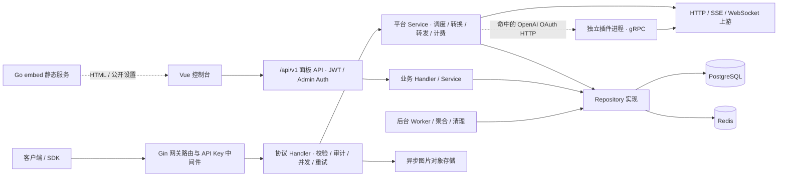
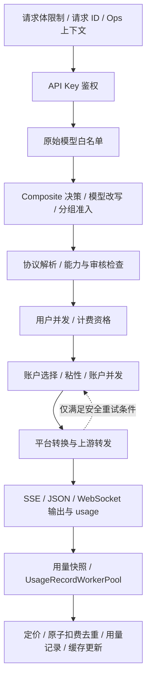

# Sub2API 架构与修改指南

> 本文是本项目理解、定位、修改和验证的总览与索引。先读本文和 [开发规范](DEVELOPMENT_RULES.md)，再沿源码入口进入对应领域。
>
> 首次核对日期：2026-09-29；代码基线：`9a62841fd124d026cf3694fcf9b79e98addcdbdc` 及本次文档/门禁变更。本文依据本地源码、测试、随仓库维护的官方 README 和领域文档编写；参考 maas 同名指南的组织方式，不继承其技术实现。
>
> **任何代码改动都必须在同一变更中更新本文的变更索引；影响现行架构、接口、路径或行为时，还必须更新对应正文。缺少索引、索引与代码不符或只改日期，一律阻断合入。**执行细则见开发规范 §19 和本文 §11。

路径约定：`backend/`、`frontend/` 等完整路径相对 **sub2api 仓库根目录**；表格标注的相对目录和本节已明确的目录可使用短路径/文件名。可点击链接相对本文所在的 `docs/`。路径和符号比行号稳定；定位后仍须阅读实现和相邻测试。正文描述当前实现，§11 记录变更历史，历史记录不替代正文。

## 1. 阅读地图与资料索引

| 要做什么 | 从哪里开始 |
| --- | --- |
| 第一次理解项目 | §2 总体架构 → §3 启动/鉴权 → §4 网关生命周期 → §5 数据与计费 |
| 修改请求、协议、模型或账户调度 | §4 → §8 修改速查 → 对应 handler/service 与测试 |
| 修改用户端或管理端 | §7 → §8 前后端关联 → §9 验证 |
| 修改支付、媒体、审计或插件 | §6 对应领域 → 下表专门文档 |
| 修改部署、配置或同步上游 | §3、§9、§10 → 开发规范与同步手册 |
| 完成任何代码修改 | 更新相关正文、§11 文件级变更索引，执行架构索引检查及受影响 Gate |

### 1.1 随仓库维护的文档

| 文档 | 用途与源码依据 |
| --- | --- |
| [README_CN.md](../README_CN.md)、[README.md](../README.md) | 官方项目能力、客户端接入和部署概览；能力需对照 `backend/internal/server/routes/`，不能把 README 赞助商广告当作项目功能。 |
| [DEVELOPMENT_RULES.md](DEVELOPMENT_RULES.md) | 强制开发规范、分层、不变量、验证门禁、索引维护与评审阻断项。 |
| [受限管理员密钥](admin-api-keys.md)、[GPT-5.5 订阅退役](OPENAI_GPT55_RETIREMENT.md) | v0.2.19 管理密钥权限/资源边界及订阅模型退役后的路由兼容说明。 |
| [v0.2.19 本地同步记录](UPSTREAM_SYNC_20261031.md) | 固定官方发布 commit 的合并范围、冲突决策、迁移/配置变化和实际验证结果。 |
| [定制开发与上游同步手册](SUB2API_CUSTOMIZATION_AND_UPSTREAM_SYNC_GUIDE.md) | 本 Fork 的开发、上游合并和发布流程；当前分支/远端以 Git 实际状态为准。 |
| [DEV_GUIDE.md](../DEV_GUIDE.md) | 开发环境、工具链和常见问题；包含历史 Windows 环境示例，非统一部署配置，差异见 §10。 |
| [数据库迁移说明](../backend/migrations/README.md) | SQL 文件命名和校验和；实际执行器是 `backend/internal/repository/migrations_runner.go`，旧命令差异见 §10。 |
| [COMPOSITE_GROUPS.md](COMPOSITE_GROUPS.md) | 组合分组与路由规则；实现入口 `composite_route_resolver.go`，当前账号归属分支见 §4.3。 |
| [OpenAI 契约兼容性方案](SUB2API_OPENAI_CONTRACT_COMPATIBILITY_TECHNICAL_PLAN.md) | v3.1 / 2026-10-02，基于 `b735bd4b47bff5a9f2382e672632f8bc7dd70795` 加未提交实施：约束策略、原值转换、两条 Anthropic 桥及文本 stop 接线/有限收尾；§1.5 区分本地通过与剩余上游检查门。C1 多轮缓存按用户确认解决；不支持并拒绝不计原成功用例通过。 |
| [cached_tokens 缺失修复方案](SUB2API_CACHED_TOKENS_PRESENCE_REMEDIATION.md) | Responses → Chat usage 的 `cached_tokens` presence 保留；明确显式零、非零和真正缺失的区别、计费不变量、回归测试与重建部署后的 CC002 复测要求。 |
| [ASYNC_IMAGE_TASKS.md](ASYNC_IMAGE_TASKS.md) | OpenAI/Grok 异步图片、对象存储、轮询和所有权；对应 `image_task_handler.go`、`service/image_task.go`。 |
| [BATCH_IMAGE_MVP.md](BATCH_IMAGE_MVP.md) | Gemini API/Vertex 批量图片、队列、冻结款、下载/清理；对应 `service/batch_image*.go`。 |
| [seedance-api.md](seedance-api.md) | Ark 原生视频接口与轮询结算；对应 `handler/seedance.go`、`service/seedance.go`。 |
| [PAYMENT_CN.md](PAYMENT_CN.md)、[PAYMENT.md](PAYMENT.md) | 内置支付配置与订单操作；对应 `routes/payment.go`、`service/payment*.go`、`internal/payment/`。 |
| [管理支付集成 API](ADMIN_PAYMENT_INTEGRATION_API.md) | 外部系统充值、兑换幂等和嵌入页参数；对应 `handler/admin/redeem_handler.go`、`service/idempotency.go`、`frontend/src/utils/embedded-url.ts`。 |
| [插件开发教程](PLUGIN_DEVELOPMENT.md)、[公开插件协议](../backend/pkg/pluginapi/README.md) | `.s2plugin`、进程协议和宿主边界；公开定义在 `backend/pkg/pluginapi/v1/`。 |
| [插件开发](../backend/pkg/pluginapi/docs/development.md)、[UI Bridge](../backend/pkg/pluginapi/docs/ui-bridge.md)、[包格式](../backend/pkg/pluginapi/docs/package-format.md)、[安全边界](../backend/pkg/pluginapi/docs/security.md) | 插件详细契约；宿主实现 `service/plugin_*.go`。 |
| [渠道监控默认值](channel-monitor-v2-safe-defaults.md) | V1/V2、低负载历史回填与错误去重；对应 `service/channel_monitor_v2_aggregator.go` 及 repository。 |
| [部署说明](../deploy/README.md)、[Docker](../deploy/DOCKER.md)、[边缘安全](../deploy/EDGE_SECURITY.md) | 二进制/容器部署、代理和安全配置；对照 `deploy/` 脚本、Compose 与配置样例。 |
| [本机源码与 IP HTTPS 部署](LOCAL_SOURCE_HTTPS_DEPLOYMENT.md) | 当前工作区 embed 源码编译与原生进程部署；2026-10-02 已运行 `https://127.0.0.1:8443`，验证前端、登录、鉴权及停止/重启。使用独立 PostgreSQL/Redis 与专用 CA；未修改系统信任，Docker 集成与真实上游未验收，非生产发布结论。 |
| [中文合规正文](legal/admin-compliance.zh.md)、[英文合规正文](legal/admin-compliance.en.md) | 管理控制台实际展示内容，属于运行资源；对应 `middleware/admin_compliance.go` 及前端合规状态。 |
| [模型价格资源](../backend/resources/model-pricing/README.md) | 定价数据来源与维护；运行时 `service/pricing_service.go`、`model_pricing_resolver.go`。 |
| [前端路由](../frontend/src/router/README.md)、[stores](../frontend/src/stores/README.md)、[公共组件](../frontend/src/components/common/README.md)、[布局](../frontend/src/components/layout/README.md)、[认证页](../frontend/src/views/auth/README.md) | 局部开发说明；方法签名、守卫和状态字段以当前 TypeScript/Vue 实现为准。 |
| [Prompt Audit 变更资料](../openspec/changes/add-openai-compatible-prompt-audit/README.md) | 设计与实施资料入口；现行实现位于 `internal/securityaudit/`，设计中的计划不能视为运行事实。 |
| [入口拒绝日志清理工具](../backend/cmd/cleanup-ingress-reject-logs/README.md)、[发布辅助工具](../.github/release-tools/README.md) | 专项运维/发布工具，操作前读各自边界及脚本。 |

新增、迁移或删除领域文档时，必须更新本表或所属章节的链接。大方案、测试报告可另存文件，但本文必须留下可定位的入口及当前完成状态。

## 2. 项目总体架构

Sub2API 将平台生成的 API Key 请求分发到上游账户，负责鉴权、分组准入、调度、协议转换、并发、计量与计费，同时提供用户控制台、管理控制台和后台任务。

- 后端：单个 Go 模块，`backend/go.mod` 当前声明 Go **1.27.3**，Gin HTTP、Wire 装配、Ent 与原生 SQL；业务数据库为 PostgreSQL，Redis 承担缓存、计数、锁和任务队列等职责。
- 前端：`frontend/package.json` 中的 Vue 3、TypeScript、Vue Router、Pinia、Vite、Tailwind CSS 3、vue-i18n；包管理器 pnpm。CI 当前使用 Node 20、pnpm 9。
- 发布：Go 服务可通过 `embed` build tag 嵌入前端；普通后端构建与嵌入构建是不同产物。多实例正确性依赖共享数据库/Redis以及一致的必要密钥，不能仅靠进程内缓存。



图中是主干调用关系，不代表所有业务都严格经过 repository。支付服务已有直接使用 Ent 的事务实现；Prompt Audit 在独立包内持有自身存储实现。新增代码应遵守开发规范的所有权边界，不扩大历史耦合。

### 2.1 目录与所有权

| 入口 | 责任与修改边界 |
| --- | --- |
| [backend/cmd/server/](../backend/cmd/server/) | `main.go` 启动/退出、版本；`wire.go` 装配源与清理；`wire_gen.go` 生成接线。 |
| [backend/internal/server/](../backend/internal/server/) | `http.go` 服务/可信代理，`router.go` 总路由，`routes/` 分组，`middleware/` 鉴权、限制和日志。 |
| [backend/internal/handler/](../backend/internal/handler/) | 协议入口和面板 API，`admin/` 管理处理器、`dto/` 输出模型。 |
| [backend/internal/service/](../backend/internal/service/) | 业务规则、平台网关、调度、计费、仓储接口、后台服务；大文件按同前缀职责拆分。 |
| [backend/internal/repository/](../backend/internal/repository/) | Ent/PostgreSQL/SQL、Redis、HTTP 上游等接口实现，迁移执行与数据一致性。 |
| [backend/ent/schema/](../backend/ent/schema/)、[backend/migrations/](../backend/migrations/) | 手写 Ent schema 与前向 SQL 迁移；`backend/ent/` 其他大量文件是生成代码。 |
| [backend/internal/domain/](../backend/internal/domain/) | 平台/状态等共享常量；平台字符串来源 `constants.go`。 |
| [backend/internal/pkg/](../backend/internal/pkg/)、[backend/internal/util/](../backend/internal/util/) | 协议转换、平台工具、日志、URL/网络安全等；`apicompat/` 是重要转换入口。 |
| [backend/internal/config/](../backend/internal/config/)、[backend/internal/setup/](../backend/internal/setup/) | 配置加载/默认值/校验与首次安装。 |
| [backend/internal/securityaudit/](../backend/internal/securityaudit/) | 内容审核协调器与 Prompt Audit 的配置、扫描、存储、worker、管理 API。 |
| [backend/internal/payment/](../backend/internal/payment/) | 支付接口、注册表、负载均衡、金额工具与 `provider/`。 |
| [backend/pkg/pluginapi/](../backend/pkg/pluginapi/) | 对外插件协议、生成代码、SDK 与文档；不放 provider 私有实现。 |
| [backend/internal/web/](../backend/internal/web/) | `embed_on.go` / `embed_off.go`，静态路由、HTML 缓存与公开设置注入。 |
| [frontend/src/](../frontend/src/) | 页面、组件、API、类型、状态、语言与样式，详见 §7。 |
| [deploy/](../deploy/)、[Dockerfile](../Dockerfile) | 安装/容器/服务/反向代理配置与部署测试。 |
| [tools/](../tools/)、[.github/workflows/](../.github/workflows/)、[Makefile](../Makefile) | 本地质量检查与 CI/发布入口，详见 §9。 |

运行调用通常是 `route → handler → service → repository 实现`；编译依赖通过 service 定义的接口倒置，由 Wire 注入实现。`backend/.golangci.yml` 的 depguard 限制 handler/service 导入 repository、Redis 和 GORM，并存在少量明确白名单。新增依赖须同时检查 provider、构造器、测试 stub/mock。

## 3. 启动、配置与访问边界

### 3.1 启动和退出

实际入口：[main.go](../backend/cmd/server/main.go)。

1. 初始化 bootstrap 日志，读取版本和 `--setup` / `--version` 参数。
2. `setup.NeedsSetup()` 判断初始化状态：自动安装走环境配置；否则运行安装向导服务器。安装服务器与正常业务服务器的路由不同。
3. `runMainServer()` 加载 bootstrap 配置与日志，调用 Wire 生成的 `initializeApplication`。
4. `repository.InitEnt` 连接 PostgreSQL，运行嵌入的 SQL migrations，创建 Ent/SQL 客户端；Redis、业务服务、handler、中间件和 HTTP 服务经 provider 装配。部分后台服务在 `service/wire.go` 的 provider 中启动，不能只读 `main.go` 查找 worker。
5. 显式启动 PluginManager 和 Prompt Audit；降级语义见它们的 `Start` 和对应策略。随后 `ListenAndServe`。
6. 收到 SIGINT/SIGTERM 后执行 HTTP Shutdown，再调用 `Application.Cleanup`：停止应用层服务，最后关闭 Redis/Ent。增加后台任务必须接入启动、取消和清理，不能遗留 goroutine。

### 3.2 配置分为两类

| 配置类型 | 代码入口 | 修改时注意 |
| --- | --- | --- |
| 进程/部署配置 | `backend/internal/config/config.go`，`deploy/config.example.yaml`、`deploy/.env.example` | `CONFIG_FILE` 可指定文件；否则依次搜索 `DATA_DIR`、`/app/data`、当前目录、`./config`、`/etc/sub2api`。Viper 将点映射为下划线读取环境变量；新字段需注册默认值/绑定并验证环境可达性。 |
| 管理员持久化设置 | `backend/internal/service/setting_service.go` 及 `setting_*.go`、`backend/internal/handler/admin/setting_handler.go`、`backend/ent/schema/setting.go` | 不同设置有独立生效/缓存机制；保存后是否即时生效需核对订阅、失效回调和使用方，不能一概称需重启或热更新。 |
| 公开设置 | `GetPublicSettingsForInjection`、`backend/internal/web/embed_on.go`、`frontend/src/stores/app.ts` | 只暴露公开字段。前端启动前注入；保存设置时由 `server/router.go` 回调清除 HTML 缓存并更新 CSP 来源。 |

`run_mode=simple` 与“后台模式”是不同机制。前者改变计费/配额行为，并有可选的 Key 时间窗口计量；后者通过 `middleware/backend_mode_guard.go` 和前端路由控制用户界面/API 的可用性。不能把 simple 理解为取消认证。

### 3.3 路由与认证速查

总入口：[router.go](../backend/internal/server/router.go) 的 `SetupRouter` / `registerRoutes`。

| API 面 | 路由源文件（均在 `backend/internal/server/routes/`） | 认证/响应边界 |
| --- | --- | --- |
| 登录、刷新、注册与认证回调 | `auth.go` | 公开入口配限流；需登录的子路由使用 JWT。身份实现还需读 `service/auth*.go`。 |
| 用户控制台 `/api/v1` | `user.go` | JWT、用户状态/会话检查、面板限流与所有权；典型返回 `{code,message,data}`。 |
| 管理接口 `/api/v1/admin` | `admin.go` | Admin Auth 支持管理员 JWT 或管理员 `x-api-key`，还有管理审计/合规及部分敏感操作的 step-up。普通网关 Key 不是管理员 Key。v0.2.19 新增 `adm_sc_` 受限管理密钥，按精确路由动作、资源策略、有效期与 IP 白名单授权；未登记的定制路由默认拒绝，完整管理员 JWT/旧管理密钥仍可使用既有接口。 |
| 模型广场 | `model_plaza.go` | Optional JWT 与公开设置控制，不能因未登录可读而开放写操作。 |
| AI 网关 | `gateway.go` | API Key、分组/模型准入、协议特定错误结构；不套面板 envelope。 |
| 支付 | `payment.go` | 用户订单 JWT、管理接口 Admin Auth；webhook 不使用面板 JWT，而由支付验签与订单校验保护。 |
| 健康与通用入口 | `common.go` | 与业务鉴权不同；安装入口另见 `internal/setup/`。 |

关键中间件：`api_key_auth.go`、`api_key_auth_google.go`、`jwt_auth.go`、`admin_auth.go`、`session_binding.go`、`step_up.go`、`admin_compliance.go`、`panel_rate_limit.go`。可信代理在 `server/http.go`，客户端 IP 解析影响登录绑定、限流和审计；修改时一起核对 `deploy/EDGE_SECURITY.md`。

## 4. 网关请求处理与修改位置

### 4.1 典型同步请求生命周期

以下是主干，不是所有媒体/原生接口共享的单一函数：



源码证据：`routes/gateway.go` 的 middleware 注册顺序；`handler/gateway_handler.go` 的 `Messages`；`handler/openai_gateway_handler.go` 的 `Responses`；`service/gateway_forward.go`、`openai_gateway_forward.go`；`service/gateway_usage_billing.go`、`usage_record_worker_pool.go`。

Handler 不只是参数转发：这里维护请求快照、平台归属、并发释放、失败账户集合、流是否已经输出以及用量提交。服务返回“错误 + 部分 usage”时也可能需要计费，不能仅在 `err == nil` 时记录。

2026-10-02 复核：`handler/openai_chat_completions.go` 在计费资格检查之后调用 `gateway_inflight_reservation.go::reserveInflightBalance`，通过 handler defer 与 usage worker 的引用交接维护余额在途预留。新校验的早退、失败及取消路径不能漏释放，也不能在异步扣费更新前释放全部引用。预留是估算并发支出，不代表已扣费或实际输出 token 上限；开关、订阅与故障降级仍以该 helper 和 BillingCacheService 为准。

### 4.2 协议入口和平台实现

| 客户端入口 | 主要 handler / service（相对 `backend/internal/`） |
| --- | --- |
| `POST /v1/messages`、`/messages/count_tokens` | 按分组平台进入 `handler/gateway_handler.go` 或 `handler/openai_gateway_handler.go` / `handler/openai_gateway_count_tokens.go`；服务 `gateway_forward.go`、`openai_gateway_messages*.go`、`gateway_count_tokens.go`。 |
| `POST /v1/responses`、`/v1/chat/completions` | `handler/openai_gateway_handler.go`、`handler/openai_chat_completions.go`，或 `gateway_handler_responses.go` / `gateway_handler_chat_completions.go`；服务为对应 `openai_gateway_*` 和 `gateway_forward_as_*.go`。 |
| `GET /v1/responses`、Live、Realtime | OpenAI handler 中对应 WebSocket/Live 路径；从 `routes/gateway.go` 的方法绑定定位，不能把 GET 与 POST Responses 混为一个入口。 |
| `/v1beta/models/*modelAction` | `handler/gemini_v1beta_handler.go`，Gemini 原生转发与 Antigravity 分支；Gemini 的模型在 URL 中而非始终在 JSON 中。 |
| `/v1/models`、`/v1/models/:model` | `Gateway.Models`；列表带 `client_version` 时会分发到 Codex manifest，单模型查询不走该分支。 |
| `/v1/embeddings`、图片、视频、语音、搜索 | `routes/gateway.go` 为每类接口选择 OpenAI/Grok/其他受支持分支；同属 OpenAI 兼容平台不等于支持全部端点。 |
| `/api/v3/contents/generations/tasks` 等 | `handler/seedance.go`；独立的 Ark 原生任务契约，见 §6。 |

`gateway.go` 还注册无版本前缀别名、Codex 专用路径和强制 Antigravity 路径。增加或改动一条路径，必须同步检查别名、原始模型准入、Ops 归一化和审计覆盖，不能只改 `/v1`。

平台标识见 `backend/internal/domain/constants.go`：Anthropic、OpenAI、Gemini、Antigravity、Grok、Kimi、Zhipu、DeepSeek、MiniMax、OpenCode Go，以及组合层 `composite`。平台标识、账号凭据类型、客户端协议是三个不同维度。实际分支还受账户端点能力、Base URL、模型映射和功能开关控制。

### 4.3 分组、模型和调度

- **API Key → Group**：`ent/schema/api_key.go` 的可空 `group_id`；Group 决定访问/定价/订阅等边界。**Account ↔ Group** 经 `account_group.go` 关联；账号承载上游凭据、平台、代理、权重/优先级和可调度状态。
- **Channel**：`service/channel*.go`、`repository/channel_repo*.go` 管理渠道模型映射/价格等，不应把 Channel 与 Account 当作同一实体。
- **Composite**：`service/composite_route_resolver.go::Resolve` 顺序是显式路由 → 已装配的账号模型归属解析 → 内置 `DetectModelPlatform`。`gateway_service.go` 注入归属 resolver；归属歧义拒绝，归属查询失败时仅可识别模型允许检测兜底。显式规则按 exact、具体 endpoint、最长 prefix、较小 priority、较小 ID 决胜。
- **模型准入**：`middleware/group_model_allowlist.go` 在 API Key 鉴权之后、Composite 改写之前读取客户端原始模型；调整映射不得绕过白名单。
- **调度**：`service/gateway_scheduling.go`、`openai_gateway_scheduling.go`、`openai_account_scheduler.go`，结合 `scheduler_snapshot_service.go`、`scheduler_outbox.go` 和 repository 缓存实现。需同时考虑平台/分组、模型、账户状态、粘性会话、负载、限流、利润约束与失败集合。
- **并发**：`handler/gateway_helper.go`、`service/concurrency_service.go`、`repository/concurrency_cache.go`。用户槽位、账户槽位和等待是不同层；所有失败/取消路径都要释放。

一次调用中必须区分客户端模型、路由改写模型、账户上游模型和计费模型。Composite 决策中的具体平台还进入配额、渠道映射、账单和 Ops；不要把字符串 `composite` 当作实际提供方。

2026-10-02 复核：`openai_gateway_scheduling.go::openAICompatibleAccountEligibilityFailureReasonBeforeProfit` 和 `openai_account_scheduler.go` 对 account_model 来源路由检查账户是否显式拥有公共模型映射，不拥有时不得因优先级、粘性或传输能力而选中。参数兼容修复与 fallback 必须保留该所有权约束。

### 4.4 请求构造、转换、出站和流

| 要改的行为 | 优先阅读的实现 |
| --- | --- |
| Anthropic 出站 URL、认证头、beta 与 body 一致性 | `service/gateway_upstream_request.go`、`gateway_claude_oauth_body.go`、`gateway_anthropic_passthrough.go`、`gateway_bedrock.go`。 |
| OpenAI Responses 构造、请求字段净化、子路径 | `service/openai_gateway_forward.go`、`openai_gateway_request_body.go`、`upstream_path_guard.go`。 |
| Messages / Responses / Chat Completions 转换 | `internal/pkg/apicompat/` 的具体方向转换器；再追踪调用它的 `service/openai_gateway_messages*.go`、`openai_gateway_chat_completions*.go`、`gateway_forward_as_*.go`。 |
| Gemini/Antigravity 转换与流 | `service/gemini_messages_compat*.go`、`antigravity_gateway_gemini.go`、`antigravity_gateway_claude.go`、`antigravity_gateway_streaming.go`、`antigravity_gateway_compat*.go`。 |
| Grok 协议桥、工具和媒体 | `service/openai_gateway_grok*.go`，以及路由指向的 Grok handler。 |
| HTTP 连接池、代理、压缩、TLS 指纹 | `repository/http_upstream.go`、`internal/pkg/tlsfingerprint/`、`internal/util/urlvalidator/`；接口与实际实现一起看。 |
| OpenAI OAuth 插件接管 | `service/openai_plugin_transport.go` 的 `doOpenAIUpstream`，详见 §6.4。 |
| SSE 解析、工具 ID/参数、结束事件、usage | `service/gateway_upstream_response.go`、`openai_gateway_response_handling.go`、对应 `apicompat/*stream*.go`；重试决策还在 handler。 |

不是所有请求都先转换成统一 DTO：透传、原生 Anthropic、Responses/Chat fallback 和各平台兼容分支各有边界。修复字段时沿“入站解析 → 分支选择 → 实际出站 body → 响应转换 → usage”追踪，避免只改未被调用的转换器。

流式/重试的关键验证：事件顺序、工具调用关联、结束标记、usage 缺失/中断、客户端取消、首输出超时；已产生下游可见输出后不能盲目换账户重放。连接是否已发送、是否已输出和业务是否可重复是不同条件。

OpenAI 契约修订的当前边界（2026-10-02 复核）：

- Anthropic Chat 转换有两个入口：`service/openai_gateway_chat_completions_anthropic_native.go` 的 CN/OpenCode 原生桥，以及 `service/gateway_forward_as_chat_completions.go` 的 Anthropic 平台桥。二者都经过 Chat → Responses → Anthropic，恢复 stop/max 时必须分别接线并检查最终出站 body。
- `pkg/apicompat/chat_contract.go` 在 strict 模式保留参数 presence、校验工具引用及 max 优先级；`service/openai_chat_contract.go` 按每次实际分支重新判断。`ChatCompletionsToResponsesWithOptions` 可保留正数小上限，legacy 模式采用 `gateway.min_output_tokens`（默认 128，配置最小 16），strict 模式保留客户端正数 max 原值，不应用该 floor。Codex 仍删除上限，strict 在删除前拒绝显式 max，不将拒绝当成执行成功。既有 incomplete/max_output_tokens → length 映射保持不变。
- `service/openai_chat_text_contract.go` 将请求级扫描器接入主 Chat JSON/SSE，限定 strict/text 单 choice 普通文本等场景；raw 原生保留 stop，两条 Anthropic 桥恢复 stop/max 后检查最终请求体。配置默认 legacy/reject/30，修改后须重启；默认部署不启用模拟。意外工具/音频/refusal 输出作为错误，不伪装成成功。
- `pkg/apicompat/types.go`、`responses_to_chatcompletions.go` 和 `chatcompletions_responses_bridge.go` 保留 `cached_tokens` 的 JSON key presence；上游明确的 `cached_tokens: 0` 继续出现在 Chat JSON/SSE，真正缺失仍保持缺失，不改变 `OpenAIUsage` 数值或计费。
- 最新模型校验可能在本地产生 400：GPT-6.1 Sol 禁用推理/Chat-only 工具请求、Claude 5.5 强制工具选择等；不能将所有 tools 400 归为上游 schema 错误。以实际映射模型及出站分支复现。
- `gateway_usage_billing.go::detachUpstreamContext` 使用 `context.WithoutCancel`；间隔超时不能限制持续心跳。本次文本控制器从命中或断连开始独立绝对收尾期限，超时取消并关闭 body；timer 不持有 Gin、不写客户端。保留真实 usage，缺失不补造；文本模式禁用失败/静默拒绝重放，不宣称所有流都有绝对期限。预留和计费仍沿既有 handler/worker 交接，真实上游费用验收尚未完成。

## 5. 持久化、缓存与计费

### 5.1 数据模型导航

| 领域 | 手写模型入口（`backend/ent/schema/`） | 服务/存储入口 |
| --- | --- | --- |
| 用户、身份与会话 | `user.go`、`auth_identity.go`、`pending_auth_session.go` | `service/auth*.go`、`user_service.go`、`repository/user_repo.go` |
| Key、分组、账户、代理 | `api_key.go`、`group.go`、`account.go`、`account_group.go`、`proxy.go` | `service/api_key_service.go`、`gateway_scheduling.go`、相应 repository |
| 订阅、平台配额 | `user_subscription.go`、`subscription_plan.go`、`user_platform_quota.go` | `service/subscription_service.go`、`gateway_usage_billing.go` |
| 用量与清理 | `usage_log.go`、`usage_cleanup_task.go` | `service/usage_service.go`、`repository/usage_log_repo*.go` |
| 设置与组合路由 | `setting.go`、`composite_model_route.go` | `setting_service.go`、`composite_route_resolver.go`、`composite_model_route_repo.go` |
| 支付 | `payment_order.go`、`payment_provider_instance.go`、`payment_audit_log.go` | `service/payment*.go`、`internal/payment/` |
| 批量图片 | `batch_image_job.go`、`batch_image_item.go`、`batch_image_event.go` | `service/batch_image*.go`、`repository/batch_image_repo.go` |

不是所有表都由 Ent schema 表示：例如计费去重、插件及审计等还使用 SQL migration/专属存储实现。修改表之前同时搜索 `backend/migrations/` 和 SQL 调用点，不能只看 Ent 目录。

### 5.2 定价与结算路径

1. Handler 获取请求时刻、模型/渠道/具体平台及用户快照；`BillingCacheService.CheckBillingEligibility` 检查调用资格。
2. 平台转发结果携带 token、缓存、图片/视频等实际 usage。`UsageRecordWorkerPool` 接收必要快照，不应持有整个 Gin context 或大请求体。
3. `service/gateway_usage_billing.go`、`openai_gateway_usage.go` 组织记录；`billing_service.go`、`pricing_service.go`、`model_pricing_resolver.go` 处理价格/倍率/模型归属；另有 service tier、reasoning、媒体计费文件。
4. `service/usage_billing.go` 定义 `UsageBillingCommand`、请求指纹和 **8 位金额量化**。指纹生成与金额量化顺序有兼容意义。
5. `repository/usage_billing_repo.go::Apply` 在一个事务中领取 `(request_id, api_key_id)` 去重键并应用金额/配额副作用，重复指纹不重复执行，冲突指纹报错；随后处理用量日志与缓存更新等。**原子扣费不代表所有异步日志和缓存写入都在同一事务内。**

修改价格或计费字段须同步：请求模型/计费模型、前端展示与类型、价格来源、历史统计、金额量化、订阅与余额路径、Key 配额、缓存失效、重复请求和失败恢复。不得把 `gateway_usage_billing.go` 的 legacy fallback 当成生产统一事务主路径。

缓存验证还应独立核对上游 usage、客户端回程和账务桶。`pkg/apicompat/responses_to_chatcompletions.go::promptDetailsFromResponses` 已通过 presence 标记保留上游显式零；下游字段缺失仍表示上游未报告，不能填充为 0。`service/openai_gateway_chat_completions_anthropic_native.go` 当前按收到的 usage 存在性转发并归一化，不再仅依赖客户端 include_usage；presence 修复不证明用户反馈的低缓存命中率已经解决。复测口径见兼容性方案 §3 和 [cached_tokens 缺失修复方案](SUB2API_CACHED_TOKENS_PRESENCE_REMEDIATION.md)。

v0.2.19 为 OpenAI/Composite 分组增加 `image_count_billing`（默认关闭），专用图片端点开启后按实际上游返回张数计费。Gemini 显式缓存资源由 `gemini_cached_content_repo.go` 和 `gemini_cached_content.go` 维护，绑定原用户、Key、分组与账号；创建/延长按存储时间计费，mutation lease 保护并发变更。

### 5.3 缓存与数据库演进

Redis 入口 `repository/redis.go`，具体用途分散在 `billing_cache.go`、`gateway_cache.go`、`scheduler_cache.go`、`concurrency_cache.go`、`image_task_store.go`、`batch_image_queue.go` 等。认证缓存失效还有 outbox/worker；数据库成功不等于其他实例的缓存已更新，修改禁用/配额/分组时须检查对应失效链。

数据库升级由 `repository/ent.go` 调用 `migrations_runner.go`，嵌入来源 `backend/migrations/`。普通迁移事务执行，`*_notx.sql` 用于并发索引，SHA256 记录防止历史迁移被静默修改。不能依靠修改 Ent schema 自动升级旧库；必须新增前向 SQL、生成 Ent、补 repository/DTO/UI 并验证空库和旧库。

## 6. 专项业务与后台任务

### 6.1 三类异步媒体不能混用

| 链路 | 代码入口（`backend/internal/`） | 状态与计费边界 |
| --- | --- | --- |
| OpenAI/Grok 异步图片 | `handler/image_task_handler.go`、`service/image_task.go`、`repository/image_task_store.go` | 默认关闭且要求对象存储完整；复用同步图片处理。Redis 保存紧凑任务状态，图片上传对象存储后移除 base64。轮询绑定用户与提交 Key；关新提交后仍可轮询。不是持久化批量 worker 队列。 |
| Gemini 批量图片 | `handler/batch_image_handler.go`、`service/batch_image_worker_runtime.go`、`batch_image_processor.go`、`batch_image_settlement.go`、`repository/batch_image_queue.go` | PostgreSQL 是状态来源，Redis 负责领取/锁/延迟重试；`gemini_api` 和 `vertex` provider 分开。提交冻结款、成功项结算、失败释放；结果由本网关代理下载。 |
| Seedance 视频 | `handler/seedance.go`、`service/seedance.go` | Ark 原生 `content[]`；显式启用端点能力的 OpenAI API Key 账号；任务绑定原用户/Key/分组/账号，Redis 保存模型快照。创建不扣 token、成功查询才按 completion tokens 结算；当前没有后台轮询结算。 |

Grok 视频/语音另在 `openai_gateway_grok*.go` 相关链路，不能套用 Seedance 的 token 计价或批量图片冻结款流程。异步任务改动至少核对所有权、重复执行、超时、取消、部分成功、存储清理与计费恢复。

### 6.2 支付、订阅和外部充值

路由 `server/routes/payment.go` → `handler/payment_handler.go` / `payment_webhook_handler.go` / `handler/admin/payment_handler.go` → `service/payment*.go` → `internal/payment/`。

支付提供方实现位于 `internal/payment/provider/`，包括 EasyPay、Alipay、Wxpay、Stripe、Airwallex；可用性取决于配置和注册。`payment_fulfillment.go` 将通知校验与履约联系起来，已有余额/订阅履约；支付成功和履约完成不是同一状态。修改需覆盖金额/币种/提供方核对、重复通知、履约租约与中断恢复。

外部系统的创建兑换接口在 `handler/admin/redeem_handler.go`，业务兑换码与 HTTP 幂等键不是一回事。`service/idempotency.go` 的 `ObserveOnly` 会改变缺键时的行为，不能只依据 API 文档判断必定拒绝。前端 `api/payment.ts`、`stores/payment.ts`、`views/user/Payment*.vue` 与 `views/admin/orders/` 分别处理用户支付和后台订单。

### 6.3 审计、监控和安全

- **请求审核**：`internal/securityaudit/coordinator.go::Check` 协调 legacy moderation 与 Prompt Audit；模式为 off/async/blocking。异步队列使用请求副本，阻断模式有独立故障策略。配置、scanner、payload 存储、worker、事件存储均在同包；UI 为 `frontend/src/features/prompt-audit/`。接入新协议必须查 `server/routes/prompt_audit_route_coverage_test.go` 及对应 handler 的调用。
- **Ops 与入口拒绝**：`handler/ops_error_logger.go`、`service/ops*.go`、`middleware/ingress_reject.go` / `ops_ingress_reject.go` 相关服务；管理页面 `frontend/src/views/admin/ops/`。排查时区分入口拒绝、本地业务限制和上游错误，不记录凭据或完整敏感正文。
- **渠道监控**：`service/channel_monitor_v2.go`、`channel_monitor_v2_aggregator.go` 和相应 repository；用户页 `ChannelStatusView.vue` 选择 V1/V2，公共 V2 组件在 `features/channel-monitor-v2/`。当前默认/历史回填边界查领域文档与实现，不能擅自全量高频重算。
- **管理审计与合规**：`service/audit_log*.go`、`middleware/audit_log.go`、`admin_compliance.go`，前端 `stores/adminCompliance.ts`；法律 Markdown 是实际产品输入，必须同步双语、版本与确认测试。

### 6.4 插件不是通用业务适配器

`service/plugin_manager.go` 管理安装、签名、版本兼容、启停、灰度及多实例协调；`plugin_runtime.go` 管理进程；`plugin_package.go` / `plugin_manifest.go` 处理包。公开协议 `backend/pkg/pluginapi/v1/plugin.proto`，UI 入口 `frontend/src/views/admin/PluginsView.vue` 与 `api/admin/plugins.ts`。

当前传输能力 `openai.oauth.outbound_transport.v1` 只接管命中的 OpenAI OAuth 上游 HTTP；`openai_plugin_transport.go` 返回标准 HTTP Response，SSE 解析、错误映射、调度和计费仍由宿主负责。API Key 账号和 OAuth 登录/token 刷新不自动进入插件。插件进程不是操作系统沙箱。

### 6.5 新增后台服务的接线检查

先搜索 `service/wire.go` 的 provider，再看 `cmd/server/wire.go::provideCleanup`，最后核对 `wire_gen.go`。现有后台职责包括令牌刷新、账户/代理/订阅到期、调度快照、用量 worker、计费缓存、批量图片、Ops/渠道聚合、备份、订单过期和插件协调等。新增任务需明确：启动开关、单实例/多实例锁、取消、重试上限、持久进度、资源回收和关闭顺序。

## 7. 前端结构与修改指南

### 7.1 启动和数据流

`frontend/src/main.ts` 初始化主题 → Vue/Pinia → `appStore.initFromInjectedConfig()` → i18n → Router → 等待初始导航后挂载 `App.vue`。公开设置在前端挂载前进入 store，减少品牌/功能开关闪烁。

```text
router/index.ts → views/ 或已有 features/ 页面 → components/ + composables/
                                           → api/ 模块 → api/client.ts → /api/v1
                                           ↔ stores/ (Pinia) + types/
```

| 目录/文件（相对 `frontend/`） | 修改入口 |
| --- | --- |
| `src/router/index.ts`、`meta.d.ts`、`title.ts` | 集中路由、懒加载、标题和守卫；没有文件式路由自动注册。 |
| `src/views/auth/`、`setup/`、`user/`、`admin/` | 登录/安装/用户/管理页面；新页面通常先定位这里。 |
| `src/features/prompt-audit/`、`channel-monitor-v2/` | 已形成的领域模块；不能据此假设所有功能都放在 features。 |
| `src/components/layout/` | `AppLayout.vue`、`AppSidebar.vue`、`AppHeader.vue`、`AuthLayout.vue`、`TablePageLayout.vue`。 |
| `src/components/common/` 及 account/group/keys 等领域目录 | 公共交互与复杂表单，改已有页面前先查是否可复用。 |
| `src/composables/` | `useTableLoader`、`useKeyedDebouncedSearch`、OAuth、step-up 等复用逻辑。 |
| `src/stores/` | auth、app、subscriptions、payment、adminSettings、adminCompliance 等共享状态。 |
| `src/api/client.ts`、`tokenRefresh.ts`、`url.ts` | 面板 HTTP 客户端、并发刷新、API/网关地址构造。 |
| `src/types/` | 共享类型；部分领域 API 文件还声明局部接口，修改字段需搜索所有调用方。 |
| `src/i18n/`、`src/style.css`、`src/styles/`、`tailwind.config.js` | 双语模块、全局与领域样式、主题；以实际 Tailwind 3 配置为准。 |

### 7.2 路由和 API 契约

路由守卫默认要求认证（`requiresAuth !== false`），管理员路由显式 `requiresAdmin`；还检查后台模式、合规确认和部分功能开关。侧栏入口也需同步功能/权限，但前端隐藏入口不能代替后端授权。

面板 API 复用 `apiClient`：带认证、语言和查询时区、管理/用户 UI 标记，解包 `{code,message,data}`，统一刷新及 423 合规/功能关闭等错误处理。网关 SSE/WebSocket 与支付第三方 SDK 有独立传输场景，不能向上游或第三方发送面板会话。

### 7.3 新页面或字段的标准步骤

1. 在 `router/index.ts` 找相邻路由、访问条件和页面；在 `AppSidebar.vue` 找菜单。
2. 在对应 `api/` 模块定义请求与响应类型，核对后端 routes → handler/DTO → service 字段及零值语义。
3. 页面复用布局、表格、弹窗和 composables；跨页状态才放 store。处理加载、空、失败、无权限、提交中与重复提交。
4. 同步 `src/i18n/locales/zh/` 与 `en/` 对应模块，检查主题、移动端、键盘和页面标题。
5. 做受影响 Vitest/类型/lint/build 验证，并实际检查 UI；更新本指南相应地图及 §11。

### 7.4 页面与后端关联速查

| 功能 | 前端入口（`frontend/src/`） | 后端入口（`backend/internal/`） |
| --- | --- | --- |
| 用户 Key | `views/user/KeysView.vue`、`api/keys.ts`、`components/keys/` | `server/routes/user.go`、`handler/api_key_handler.go`、`service/api_key_service.go` |
| 上游账户/凭据/模型映射 | `views/admin/AccountsView.vue`、`api/admin/accounts.ts`、`components/account/`、OAuth composables | `handler/admin/account_handler.go` 与各 OAuth handler、`service/account*.go`、平台调度服务 |
| 分组/Composite | `views/admin/GroupsView.vue`、`api/admin/groups.ts`、`components/group/` | `handler/admin/group_handler.go`、`service/composite_route_resolver.go`、`repository/group_repo.go` |
| 渠道/模型价格 | `views/admin/ChannelsView.vue`、`api/admin/channels.ts` | `handler/admin/channel_handler.go`、`service/channel*.go`、`repository/channel_repo*.go` |
| 使用记录/仪表盘 | `views/user/UsageView.vue`、`views/admin/UsageView.vue`、相应 Dashboard 和 usage API | `handler/usage_handler.go`、`handler/admin/usage_handler.go`、`repository/usage_log_repo*.go` |
| 系统设置/品牌 | `views/admin/SettingsView.vue`、`stores/app.ts`、`api/admin/settings.ts` | `handler/admin/setting_handler.go`、`service/setting_service.go`、`web/embed_on.go` |
| 订阅/订单 | `views/user/SubscriptionsView.vue`、`PaymentView.vue`、`views/admin/orders/` | `routes/payment.go`、`service/subscription_service.go`、`payment_fulfillment.go` |
| 备份/异步图片存储 | `views/admin/BackupView.vue`、`api/admin/backup.ts` | `handler/admin/backup_handler.go`、`service/backup*.go`、`service/image_task.go` |
| 插件/审计/渠道监控 | §6 对应页面与 API | §6 专属服务及管理路由 |

## 8. 常见修改场景与最小联动范围

| 场景 | 先改哪里 / 必须追踪哪里 | 至少验证什么 |
| --- | --- | --- |
| 修复上游字段丢失/不兼容 | §4.4 真实协议分支、请求体修改顺序、原生/转换/透传路径 | 实际出站 JSON、流式/非流式、工具/推理/usage、错误与重试 |
| 新增模型或修改模型映射 | 平台模型定义、账户映射/能力、白名单、Composite、渠道价格、模型列表和表单 | 原始模型准入、分组/平台选择、上游模型、展示与计费模型一致 |
| 修改调度或故障转移 | §4.3 调度器、快照/outbox、并发、handler 的失败状态与输出检查 | 粘性/负载/无账户、限流、取消、已输出时不重放、槽位释放 |
| 新增平台/端点 | domain 常量、routes、handler/service、凭据、能力、转换、调度、usage、UI | 按真实支持范围声明端点；认证/权限/计费/审计/别名全链路 |
| 改计费/价格 | §5.2，价格资源、倍率、模型、结算 SQL 与报表 | 8 位精度、重复/冲突请求、余额/订阅/Key 配额、simple 与缓存 |
| 改数据库字段 | schema + 新 migration + Ent 生成 + repository + DTO/TS/UI | 空库/升级/空值/旧数据、事务及回滚兼容、生成 diff |
| 新增面板 API | routes + handler/DTO + service + 实现/装配 + 前端 API | 认证/资源归属、envelope、分页/过滤/错误、幂等与缓存 |
| 新增运行配置/开关 | config 默认值/环境注册、配置样例、setting/缓存、DTO、前端表单 | 缺省/关闭/升级兼容、持久化与实际生效、秘密不外泄 |
| 改 UI / 导航 / 品牌 | §7 页面/布局/store/双语；公开设置还关联 Vite/Go HTML 注入 | 权限、主题/视口、加载错误、刷新、构建与 HTML 缓存 |
| 改媒体任务/支付/插件 | §6 专属路径 | 领域文档中的所有权、状态机、重试、持久化与费用边界 |
| 改构建/部署/自动提交 | §9 Makefile、Dockerfile、workflow/脚本及版本来源 | 真正执行受影响脚本/测试，产物形态正确，机器人提交也留下 §11 索引 |

定位建议（在仓库根执行）：

```bash
rg -n 'RegisterGatewayRoutes|RegisterAdminRoutes' backend/internal/server
rg -n 'SelectAccount|RecordUsage|CheckBillingEligibility' backend/internal/handler
rg -n '目标字段或函数名' backend/internal frontend/src
rg --files backend/internal frontend/src | rg '(test\.go|spec\.ts)$'
```

## 9. 构建、测试、发布与索引门禁

### 9.1 开发与构建

先按 `deploy/config.example.yaml` 配置本地 PostgreSQL/Redis 和安装流程；不要将 `DEV_GUIDE.md` 的历史本机凭据当默认安全配置。工具链以 `backend/go.mod`、`frontend/package.json`、workflow 为准。

```bash
# 以下从 sub2api 仓库根执行；后端与前端 dev 在不同终端运行
pnpm --dir frontend install --frozen-lockfile
(cd backend && go run ./cmd/server)
pnpm --dir frontend run dev

# 后端普通构建 / 前端构建
make -C backend build
make build-frontend

# 修改 schema / Wire 后生成（按影响选择）
(cd backend && go generate ./ent)
(cd backend && go generate ./cmd/server)

# 完整嵌入构建：必须先生成前端，再编译 embed 变体
pnpm --dir frontend run build
(cd backend && CGO_ENABLED=0 go build -tags embed -o bin/server ./cmd/server)
```

Vite 默认开发端口 `3000`、代理目标 `http://localhost:8080`，可由 `VITE_DEV_PORT` / `VITE_DEV_PROXY_TARGET` 配置；当前代理 `/api`、`/v1`、`/setup`。其他网关原生路径需直接请求后端或显式配置代理。前端输出到 `backend/internal/web/dist`，不是 `frontend/dist`。

根 `make build` 按现有 Makefile 分别构建后端与前端，后端目标没有 `-tags embed`，因此**不是完整嵌入发行构建**。本地上例用于验证嵌入形态；正式版本/commit/date/BuildType 注入以 Dockerfile、发布 workflow 和 `backend/scripts/resolve-version.sh` 为准。

本机无域名 HTTPS 部署流程见 [专门文档](LOCAL_SOURCE_HTTPS_DEPLOYMENT.md)。目标为 `https://127.0.0.1:8443` → 本机代理 → 回环 HTTP 应用；证书 SAN 必须包含 IP。2026-10-02 的契约编译阻断已由后续实现解除，历史过程保留在 §11 和部署文档。2026-10-31 的源码基线为 v0.2.19 加 Fork 定制，实际验证以 [本次同步记录](UPSTREAM_SYNC_20261031.md) 为准；历史部署记录不表示这次源码已部署。

### 9.2 测试入口及真实覆盖范围

| 命令 | 覆盖范围 |
| --- | --- |
| `make -C backend test-unit` | `go test -tags=unit ./...`。 |
| `make -C backend test-integration` | `go test -tags=integration ./...`；需对应 PostgreSQL/Redis/testcontainers 环境。 |
| `make -C backend test` | 普通 `go test ./...` + golangci-lint；不等于所有 build tag 测试。 |
| `make test-frontend` | lint:check、typecheck、根 Makefile 指定的 critical Vitest 子集。 |
| `pnpm --dir frontend run test:run` | 全套 Vitest 一次运行。 |
| `pnpm --dir frontend run check:i18n` | 双语键完整性；build 也会先执行此检查。 |
| `(cd backend && go test -tags embed ./internal/web)` | 已生成前端资源时，验证静态路由/注入/缓存等 embed 行为。 |
| `make check-architecture-index` | 工作区与 HEAD 比较（含未跟踪且未忽略文件），校验代码修改已在本指南新增索引。 |
| `python3 -B -m unittest discover -s tools -p 'test_check_architecture_index.py'` | 门禁本身的临时 Git 仓库回归。 |

按 [开发规范](DEVELOPMENT_RULES.md) §17 选择必需 Gate；文档核对不能代替业务验证，编译成功不能代替运行测试，云端/插件/支付的未运行集成不得标为通过。

### 9.3 CI 与执行边界

- `backend-ci.yml`：架构索引检查、部署脚本测试、Go unit/integration/lint、前端关键测试、发布辅助测试。架构索引 job 使用完整 Git 历史；PR 比较 merge-base 到 PR head，push 比较事件 before 到 head，新分支按默认分支共同祖先选择基线。
- `security-scan.yml`：govulncheck、pnpm audit 与例外检查；gosec 在后端 lint 配置中。
- `release.yml`：发行构建及版本同步。自动更新 `backend/cmd/server/VERSION` 时也更新 §11 并执行索引检查，不豁免机器人或生成文件。

检查实现为 `tools/check_architecture_index.py`：代码/配置/资源/脚本/锁文件/CI/生成文件/测试发生变化时，要求本指南的索引区有**本次新增行**逐文件记录。重命名须覆盖旧、新路径，删除须保留被删路径的记录；只有正文里早已出现文件名不能通过。纯说明 `.md` 文件通常不触发代码门禁，但 `docs/legal/` 是运行资源，不豁免。新增说明文档仍须按规范维护 §1 的语义索引。

本地可按提交范围或暂存区检查：

```bash
python3 tools/check_architecture_index.py --base <基线提交> --head HEAD
python3 tools/check_architecture_index.py --staged
make check-architecture-index
```

自动检查只能证明“变更路径有新增索引”，不能判断说明是否正确；评审必须核对正文、行为和验证记录。托管平台是否将 `architecture-index` 设为必需状态检查属于远端分支保护配置，不能由仓库 YAML 单独保证；本规范要求维护者将其配置为必需检查，禁止绕过失败结果合入。

## 10. 已核对的文档差异与维护原则

| 旧描述/易误解处 | 当前依据与处理方式 |
| --- | --- |
| maas 的 React、GORM、多数据库、relay adaptor/relaykit 布局 | 本项目实际是 Vue/Gin/Ent/PostgreSQL，平台网关在 `internal/service/`，没有对应的 relaykit 独立模块。 |
| Composite 文档只列显式规则和内置检测 | 当前 `Resolve` 还有账号模型归属分支，见 §4.3；新增平台以 constants、验证函数和路由实现为准。 |
| 迁移 README 中 `make migrate-up/down`、Down 示例建议 | 当前 backend Makefile 没有这些目标；runner 执行完整 SQL，不解析 goose Up/Down。使用新增前向迁移并验证实际启动升级。 |
| 支付旧表把内置订阅列为计划 | `payment_fulfillment.go` 已有订阅履约，Composite 订阅也有链路；不据旧表重复实现。 |
| 插件教程 Go 1.21、示例 build/keygen 工具 | 宿主要求以 `backend/go.mod` 为准；教程示例不等于仓库已提供可安装包/完整示例工程。 |
| DEV_GUIDE 的本机路径、Fork 地址、旧 CI 摘要 | 环境示例不构成部署契约；工作流和 Git remote 才是当前依据，分支/同步按专门手册。 |
| “异步”意味着可靠跨重启恢复、“所有接口都支持所有平台” | 三类任务与每个 endpoint 分别判断，见 §4.2、§6.1；不得从名称推断能力。 |

发现新的差异时，本次变更必须修订本指南受影响描述，并将需要长期维护的领域说明同步修正。计划、已实现、离线测试通过、真实上游验证通过要明确区分。不得仅更新基线日期而保留失效路径。

## 11. 强制变更索引

本节记录**本指南建立之后**的变更，不伪造基线之前的开发历史。每个独立变更记录日期/标识、原因与最终行为、受影响源码路径、关联章节/领域文档、实际验证和限制。所有变更代码路径必须以反引号中的仓库相对完整路径写在本次新增索引行内；批量生成文件可在同一记录分多行列出，但不得仅写目录或通配符代替。

历史索引保留追溯信息；移动/删除后修订正文入口，历史条目注明替代位置。验证结果可链接专门报告。索引不是代码 diff 的全文复制，也不能用“杂项”“同上”“已同步”替代行为说明。

<!-- architecture-change-index:start -->

### 2026-10-31 · UPSTREAM-SECURITY-020 · 修复同步分支的前端安全门禁

- 原因与行为：GitHub frontend-security 报告 Vue I18n、decode-uri-component 和 follow-redirects 新增高危漏洞。升级 Vue I18n 与消息编译器至 11.4.16，传递依赖最低修复版本分别为 0.5.1、1.16.2，保持既有漏洞检查和例外策略；套餐卡片回归改为验证实际翻译文案，保留期限/布局/购买动作断言。
- 代码/配置：`frontend/package.json`、`frontend/pnpm-lock.yaml`、`frontend/src/components/payment/__tests__/SubscriptionPlanCard.spec.ts`。
- 关联：本指南 §7/§9、[同步记录](UPSTREAM_SYNC_20261031.md) 的合入前安全门禁修复。无需数据库迁移，不更新生产或本地运行二进制。
- 验证：同 CI 参数的 production audit 及既有例外检查通过；frozen-lockfile 安装、lint/typecheck、576 项 critical、3,011 项全量、套餐卡片定向 9 项和构建通过；远端检查以追加提交的 GitHub CI 为准，不把已有 xlsx 例外计为零漏洞。


### 2026-10-31 · UPSTREAM-SYNC-019 · 合并官方 v0.2.19 并保留 Fork 定制

- 原因与行为：官方基线由 v0.2.15 / `3a6fd1c9db07203ca308aaba69e502bc1f35b307` 升至 v0.2.19 / `dece26153621959ccd7635814f4b2d08304e681a`；在独立同步分支保留当前管理员工具提交 `c92175f2b`。引入受限管理密钥、分组多语言、Gemini 显式缓存与租约、图片按张计费和平台/协议/安全修复。
- 冲突决策：Chat strict 模式保留客户端 max 原值，legacy 模式使用官方配置 floor；保留 stop 文本 observer、有限收尾与真实 usage，并合并官方原始响应模型审计。保留 cached_tokens presence、定制别名、管理员 KEY CRUD 与文档追踪规则；Wire 从 provider 源重新生成，恢复管理 KEY handler 的 APIKeyService 注入。
- 构建与兼容：Go 模块、三个 Dockerfile 和 CI 对齐官方 1.27.3，lint 2.14.0；版本为 `0.2.19-custom.1`。七个新 SQL 迁移保持前向新增，已有迁移未改写，尚未执行数据库迁移。受限管理密钥默认拒绝未登记的 Fork 扩展路由。
- 关联：本指南 §1/§2/§3.3/§4.4/§5.2/§9，开发规范 §16–§19；[同步记录](UPSTREAM_SYNC_20261031.md) 提供完整冲突、依赖、配置、迁移、验证及回滚边界。验证：后端 unit、普通测试和 lint（0 issues）、前端 critical 576 项/全套 3011 项、前后端构建及 embed web 测试通过；两份管理工具测试与索引门禁通过。数据库 integration 因缺 Docker 跳过，未执行迁移演练、实际 UI 或真实上游验收，不宣称生产可发布。

- .github：
  `.github/workflows/backend-ci.yml`、`.github/workflows/release.yml`、`.github/workflows/security-scan.yml`。

- assets：
  `assets/partners/banners/wandapi-cn-dark.svg`、`assets/partners/banners/wandapi-cn.svg`、`assets/partners/banners/wandapi-en-dark.svg`、`assets/partners/banners/wandapi-en.svg`。
  `assets/partners/logos/NiuProxy.jpg`、`assets/partners/logos/aimzoon.jpg`、`assets/partners/logos/chenju_ai.png`、`assets/partners/logos/modelflare.png`。
  `assets/partners/logos/ooko.ai.png`、`assets/partners/logos/proxy4free.png`、`assets/partners/logos/soleapi.png`。

- backend/Dockerfile：
  `backend/Dockerfile`。

- backend/cmd：
  `backend/cmd/server/VERSION`、`backend/cmd/server/wire.go`、`backend/cmd/server/wire_gen.go`、`backend/cmd/server/wire_gen_test.go`。

- backend/ent：
  `backend/ent/group.go`、`backend/ent/group/group.go`、`backend/ent/group/where.go`、`backend/ent/group_create.go`。
  `backend/ent/group_update.go`、`backend/ent/migrate/schema.go`、`backend/ent/mutation.go`、`backend/ent/runtime/runtime.go`。
  `backend/ent/schema/group.go`。

- backend/go.mod：
  `backend/go.mod`。

- backend/go.sum：
  `backend/go.sum`。

- backend/internal/config：
  `backend/internal/config/config.go`、`backend/internal/config/config_test.go`。

- backend/internal/domain：
  `backend/internal/domain/constants.go`、`backend/internal/domain/constants_test.go`、`backend/internal/domain/group_i18n.go`、`backend/internal/domain/group_i18n_test.go`。

- backend/internal/handler：
  `backend/internal/handler/admin/account_codex_import.go`、`backend/internal/handler/admin/account_codex_import_test.go`、`backend/internal/handler/admin/account_handler.go`、`backend/internal/handler/admin/account_handler_available_models_test.go`。
  `backend/internal/handler/admin/account_handler_grok_model_diagnostics_test.go`、`backend/internal/handler/admin/admin_helpers_test.go`、`backend/internal/handler/admin/announcement_handler.go`、`backend/internal/handler/admin/custom_admin_key_accounts.go`。
  `backend/internal/handler/admin/custom_admin_key_accounts_test.go`、`backend/internal/handler/admin/custom_admin_key_codex_import.go`、`backend/internal/handler/admin/custom_admin_key_codex_import_test.go`、`backend/internal/handler/admin/custom_admin_key_commit_test.go`。
  `backend/internal/handler/admin/custom_admin_key_group_models.go`、`backend/internal/handler/admin/custom_admin_key_proxies.go`、`backend/internal/handler/admin/custom_admin_key_proxies_test.go`、`backend/internal/handler/admin/custom_admin_key_users.go`。
  `backend/internal/handler/admin/custom_admin_key_users_test.go`、`backend/internal/handler/admin/custom_admin_keys.go`、`backend/internal/handler/admin/custom_admin_keys_test.go`、`backend/internal/handler/admin/custom_legacy_admin_key_test.go`。
  `backend/internal/handler/admin/group_handler.go`、`backend/internal/handler/admin/idempotency_helper.go`、`backend/internal/handler/admin/ops_dashboard_handler.go`、`backend/internal/handler/admin/promo_handler.go`。
  `backend/internal/handler/admin/proxy_handler.go`、`backend/internal/handler/admin/scoped_admin_content_response.go`、`backend/internal/handler/admin/scoped_admin_content_response_test.go`、`backend/internal/handler/admin/scoped_admin_subscription_response.go`。
  `backend/internal/handler/admin/scoped_admin_subscription_response_test.go`、`backend/internal/handler/admin/scoped_admin_usage_response.go`、`backend/internal/handler/admin/scoped_admin_usage_response_test.go`、`backend/internal/handler/admin/setting_handler_runtime.go`。
  `backend/internal/handler/admin/subscription_handler.go`、`backend/internal/handler/admin/usage_handler.go`、`backend/internal/handler/admin/user_handler.go`、`backend/internal/handler/api_key_handler.go`。
  `backend/internal/handler/available_channel_handler.go`、`backend/internal/handler/dto/account_mapper_redact_test.go`、`backend/internal/handler/dto/account_quota_service_account_test.go`、`backend/internal/handler/dto/group_localize.go`。
  `backend/internal/handler/dto/group_localize_test.go`、`backend/internal/handler/dto/mappers.go`、`backend/internal/handler/dto/types.go`、`backend/internal/handler/endpoint.go`。
  `backend/internal/handler/endpoint_test.go`、`backend/internal/handler/gateway_compat_stream_usage_test.go`、`backend/internal/handler/gateway_handler.go`、`backend/internal/handler/gateway_handler_chat_completions.go`。
  `backend/internal/handler/gateway_handler_responses.go`、`backend/internal/handler/gateway_handler_warmup_intercept_unit_test.go`、`backend/internal/handler/gateway_models_test.go`、`backend/internal/handler/gemini_cached_content_bound_retry_test.go`。
  `backend/internal/handler/gemini_cached_contents_billing_test.go`、`backend/internal/handler/gemini_cached_contents_handler.go`、`backend/internal/handler/gemini_cached_contents_handler_test.go`、`backend/internal/handler/gemini_client_cancel_test.go`。
  `backend/internal/handler/gemini_image_generation_gate.go`、`backend/internal/handler/gemini_image_generation_gate_test.go`、`backend/internal/handler/gemini_mixed_models_test.go`、`backend/internal/handler/gemini_v1beta_handler.go`。
  `backend/internal/handler/gemini_v1beta_handler_test.go`、`backend/internal/handler/gemini_vertex_models_test.go`、`backend/internal/handler/group_localize_test.go`、`backend/internal/handler/model_plaza_handler.go`。
  `backend/internal/handler/model_plaza_handler_test.go`、`backend/internal/handler/no_account_error.go`、`backend/internal/handler/no_account_error_test.go`、`backend/internal/handler/openai_gateway_handler.go`。
  `backend/internal/handler/ops_error_logger.go`、`backend/internal/handler/ops_error_logger_google_test.go`、`backend/internal/handler/payment_handler.go`、`backend/internal/handler/payment_webhook_handler.go`。
  `backend/internal/handler/payment_webhook_handler_test.go`、`backend/internal/handler/redeem_handler.go`、`backend/internal/handler/security_audit_errors.go`、`backend/internal/handler/security_audit_order_test.go`。
  `backend/internal/handler/single_account_retry_probe_unit_test.go`、`backend/internal/handler/subscription_handler.go`、`backend/internal/handler/usage_handler.go`、`backend/internal/handler/wire.go`。

- backend/internal/payment：
  `backend/internal/payment/provider/alipay.go`、`backend/internal/payment/provider/alipay_test.go`、`backend/internal/payment/provider/easypay.go`、`backend/internal/payment/provider/easypay_confirm_test.go`。
  `backend/internal/payment/provider/easypay_query_test.go`、`backend/internal/payment/types.go`。

- backend/internal/pkg：
  `backend/internal/pkg/adminaccess/catalog.go`、`backend/internal/pkg/adminaccess/policy.go`、`backend/internal/pkg/adminaccess/policy_test.go`、`backend/internal/pkg/antigravity/claude_types.go`。
  `backend/internal/pkg/antigravity/claude_types_test.go`、`backend/internal/pkg/antigravity/client.go`、`backend/internal/pkg/antigravity/client_test.go`、`backend/internal/pkg/antigravity/oauth.go`。
  `backend/internal/pkg/antigravity/oauth_test.go`、`backend/internal/pkg/antigravity/request_transformer.go`、`backend/internal/pkg/antigravity/request_transformer_test.go`、`backend/internal/pkg/antigravity/response_transformer.go`。
  `backend/internal/pkg/antigravity/response_transformer_malformed_test.go`、`backend/internal/pkg/antigravity/stream_transformer.go`、`backend/internal/pkg/antigravity/usage_contract_test.go`、`backend/internal/pkg/apicompat/anthropic_responses_test.go`。
  `backend/internal/pkg/apicompat/anthropic_to_responses.go`、`backend/internal/pkg/apicompat/anthropic_to_responses_response.go`、`backend/internal/pkg/apicompat/chatcompletions_anthropic_bridge.go`、`backend/internal/pkg/apicompat/chatcompletions_anthropic_bridge_test.go`。
  `backend/internal/pkg/apicompat/chatcompletions_responses_test.go`、`backend/internal/pkg/apicompat/chatcompletions_to_responses.go`、`backend/internal/pkg/apicompat/responses_to_anthropic_request.go`、`backend/internal/pkg/apicompat/types.go`。
  `backend/internal/pkg/claude/constants.go`、`backend/internal/pkg/claude/constants_model_test.go`、`backend/internal/pkg/claude/effort_catalog.go`、`backend/internal/pkg/claude/effort_catalog_test.go`。
  `backend/internal/pkg/gemini/models.go`、`backend/internal/pkg/gemini/models_test.go`、`backend/internal/pkg/geminicli/models.go`、`backend/internal/pkg/geminicli/models_test.go`。
  `backend/internal/pkg/openai/constants.go`、`backend/internal/pkg/openai/request.go`、`backend/internal/pkg/openai/request_codex_identity_normalization_test.go`、`backend/internal/pkg/pagination/pagination.go`。
  `backend/internal/pkg/pagination/pagination_test.go`、`backend/internal/pkg/response/response.go`、`backend/internal/pkg/response/response_test.go`。

- backend/internal/repository：
  `backend/internal/repository/account_repo.go`、`backend/internal/repository/account_repo_grok_managed_extra_integration_test.go`、`backend/internal/repository/account_repo_grok_managed_extra_test.go`、`backend/internal/repository/account_repo_grok_models.go`。
  `backend/internal/repository/account_repo_grok_models_integration_test.go`、`backend/internal/repository/account_repo_grok_models_test.go`、`backend/internal/repository/account_repo_opencode_go_usage_test.go`、`backend/internal/repository/account_repo_upstream_billing_probe_update_test.go`。
  `backend/internal/repository/api_key_repo.go`、`backend/internal/repository/api_key_repo_integration_test.go`、`backend/internal/repository/billing_inflight_cache.go`、`backend/internal/repository/billing_inflight_cache_test.go`。
  `backend/internal/repository/custom_account_proxy_selection.go`、`backend/internal/repository/custom_account_proxy_selection_test.go`、`backend/internal/repository/custom_admin_key_group_models.go`、`backend/internal/repository/custom_admin_key_group_models_test.go`。
  `backend/internal/repository/custom_admin_key_review_test.go`、`backend/internal/repository/custom_admin_key_scope.go`、`backend/internal/repository/custom_admin_key_scope_test.go`、`backend/internal/repository/custom_admin_key_transaction.go`。
  `backend/internal/repository/custom_admin_keys.go`、`backend/internal/repository/custom_admin_keys_postgres_test.go`、`backend/internal/repository/custom_admin_keys_test.go`、`backend/internal/repository/custom_proxy_options.go`。
  `backend/internal/repository/custom_proxy_sample_test.go`、`backend/internal/repository/custom_proxy_search.go`、`backend/internal/repository/gemini_cached_content_repo.go`、`backend/internal/repository/gemini_cached_content_repo_integration_test.go`。
  `backend/internal/repository/group_repo.go`、`backend/internal/repository/group_repo_integration_test.go`、`backend/internal/repository/pagination_test.go`、`backend/internal/repository/scheduler_cache.go`。
  `backend/internal/repository/scheduler_cache_snapshot_memo_unit_test.go`、`backend/internal/repository/scheduler_cache_test.go`、`backend/internal/repository/setting_repo.go`、`backend/internal/repository/simple_mode_default_groups.go`。
  `backend/internal/repository/simple_mode_default_groups_integration_test.go`、`backend/internal/repository/usage_billing_repo.go`、`backend/internal/repository/usage_billing_repo_integration_test.go`、`backend/internal/repository/usage_billing_repo_unit_test.go`。
  `backend/internal/repository/wire.go`。

- backend/internal/securityaudit：
  `backend/internal/securityaudit/prompt_handler.go`、`backend/internal/securityaudit/prompt_handler_test.go`。

- backend/internal/server：
  `backend/internal/server/api_contract_test.go`、`backend/internal/server/middleware/admin_auth.go`、`backend/internal/server/middleware/custom_admin_key_rate_limit_test.go`、`backend/internal/server/middleware/custom_admin_keys_test.go`。
  `backend/internal/server/middleware/panel_rate_limit.go`、`backend/internal/server/routes/admin.go`、`backend/internal/server/routes/composite_platform_test.go`、`backend/internal/server/routes/custom_admin_key_access_test.go`。
  `backend/internal/server/routes/custom_admin_key_group_models_test.go`、`backend/internal/server/routes/custom_admin_key_payment_rate_limit_test.go`、`backend/internal/server/routes/custom_admin_key_user_responses_test.go`、`backend/internal/server/routes/custom_admin_keys.go`。
  `backend/internal/server/routes/custom_admin_keys_test.go`、`backend/internal/server/routes/gateway.go`、`backend/internal/server/routes/gateway_models_pinned_test.go`、`backend/internal/server/routes/payment.go`。
  `backend/internal/server/routes/prompt_audit_route_coverage_test.go`。

- backend/internal/service：
  `backend/internal/service/account.go`、`backend/internal/service/account_kimi_coding_test.go`、`backend/internal/service/account_model_mapping_signature_test.go`、`backend/internal/service/account_quota_schedulable_test.go`。
  `backend/internal/service/account_quota_service_account_test.go`、`backend/internal/service/account_shared_snapshot_test.go`、`backend/internal/service/account_stats_pricing_test.go`、`backend/internal/service/account_test_service.go`。
  `backend/internal/service/account_test_service_antigravity_test.go`、`backend/internal/service/account_test_service_gemini_test.go`、`backend/internal/service/account_websearch_test.go`、`backend/internal/service/admin_account.go`。
  `backend/internal/service/admin_account_grok_catalog_test.go`、`backend/internal/service/admin_group.go`、`backend/internal/service/admin_group_duplicate.go`、`backend/internal/service/admin_service.go`。
  `backend/internal/service/admin_service_group_i18n_test.go`、`backend/internal/service/admin_service_group_test.go`、`backend/internal/service/admin_service_role_test.go`、`backend/internal/service/admin_user.go`。
  `backend/internal/service/antigravity_gateway_claude.go`、`backend/internal/service/antigravity_gateway_compat.go`、`backend/internal/service/antigravity_gateway_gemini.go`、`backend/internal/service/antigravity_gateway_nonstream_malformed_test.go`。
  `backend/internal/service/antigravity_gateway_retry.go`、`backend/internal/service/antigravity_gateway_service.go`、`backend/internal/service/antigravity_gateway_service_test.go`、`backend/internal/service/antigravity_gateway_streaming.go`。
  `backend/internal/service/antigravity_gemini_thinking_variant.go`、`backend/internal/service/antigravity_gemini_thinking_variant_test.go`、`backend/internal/service/antigravity_image_test.go`、`backend/internal/service/antigravity_rate_limit_test.go`。
  `backend/internal/service/api_key_auth_cache.go`、`backend/internal/service/api_key_auth_cache_impl.go`、`backend/internal/service/api_key_service.go`、`backend/internal/service/apicompat_config.go`。
  `backend/internal/service/billing_cache_service.go`、`backend/internal/service/billing_inflight_reservation.go`、`backend/internal/service/billing_service.go`、`backend/internal/service/billing_service_test.go`。
  `backend/internal/service/channel_available.go`、`backend/internal/service/channel_monitor_checker.go`、`backend/internal/service/channel_monitor_checker_body_test.go`、`backend/internal/service/channel_service.go`。
  `backend/internal/service/channel_websearch_merge_test.go`、`backend/internal/service/cn_provider_probe_url_test.go`、`backend/internal/service/cn_provider_quota_service.go`、`backend/internal/service/cn_providers_test.go`。
  `backend/internal/service/composite_model_route.go`、`backend/internal/service/composite_platform_test.go`、`backend/internal/service/composite_route_resolver.go`、`backend/internal/service/composite_route_resolver_test.go`。
  `backend/internal/service/content_moderation.go`、`backend/internal/service/custom_admin_key_accounts.go`、`backend/internal/service/custom_admin_key_accounts_test.go`、`backend/internal/service/custom_admin_key_codex_import.go`。
  `backend/internal/service/custom_admin_key_codex_import_test.go`、`backend/internal/service/custom_admin_key_group_models.go`、`backend/internal/service/custom_admin_key_group_models_test.go`、`backend/internal/service/custom_admin_key_proxy_selection.go`。
  `backend/internal/service/custom_admin_key_proxy_selection_test.go`、`backend/internal/service/custom_admin_key_recovery_review_test.go`、`backend/internal/service/custom_admin_key_testdb_test.go`、`backend/internal/service/custom_admin_key_transaction.go`。
  `backend/internal/service/custom_admin_key_transaction_test.go`、`backend/internal/service/custom_admin_keys.go`、`backend/internal/service/custom_admin_keys_test.go`、`backend/internal/service/custom_proxy_options.go`。
  `backend/internal/service/deepseek_pricing_test.go`、`backend/internal/service/gateway_anthropic_base_url_test.go`、`backend/internal/service/gateway_anthropic_passthrough.go`、`backend/internal/service/gateway_bedrock.go`。
  `backend/internal/service/gateway_billing_block.go`、`backend/internal/service/gateway_billing_block_test.go`、`backend/internal/service/gateway_billing_header_test.go`、`backend/internal/service/gateway_claude_oauth_body.go`。
  `backend/internal/service/gateway_context_management_test.go`、`backend/internal/service/gateway_count_tokens.go`、`backend/internal/service/gateway_forward.go`、`backend/internal/service/gateway_forward_as_chat_completions.go`。
  `backend/internal/service/gateway_forward_as_chat_completions_ping_test.go`、`backend/internal/service/gateway_forward_as_responses.go`、`backend/internal/service/gateway_forward_compat_client_disconnect_test.go`、`backend/internal/service/gateway_forward_compat_stream.go`。
  `backend/internal/service/gateway_hotpath_optimization_test.go`、`backend/internal/service/gateway_image_reasoning_pricing_test.go`、`backend/internal/service/gateway_model_availability.go`、`backend/internal/service/gateway_request.go`。
  `backend/internal/service/gateway_request_haiku55_test.go`、`backend/internal/service/gateway_scheduling.go`、`backend/internal/service/gateway_service.go`、`backend/internal/service/gateway_upstream_request.go`。
  `backend/internal/service/gateway_upstream_request_test.go`、`backend/internal/service/gateway_upstream_response.go`、`backend/internal/service/gateway_usage_billing.go`、`backend/internal/service/gateway_usage_billing_account_quota_test.go`。
  `backend/internal/service/gateway_usage_billing_request_id_test.go`、`backend/internal/service/gateway_websearch_emulation.go`、`backend/internal/service/gateway_websearch_emulation_test.go`、`backend/internal/service/gemini_cache_storage_pricing.go`。
  `backend/internal/service/gemini_cache_storage_pricing_test.go`、`backend/internal/service/gemini_cached_content.go`、`backend/internal/service/gemini_cached_content_hardening_test.go`、`backend/internal/service/gemini_cached_content_not_found_test.go`。
  `backend/internal/service/gemini_cached_content_test.go`、`backend/internal/service/gemini_chat_completions_compat_service.go`、`backend/internal/service/gemini_compat_thinking.go`、`backend/internal/service/gemini_compat_thinking_test.go`。
  `backend/internal/service/gemini_error_policy_single_check_test.go`、`backend/internal/service/gemini_error_policy_test.go`、`backend/internal/service/gemini_image_generation_gate.go`、`backend/internal/service/gemini_image_generation_gate_test.go`。
  `backend/internal/service/gemini_image_output_accounting.go`、`backend/internal/service/gemini_image_output_accounting_test.go`、`backend/internal/service/gemini_messages_compat_service.go`、`backend/internal/service/gemini_messages_compat_service_test.go`。
  `backend/internal/service/gemini_models_endpoints.go`、`backend/internal/service/gemini_models_endpoints_test.go`、`backend/internal/service/gemini_native_reasoning_pricing_test.go`、`backend/internal/service/gemini_native_response_signal_test.go`。
  `backend/internal/service/gemini_quota.go`、`backend/internal/service/gemini_quota_test.go`、`backend/internal/service/gemini_same_account_retries_test.go`、`backend/internal/service/gemini_stream_client_abort.go`。
  `backend/internal/service/gemini_stream_client_abort_test.go`、`backend/internal/service/gemini_vertex_api_key_forward_test.go`、`backend/internal/service/gemini_vertex_token_error.go`、`backend/internal/service/gemini_vertex_token_error_test.go`。
  `backend/internal/service/grok_media.go`、`backend/internal/service/grok_model_catalog.go`、`backend/internal/service/grok_model_catalog_store.go`、`backend/internal/service/grok_model_catalog_store_test.go`。
  `backend/internal/service/grok_model_catalog_sync_test.go`、`backend/internal/service/grok_model_catalog_test.go`、`backend/internal/service/grok_model_diagnostics.go`、`backend/internal/service/grok_model_diagnostics_test.go`。
  `backend/internal/service/grok_observed_models.go`、`backend/internal/service/grok_observed_models_log_test.go`、`backend/internal/service/grok_p2_test.go`、`backend/internal/service/grok_quota_service_test.go`。
  `backend/internal/service/grok_response_model_audit_test.go`、`backend/internal/service/group.go`、`backend/internal/service/group_i18n.go`、`backend/internal/service/group_i18n_test.go`。
  `backend/internal/service/group_service.go`、`backend/internal/service/image_billing_count.go`、`backend/internal/service/image_billing_count_test.go`、`backend/internal/service/image_count_billing_switch_test.go`。
  `backend/internal/service/image_storage.go`、`backend/internal/service/image_storage_test.go`、`backend/internal/service/media_price_config.go`、`backend/internal/service/model_plaza_service.go`。
  `backend/internal/service/model_plaza_service_test.go`、`backend/internal/service/model_rate_limit.go`、`backend/internal/service/model_rate_limit_snapshot_cow_test.go`、`backend/internal/service/model_rate_limit_test.go`。
  `backend/internal/service/openai_account_runtime_block_fastpath.go`、`backend/internal/service/openai_account_scheduler.go`、`backend/internal/service/openai_account_scheduler_test.go`、`backend/internal/service/openai_alpha_search_billing_test.go`。
  `backend/internal/service/openai_capacity_shed_test.go`、`backend/internal/service/openai_chat_contract.go`、`backend/internal/service/openai_chat_roles.go`、`backend/internal/service/openai_chat_roles_test.go`。
  `backend/internal/service/openai_chat_text_contract_test.go`、`backend/internal/service/openai_codex_identity.go`、`backend/internal/service/openai_codex_identity_test.go`、`backend/internal/service/openai_codex_model_metadata.go`。
  `backend/internal/service/openai_codex_model_metadata_test.go`、`backend/internal/service/openai_codex_models_service.go`、`backend/internal/service/openai_codex_models_service_test.go`、`backend/internal/service/openai_codex_transform.go`。
  `backend/internal/service/openai_codex_version_sync_service_test.go`、`backend/internal/service/openai_compact_fallback.go`、`backend/internal/service/openai_compat_model.go`、`backend/internal/service/openai_gateway_anthropic_native_pump.go`。
  `backend/internal/service/openai_gateway_anthropic_native_pump_test.go`、`backend/internal/service/openai_gateway_cc_pipeline.go`、`backend/internal/service/openai_gateway_chat_completions.go`、`backend/internal/service/openai_gateway_chat_completions_anthropic_native.go`。
  `backend/internal/service/openai_gateway_chat_completions_raw.go`、`backend/internal/service/openai_gateway_chat_completions_test.go`、`backend/internal/service/openai_gateway_cn_fixes_test.go`、`backend/internal/service/openai_gateway_count_tokens.go`。
  `backend/internal/service/openai_gateway_deepseek_input_image_test.go`、`backend/internal/service/openai_gateway_forward.go`、`backend/internal/service/openai_gateway_grok.go`、`backend/internal/service/openai_gateway_grok_chat_bridge.go`。
  `backend/internal/service/openai_gateway_messages.go`、`backend/internal/service/openai_gateway_messages_chat_fallback.go`、`backend/internal/service/openai_gateway_model_availability.go`、`backend/internal/service/openai_gateway_passthrough.go`。
  `backend/internal/service/openai_gateway_request_body.go`、`backend/internal/service/openai_gateway_response_flush_test.go`、`backend/internal/service/openai_gateway_response_handling.go`、`backend/internal/service/openai_gateway_responses_anthropic_native.go`。
  `backend/internal/service/openai_gateway_responses_chat_fallback.go`、`backend/internal/service/openai_gateway_responses_chat_fallback_test.go`、`backend/internal/service/openai_gateway_scheduling.go`、`backend/internal/service/openai_gateway_search_surcharge_test.go`。
  `backend/internal/service/openai_gateway_service.go`、`backend/internal/service/openai_gateway_upstream_errors.go`、`backend/internal/service/openai_gateway_usage.go`、`backend/internal/service/openai_gpt61_terra_test.go`。
  `backend/internal/service/openai_image_generation_controls_test.go`、`backend/internal/service/openai_images.go`、`backend/internal/service/openai_images_responses.go`、`backend/internal/service/openai_images_upload_limit_test.go`。
  `backend/internal/service/openai_model_alias.go`、`backend/internal/service/openai_model_retirement.go`、`backend/internal/service/openai_model_retirement_test.go`、`backend/internal/service/openai_models_list.go`。
  `backend/internal/service/openai_oauth_passthrough_test.go`、`backend/internal/service/openai_response_model_rewrite_test.go`、`backend/internal/service/openai_responses_created_at.go`、`backend/internal/service/openai_responses_created_at_test.go`。
  `backend/internal/service/openai_responses_ingress_compat.go`、`backend/internal/service/openai_setup_token_compat_test.go`、`backend/internal/service/openai_subscription_long_context_test.go`、`backend/internal/service/openai_usage_deepseek_cache_test.go`。
  `backend/internal/service/openai_ws_forwarder_ingress.go`、`backend/internal/service/openai_ws_forwarder_success_test.go`、`backend/internal/service/openai_ws_forwarder_support.go`、`backend/internal/service/openai_ws_http_bridge.go`。
  `backend/internal/service/openai_ws_http_bridge_test.go`、`backend/internal/service/openai_ws_v2_passthrough_adapter.go`、`backend/internal/service/ops_upstream_context.go`、`backend/internal/service/pagination_test.go`。
  `backend/internal/service/payment_config_plans.go`、`backend/internal/service/payment_fulfillment.go`、`backend/internal/service/payment_notification_confirm_test.go`、`backend/internal/service/payment_order.go`。
  `backend/internal/service/payment_order_type_test.go`、`backend/internal/service/payment_refund.go`、`backend/internal/service/payment_refund_pending_hold_test.go`、`backend/internal/service/payment_refund_test.go`。
  `backend/internal/service/payment_resume_service.go`、`backend/internal/service/payment_resume_service_test.go`、`backend/internal/service/payment_service.go`、`backend/internal/service/pricing_service.go`。
  `backend/internal/service/pricing_service_test.go`、`backend/internal/service/ratelimit_cn_frequency_429_test.go`、`backend/internal/service/ratelimit_cn_providers.go`、`backend/internal/service/ratelimit_service.go`。
  `backend/internal/service/ratelimit_service_403_html_test.go`、`backend/internal/service/request_metadata.go`、`backend/internal/service/response_model_billing_test.go`、`backend/internal/service/scheduler_cache.go`。
  `backend/internal/service/setting_features.go`、`backend/internal/service/setting_gateway_runtime.go`、`backend/internal/service/setting_service.go`、`backend/internal/service/settings_view.go`。
  `backend/internal/service/single_account_retry_probe_test.go`、`backend/internal/service/temp_unsched.go`、`backend/internal/service/temp_unsched_scope_test.go`、`backend/internal/service/upstream_models.go`。
  `backend/internal/service/upstream_models_antigravity_test.go`、`backend/internal/service/upstream_models_test.go`、`backend/internal/service/upstream_models_vertex_test.go`、`backend/internal/service/upstream_response_model_test.go`。
  `backend/internal/service/usage_billing.go`、`backend/internal/service/vertex_service_account.go`、`backend/internal/service/vertex_service_account_test.go`、`backend/internal/service/wire.go`。

- backend/internal/util：
  `backend/internal/util/logredact/redact.go`、`backend/internal/util/logredact/redact_test.go`。

- backend/migrations：
  `backend/migrations/242_group_i18n.sql`、`backend/migrations/243_gemini_cached_contents.sql`、`backend/migrations/244_gemini_cached_contents_channel_usage.sql`、`backend/migrations/245_gemini_cached_contents_mutation_lease.sql`。
  `backend/migrations/246_enable_gemini_image_generation_groups.sql`、`backend/migrations/247_scoped_admin_api_keys.sql`、`backend/migrations/248_group_image_count_billing.sql`、`backend/migrations/gemini_image_generation_groups_migration_test.go`。

- backend/resources：
  `backend/resources/model-pricing/model_prices_and_context_window.json`。

- deploy：
  `deploy/Dockerfile`、`deploy/config.example.yaml`。

- frontend：
  `frontend/package.json`、`frontend/pnpm-lock.yaml`。

- frontend/src/api：
  `frontend/src/api/__tests__/admin.accounts.grokModelDiagnostics.spec.ts`、`frontend/src/api/admin/accounts.ts`、`frontend/src/api/admin/adminAccessKeys.ts`。

- frontend/src/components：
  `frontend/src/components/account/AccountCapacityCell.vue`、`frontend/src/components/account/AccountGroupsCell.vue`、`frontend/src/components/account/AccountTestModal.vue`、`frontend/src/components/account/AccountUsageCell.vue`。
  `frontend/src/components/account/CreateAccountModal.vue`、`frontend/src/components/account/EditAccountModal.vue`、`frontend/src/components/account/GrokModelDiagnosticsPanel.vue`、`frontend/src/components/account/ModelWhitelistSelector.vue`。
  `frontend/src/components/account/UsageProgressBar.vue`、`frontend/src/components/account/__tests__/AccountUsageCell.spec.ts`、`frontend/src/components/account/__tests__/CreateAccountModal.spec.ts`、`frontend/src/components/account/__tests__/EditAccountModal.grokUpstream.spec.ts`。
  `frontend/src/components/account/__tests__/EditAccountModal.spec.ts`、`frontend/src/components/account/__tests__/GrokModelDiagnosticsPanel.spec.ts`、`frontend/src/components/account/__tests__/ModelWhitelistSelector.spec.ts`、`frontend/src/components/account/__tests__/UsageProgressBar.spec.ts`。
  `frontend/src/components/admin/account/AccountActionMenu.vue`、`frontend/src/components/admin/account/AccountTableFilters.vue`、`frontend/src/components/admin/account/AccountTestModal.vue`、`frontend/src/components/admin/account/__tests__/AccountTableFilters.spec.ts`。
  `frontend/src/components/admin/group/GroupI18nField.vue`、`frontend/src/components/admin/group/GroupRPMOverridesModal.vue`、`frontend/src/components/admin/group/GroupRateMultipliersModal.vue`、`frontend/src/components/admin/group/__tests__/GroupI18nField.spec.ts`。
  `frontend/src/components/admin/group/__tests__/GroupRPMOverridesModal.requests.spec.ts`、`frontend/src/components/admin/group/__tests__/GroupRateMultipliersModal.edit.spec.ts`、`frontend/src/components/admin/settings/AdminAccessKeysSettings.vue`、`frontend/src/components/admin/settings/__tests__/AdminAccessKeysSettings.spec.ts`。
  `frontend/src/components/common/GroupBadge.vue`、`frontend/src/components/common/LocaleSwitcher.vue`、`frontend/src/components/common/PlatformTypeBadge.vue`、`frontend/src/components/common/Select.vue`。
  `frontend/src/components/common/__tests__/LocaleSwitcher.spec.ts`、`frontend/src/components/common/__tests__/Select.ime.spec.ts`、`frontend/src/components/keys/UseKeyModal.vue`、`frontend/src/components/keys/__tests__/UseKeyModal.spec.ts`。
  `frontend/src/components/payment/PaymentQRDialog.vue`、`frontend/src/components/payment/PaymentStatusPanel.vue`、`frontend/src/components/payment/__tests__/paymentCountdown.spec.ts`。

- frontend/src/composables：
  `frontend/src/composables/__tests__/useGeminiOAuth.errors.spec.ts`、`frontend/src/composables/__tests__/useModelWhitelist.spec.ts`、`frontend/src/composables/useGeminiOAuth.ts`、`frontend/src/composables/useModelWhitelist.ts`。

- frontend/src/features：
  `frontend/src/features/channel-monitor-v2/MonitorSettingsPanel.vue`、`frontend/src/features/channel-monitor-v2/__tests__/MonitorSettingsPanel.spec.ts`。

- frontend/src/i18n：
  `frontend/src/i18n/locales/en/admin/accounts.ts`、`frontend/src/i18n/locales/en/admin/channels.ts`、`frontend/src/i18n/locales/en/admin/ops.ts`、`frontend/src/i18n/locales/en/admin/overview.ts`。
  `frontend/src/i18n/locales/en/admin/settings.ts`、`frontend/src/i18n/locales/en/adminAccessKeys.ts`、`frontend/src/i18n/locales/en/batchImage.ts`、`frontend/src/i18n/locales/en/channelMonitorV2.ts`。
  `frontend/src/i18n/locales/en/index.ts`、`frontend/src/i18n/locales/zh/admin/accounts.ts`、`frontend/src/i18n/locales/zh/admin/channels.ts`、`frontend/src/i18n/locales/zh/admin/ops.ts`。
  `frontend/src/i18n/locales/zh/admin/overview.ts`、`frontend/src/i18n/locales/zh/admin/settings.ts`、`frontend/src/i18n/locales/zh/adminAccessKeys.ts`、`frontend/src/i18n/locales/zh/batchImage.ts`。
  `frontend/src/i18n/locales/zh/channelMonitorV2.ts`、`frontend/src/i18n/locales/zh/index.ts`。

- frontend/src/types：
  `frontend/src/types/index.ts`。

- frontend/src/utils：
  `frontend/src/utils/__tests__/geminiExplicitCache.spec.ts`、`frontend/src/utils/accountQuota.ts`、`frontend/src/utils/geminiExplicitCache.ts`。

- frontend/src/views：
  `frontend/src/views/admin/AccountsView.vue`、`frontend/src/views/admin/ChannelsView.vue`、`frontend/src/views/admin/GroupsView.vue`、`frontend/src/views/admin/SettingsView.vue`。
  `frontend/src/views/admin/__tests__/ChannelsView.webSearchEmulation.spec.ts`、`frontend/src/views/admin/__tests__/groupsImagePricing.spec.ts`、`frontend/src/views/admin/groupsImagePricing.ts`、`frontend/src/views/admin/ops/components/OpsDashboardHeader.vue`。
  `frontend/src/views/admin/ops/components/OpsRequestDetailsModal.vue`、`frontend/src/views/admin/ops/components/__tests__/OpsDashboardHeader.timezone.spec.ts`、`frontend/src/views/admin/ops/components/__tests__/OpsRequestDetailsModal.spec.ts`、`frontend/src/views/admin/ops/utils/accountNameMap.ts`。
  `frontend/src/views/user/ChannelStatusV1View.vue`、`frontend/src/views/user/PaymentQRCodeView.vue`、`frontend/src/views/user/PaymentView.vue`、`frontend/src/views/user/StripePaymentView.vue`。
  `frontend/src/views/user/__tests__/ChannelStatusV1View.details.spec.ts`、`frontend/src/views/user/__tests__/StripePaymentView.spec.ts`。

- 构建与根目录：
  `Dockerfile`、`Makefile`。


### 2026-10-17 · ADMIN-SKILL-001 · 完善 Sub2API 管理 skill 与管理员 KEY 生命周期

- 原因与行为：管理 skill 新增原生 macOS Keychain/Linux Secret Service 凭据读取、用户/KEY/消费排行/账户负载/定时测试/备份计划命令；消费排行按完整分页 usage 明细的 `actual_cost` 汇总并保留时间、筛选和完整性元数据。Node 直通写入也要求确认。
- 代码路径：`backend/internal/handler/admin/apikey_handler.go`、`backend/internal/handler/admin/user_handler.go`、`backend/internal/handler/wire.go`、`backend/internal/server/routes/admin.go`、`skills/sub2api-admin/scripts/sub2api_admin.py`、`skills/sub2api-admin/scripts/sub2api-admin.js`、`skills/sub2api-admin/tests/test_sub2api_admin.py`、`sub2api-admin-skill/scripts/sub2api_admin.py`、`sub2api-admin-skill/scripts/sub2api-admin.js`、`sub2api-admin-skill/tests/test_sub2api_admin.py`。
- 后端路径：`sub2api/backend/internal/handler/admin/apikey_handler.go`、`sub2api/backend/internal/handler/admin/user_handler.go`、`sub2api/backend/internal/handler/wire.go`、`sub2api/backend/internal/server/routes/admin.go`。新增显式目标用户的管理员 KEY CRUD 与 `/admin/users/me`，复用 APIKeyService 的配额、分组、所有权和校验。
- 文档路径：`sub2api/docs/SUB2API_ADMIN_SKILL_IMPLEMENTATION.md`、`sub2api/sub2api-admin-skill/SKILL.md`、`sub2api/sub2api-admin-skill/references/admin-cli.md` 及其发布副本。
- 验证：Python 单元测试、Python 编译、Node 语法检查；Go 定向测试待依赖编译完成后记录。未连接生产服务，未创建/修改真实 KEY、用户或计划。

### 2026-10-03 · ARCH-003 · 增加本地启动脚本

- 原因与行为：新增仓库根目录 `start.sh`，从项目根目录启动 `backend/bin/sub2api`，保证配置文件按项目目录查找，并将命令行参数透传给服务；可通过 `SUB2API_BIN` 指定其他二进制路径。
- 关联章节：§3.1 启动和退出、§9.1 构建与运行；未找到或不可执行的二进制时给出先执行 `./build.sh` 的提示并退出。
- 验证：执行 `bash -n start.sh`，并用临时目录验证缺少二进制时的错误处理。

### 2026-10-03 · ARCH-002 · 增加一键完整嵌入编译脚本

- 原因与行为：新增仓库根目录 `build.sh`，执行时按锁文件安装前端依赖、构建前端资源，并以 `embed` build tag 编译后端，使生成的 `backend/bin/sub2api` 包含前端页面。
- 关联章节：§9.1 的完整嵌入构建流程；脚本支持通过 `VERSION`、`COMMIT`、`DATE`、`BUILD_TYPE` 和 `OUTPUT` 环境变量覆盖构建元数据或输出路径。
- 验证：执行 `bash -n build.sh`，并运行脚本完成前端构建与后端编译。

### 2026-09-29 · ARCH-001 · 建立架构总览与强制索引门禁

- 原因与行为：基于本地代码建立 §1–§10 总览、模块/前后端/领域入口、修改和验证指南；开发规范将任意代码改动同步本文设为强制要求。新增本地与 CI 路径覆盖检查，发布机器人同步版本时也留下索引。
- 规范与入口：`docs/ARCHITECTURE_AND_MODIFICATION_GUIDE.md`、`docs/DEVELOPMENT_RULES.md`、`DEV_GUIDE.md`。
- 门禁实现与测试：`tools/check_architecture_index.py`、`tools/test_check_architecture_index.py`；接线：`Makefile`、`.github/workflows/backend-ci.yml`、`.github/workflows/release.yml`。
- 关联章节：§9 描述命令与自动化实际覆盖；开发规范 §19 定义同步责任，§20/§21 定义合入阻断与完成清单。
- 验证：门禁临时 Git 仓库回归 **11/11 通过**；工作区索引检查覆盖 **6 个代码/配置路径**（含既有 `.gitignore`）；三份入口/规范文档 **93 个本地链接**、显式源码路径和 Markdown 结构核对通过；两个 workflow YAML 解析及 **29 个 run 片段**的 Bash 语法检查通过。发布同步片段已在临时 Git 仓库实际执行，版本写入/索引门禁通过，重复同版本不新增条目；`git diff --check` 通过。未运行 Go/前端业务、真实发布或远端分支保护验证。

### 2026-09-29 · BASELINE-LOCAL · 接入任务开始前已有的本地规范工作

- 范围：`.gitignore` 与 `docs/SUB2API_CUSTOMIZATION_AND_UPSTREAM_SYNC_GUIDE.md` 是任务开始前已有工作区改动，本次不改写它们；`docs/DEVELOPMENT_RULES.md` 也是既有未跟踪文档，本次在其原内容上增加架构索引约束。
- 当前行为：`.gitignore` 允许文档/脚本/测试进入版本管理，忽略本地配置、缓存、构建产物与本地工作目录；同步手册提供本 Fork 上游维护流程。记录用于让当前待提交变更可由总览定位，不追认其历史业务验证。

### 2026-09-29 · DOC-OPENAI-CONTRACT-002 · 按当前代码修订兼容性方案

- 原因与行为：旧方案沿用早期缓存、工具错误和单一 OAuth 路径假设；按 `b4a9452a68d494c85ee3a1da9bfc0128c2d1da9a` 核对后，将已有缓存派生/隔离/usage 能力转为回归项，撤销整响应缓存及伪造 token 用量设计，重新定义 stop、token 原值/不支持限制、工具选择校验的后续实施范围。
- 文档路径：`docs/SUB2API_OPENAI_CONTRACT_COMPATIBILITY_TECHNICAL_PLAN.md`；本指南 §1.1 增加领域入口，关联 §4.3–§4.4、§5.2、§9。本次仅修改说明文档，未实现业务代码、配置或数据库变更。
- 验证：两份文档共 **92 个本地链接**存在，Markdown 标题层级/代码围栏/尾空白检查通过；源码符号、现有测试入口和命令已核对；`git diff --check` 与 `make check-architecture-index` 通过（纯文档，0 个代码路径）。未运行 Go/前端业务测试、真实上游缓存命中或工具调用复测；方案中的后续验收保持未完成。

### 2026-10-02 · DOC-OPENAI-CONTRACT-003 · 补齐契约方案关键逻辑与实施检查门

- 原因与行为：按 `b735bd4b47bff5a9f2382e672632f8bc7dd70795` 更新 v3.0 方案，保留五项原始问题及历史统计，纠正没有证据的“缓存已解决”描述；补充当前模型限制、两条 Anthropic 桥、缓存 presence 限制、预留/计费交接与绝对收尾设计。新增接口、关键代码、错误/配置、测试样例及 P0–P5 逐项实施步骤均标记为拟议，未实现业务功能。
- 文档路径：`docs/SUB2API_OPENAI_CONTRACT_COMPATIBILITY_TECHNICAL_PLAN.md`、`docs/ARCHITECTURE_AND_MODIFICATION_GUIDE.md`；关联本指南 §1.1、§4.1、§4.3–§4.4、§5.2，领域方案 §1–§10。
- 验收原则：受支持路径必须验证真实行为；不支持并明确拒绝仅确认能力边界，不计原成功响应测试通过；真实上游未复测的缓存和工具问题保持待验证。
- 验证：两份文档 **93 个本地链接**存在，标题层级、代码围栏、表格列数及重复标题检查通过；**35 个现有源码函数声明**和 Makefile 命令入口核对通过，6 个拟新增文件确认尚不存在；**9 段 Go 示例语法检查**、3 段 JSON 解析、2 段 Bash 语法检查通过（Go 片段按需包装后仅检查语法，未编译、未执行业务）。`git diff --check`、`make check-architecture-index` 通过（纯文档，0 个代码路径）。未运行 Go/前端业务测试、真实上游调用或部署演练；不创建代码、配置、迁移、前端或缓存设施。

### 2026-10-02 · OPENAI-CONTRACT-WIP-004 · 记录部署前发现的未完成契约工作区

- 状态与来源：以下业务改动在本次源码部署任务开始前已存在，属于前序方案实施的未完成工作。本次保留它们，不增加空实现、删除接线或回退到旧提交来绕过编译错误；记录路径不是验收通过或授权发布。
- 参数解析与转换：`backend/internal/pkg/apicompat/chat_contract.go`、`backend/internal/pkg/apicompat/chat_stop_scanner.go`、`backend/internal/pkg/apicompat/chatcompletions_to_responses.go`；已有解析器、扫描器及转换选项草稿，尚未完成回归验证。
- 配置：`backend/internal/config/config.go`、`backend/internal/config/openai_chat_contract.go`；已有 legacy/strict、stop 模式及收尾期限字段/校验草稿，不代表全部模式可运行。
- Handler：`backend/internal/handler/openai_chat_completions.go`、`backend/internal/handler/gateway_handler_chat_completions.go`；已有契约解析、预留估算接线改动，生命周期与计费回归尚未完成。
- Service：`backend/internal/service/openai_chat_contract.go`、`backend/internal/service/openai_gateway_chat_completions.go`、`backend/internal/service/openai_gateway_chat_completions_raw.go`、`backend/internal/service/openai_gateway_chat_completions_anthropic_native.go`、`backend/internal/service/gateway_forward_as_chat_completions.go`；已有分支校验和字段映射草稿，主 Chat 流式/缓冲路径引用未实现的 `chatTextContract`、`newChatTextContract`，调用参数与被调函数不匹配。
- 验证：以 Go 1.27.0 对当前工作区执行普通后端构建，出现上述 4 处错误，退出码 1；没有可运行产物，没有完成业务或上游验收。解除阻断须完成原方案实现及开发规范要求的测试，不能把本条文件级登记当作功能通过。

### 2026-10-02 · LOCAL-HTTPS-001 · 本机源码部署检查与无域名 HTTPS 操作说明

- 文档路径：`docs/LOCAL_SOURCE_HTTPS_DEPLOYMENT.md`、`docs/ARCHITECTURE_AND_MODIFICATION_GUIDE.md`；关联 §1.1、§9.1、开发规范 §16–§19。本次只修改说明文档，不修改前述业务代码或仓库部署默认配置。
- 已执行：当前源码构建失败；用单次 GOPROXY 切换完成后端依赖下载并进入编译；前端锁定依赖安装未完成，后端失败后停止。生成专用本地 CA 和 `127.0.0.1` SAN 证书，OpenSSL 证书链校验通过，文件位于被忽略的 `.dev/local-https/`，未写入系统信任，私钥不进入版本管理。
- 未执行：未安装/启动 PostgreSQL 或 Caddy，未初始化数据库，未启动应用，未完成 HTTPS、页面、真实上游或业务验收。文档中的后续命令保留“待执行”状态，不宣称部署成功。
- 文档验证：两份文档共 67 个本地链接存在，16 段 Bash 示例语法及代码围栏闭合检查通过；`git diff --check`、`make check-architecture-index` 通过（12 个已有代码路径按 WIP 状态登记）。未暂存/提交文件，未运行暂存区检查；索引通过不改变源码编译失败的阻断结论。

### 2026-10-02 · OPENAI-CONTRACT-005 · 完成契约接线并解除源码编译阻断

- 原因与行为：接续 WIP-004，补齐真实文本控制器及 JSON/SSE 接线、有界 drain、真实 usage 与失败元数据；严格参数校验在可能放宽约束的转换前执行，分支变化重新判断，legacy 保持旧行为。本地参数错误不作为账号故障惩罚；不改缓存算法或计费价格。用户确认多轮缓存升级后已解决，C1 转为回归，不外推 C2 或真实上游工具/上限已通过。
- 协议及扫描器：`backend/internal/pkg/apicompat/chat_contract.go`、`backend/internal/pkg/apicompat/chat_stop_scanner.go`、`backend/internal/pkg/apicompat/chatcompletions_to_responses.go`、`backend/internal/pkg/apicompat/chat_contract_test.go`。
- 配置与测试：`backend/internal/config/config.go`、`backend/internal/config/openai_chat_contract.go`、`backend/internal/config/openai_chat_contract_test.go`；默认 legacy/reject/30，Viper 环境读取、枚举及范围校验有实际测试。
- Handler 与预留估算接线：`backend/internal/handler/openai_chat_completions.go`、`backend/internal/handler/gateway_handler_chat_completions.go`。
- 分支策略及响应生命周期：`backend/internal/service/openai_chat_contract.go`、`backend/internal/service/openai_chat_text_contract.go`、`backend/internal/service/openai_gateway_chat_completions.go`、`backend/internal/service/openai_gateway_messages.go`、`backend/internal/service/openai_gateway_chat_completions_raw.go`、`backend/internal/service/openai_gateway_chat_completions_anthropic_native.go`、`backend/internal/service/gateway_forward_as_chat_completions.go`、`backend/internal/service/openai_chat_text_contract_test.go`。可选 observer/可变参数保留旧调用方；两条 Anthropic 桥分别接线，最终 body 不满足约束则拒绝。
- 部署配置：`deploy/config.example.yaml`、`deploy/.env.example`、`deploy/docker-compose.yml`、`deploy/docker-compose.local.yml`、`deploy/docker-compose.dev.yml`、`deploy/docker-compose.standalone.yml`，同步三个环境变量，默认不启用新语义。
- 关联：本指南 §4.3–§4.4、§5.2、§9，[契约方案](SUB2API_OPENAI_CONTRACT_COMPATIBILITY_TECHNICAL_PLAN.md) §1.5/§8–§10。本地 Go unit、普通 tests+lint、定向 tests/race、普通/嵌入 build 通过；前端 critical 308 测试及构建通过。repository integration 因无 Docker 自动跳过，不计通过；真实上游、完整费用及幂等结算验收保留待办，不宣布生产可发布。

### 2026-10-02 · LOCAL-HTTPS-002 · 当前源码的原生进程 IP HTTPS 部署

- 原因与行为：接续 LOCAL-HTTPS-001，当前源码编译阻断已解决；本机无 Docker，使用源码构建的 embed Sub2API、Caddy、PostgreSQL 18.6 及已有 Redis 命令，在 `.dev/local-https/` 下创建隔离数据。仅监听回环 IP，以显式证书提供 HTTPS；不修改系统 CA 信任、不安装开机启动、不覆盖其他实例。管理员密码不打印，未代替用户接受合规声明。
- 管理脚本：`deploy/local-source-https.mjs`；预检、空目录初始化、进程身份记录、顺序启停、健康/TLS 验证、私有凭据与日志。配置环境只影响新启动进程；启动失败保留本实例组件/数据，可重试或停止。
- 脚本测试：`deploy/tests/local-source-https-test.mjs`、`deploy/tests/local-source-https-smoke.mjs`；前者无服务副作用，后者显式读取本机私有凭据检查 HTTPS/登录，不调用上游。
- embed 验收修正：`backend/internal/web/embed_test.go`；旧 PNG 已由 SVG 替换，测试使用现存 SVG，增加内容断言并保留缓存检查，不修改产品静态服务逻辑。
- 文档：`docs/LOCAL_SOURCE_HTTPS_DEPLOYMENT.md`、`docs/SUB2API_OPENAI_CONTRACT_COMPATIBILITY_TECHNICAL_PLAN.md`、本指南 §1.1/§4.4/§9。历史失败条目保留追溯，本条覆盖当前状态。
- 实测：配置/语法测试、Compose gateway/security 文本检查通过；HTTPS health、UI/JS/SVG、管理员登录/合规状态成功，未授权 models 为 401；四个 TCP 端口只监听 127.0.0.1；停止/启动后 smoke 再次通过，291 条迁移记录及 pg_trgm 存在。Compose simple-mode-env 因缺 Docker 无法执行；未做浏览器视觉、系统信任、生产备份恢复或真实上游验收。详见部署文档的结果与限制。
- 文档 Gate：三份文档的 103 个本地链接、13 段 Bash 语法及围栏检查通过，18 个变动 Go 文件 gofmt 干净；`make check-architecture-index` 覆盖 27 个代码路径，`git diff --check` 通过。未暂存/提交/推送，暂存区和 CI 门禁未执行。

### 2026-10-03 · OPENAI-CONTRACT-006 · 修复未版本化 Chat 别名的前端拦截并补真实验收记录

- 原因与行为：嵌入式前端中间件此前未绕过 `backend/internal/web/embed_on.go` 中的 `/chat/completions`，导致已注册的 OpenAI Chat 别名在真实服务上被 SPA fallback 返回 HTML；新增精确 bypass，并在 `backend/internal/web/embed_test.go` 增加回归断言。重建 embed 二进制后，别名返回 JSON Chat Completions 响应。
- 测试资产：`test/README.md`、`test/TEST_REPORT.md`、`test/ISSUE_REGRESSION_REPORT.md`、`test/ISSUE_REGRESSION_REPORT_GPT56_TERRA.md`、`test/openai_contract_http_test.py`、`test/issue_regression_cases.py`、`test/run_local_regression.sh`；脱敏结果记录在 `test/issue-regression-report.json`、`test/issue-regression-report-gpt-5.6-terra.json`、`test/openai-contract-report.json`、`test/openai-contract-report-strict-text.json`、`test/openai-contract-report-strict-text-after-alias.json`，本地回归输出在 `test/local-regression.log`。
- 实测：重建后的 strict/text 真实黑盒 13/13 通过；legacy/reject 作为默认回滚配置恢复运行。CC002 修复后 JSON/SSE 各 30/30 HTTP 200，usage coverage 均 100%，无缺失 `cached_tokens`，SSE 每条一个 `[DONE]`；warm request hit rate 均 28/29（96.55%），token hit rate 约 64.44%/64.39%，低于 80% 工程目标的部分归因于上游缓存覆盖率，不再是字段缺失。legacy stop/max 旧行为和 Codex max 明确拒绝仍按真实能力记录。
- 验证：相关 `apicompat` 与 service 定向测试、重建服务后的 CC002 JSON/SSE 复测、`make check-architecture-index`、`git diff --check`、embed/web/route 定向测试及本机 HTTPS health 通过。`make -C backend test-unit` 被既有 service 外部账户/OAuth 错误场景阻塞，不能宣称 Go 全量 Gate 通过；repository integration 仍受缺 Docker 限制，生产灰度和费用/幂等上游验收不宣称完成。

### 2026-10-03 · OPENAI-CONTRACT-007 · 保留 `cached_tokens` 显式零 presence

- 原因与行为：CC002 修复前的 JSON/SSE 样本中，成功响应偶发缺少 `usage.prompt_tokens_details.cached_tokens`。`ResponsesInputTokensDetails` 原先把显式 `cached_tokens: 0` 与字段缺失都解码为零，`promptDetailsFromResponses` 和 `omitempty` 随后丢弃该字段；新增 presence 标记和自定义 JSON 编解码，仅恢复上游明确存在的零值，不推断真正缺失字段。
- 代码路径：`backend/internal/pkg/apicompat/types.go`、`backend/internal/pkg/apicompat/responses_to_chatcompletions.go`、`backend/internal/pkg/apicompat/chatcompletions_responses_bridge.go`；回归测试：`backend/internal/pkg/apicompat/chatcompletions_responses_test.go`。覆盖 Responses → Chat JSON、Responses SSE 终态、Chat → Responses round-trip，以及缺失字段不被伪造。
- 文档路径：`docs/SUB2API_CACHED_TOKENS_PRESENCE_REMEDIATION.md`、`docs/SUB2API_OPENAI_CONTRACT_COMPATIBILITY_TECHNICAL_PLAN.md`、`docs/ARCHITECTURE_AND_MODIFICATION_GUIDE.md`；关联 §4.4、§5.2、§9.2 和 OpenAI 契约方案 §3/§9/§10。
- 验证：`(cd backend && go test ./internal/pkg/apicompat -count=1)` 通过；`(cd backend && go test ./internal/service -run 'Test(CopyOpenAIUsage|.*CachedTokens|.*Usage)' -count=1)` 通过；重建服务后的 CC002 JSON/SSE 各 30/30 HTTP 200、usage coverage 100%，无缺失 `cached_tokens`，SSE 每条一个 `[DONE]`。warm request hit rate 均 96.55%，token hit rate 约 64.4%，低于 80% 工程目标的剩余部分是上游缓存覆盖率问题。不改变缓存 key、计费数值、数据库或配置。

### 2026-10-03 · TEST-ASSETS-001 · 保留 CC001/CC002 黑盒测试资产

- 原因与行为：工作区已有 CC001 多轮缓存和 CC002 重复 prompt-cache 的 runner、单元测试、忽略规则及脱敏 JSON 报告；这些文件用于复测缓存身份、JSON/SSE usage 和命中率统计，保留现有报告事实，不将报告中的未验证状态改写为通过。
- 文件路径：`test/TC-CC-001-multiturn-prompt-cache/.gitignore`、`test/TC-CC-001-multiturn-prompt-cache/report-latest-json.json`、`test/TC-CC-001-multiturn-prompt-cache/report-latest.json`、`test/TC-CC-001-multiturn-prompt-cache/report-sse.json`、`test/TC-CC-001-multiturn-prompt-cache/report.json`、`test/TC-CC-001-multiturn-prompt-cache/run.py`、`test/TC-CC-001-multiturn-prompt-cache/test_cases.py`、`test/TC-CC-002-repeated-prompt-cache/.gitignore`、`test/TC-CC-002-repeated-prompt-cache/report.json`、`test/TC-CC-002-repeated-prompt-cache/run.py`、`test/TC-CC-002-repeated-prompt-cache/test_cases.py`。
- 关联：§4.4 协议流与 usage、§5.2 缓存与计费、[OpenAI 契约方案](SUB2API_OPENAI_CONTRACT_COMPATIBILITY_TECHNICAL_PLAN.md) §3、[cached_tokens 修复方案](SUB2API_CACHED_TOKENS_PRESENCE_REMEDIATION.md)。
- 验证与限制：CC002 runner 离线单元测试 4/4 通过；修复前真实报告记录 60 条 HTTP 200 请求和 3 条缺失 `cached_tokens`，修复后真实报告记录 JSON/SSE 各 30/30 HTTP 200、usage coverage 100% 和无缺失字段。报告不包含 API Key、prompt 或响应正文；token hit rate 约 64.4% 仍低于 80% 工程目标，需作为上游缓存命中覆盖率问题单独跟踪。

<!-- architecture-change-index:end -->
