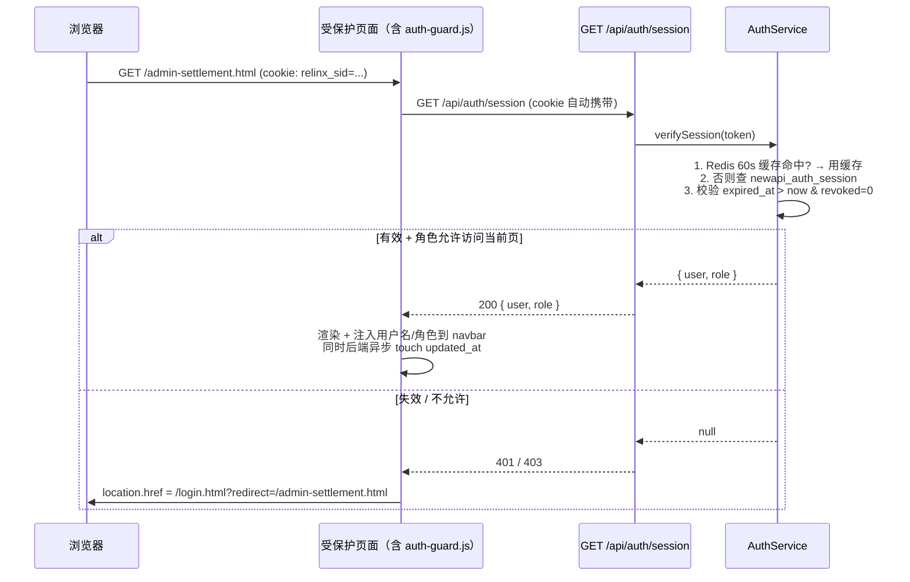
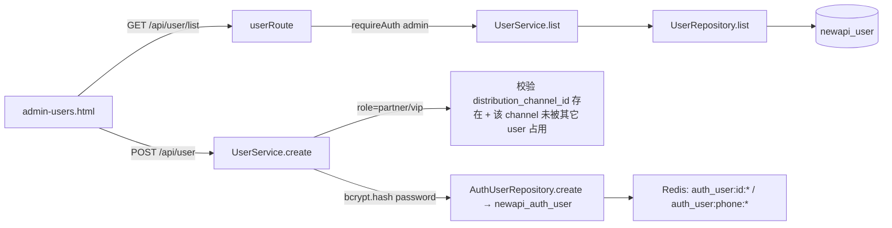

# 用户鉴权系统 — 技术方案

> **Sub2API 引用说明（2026-11-01）**：本文为既有业务系统的参考方案，用于参考技术文档的章节组织与详细程度，不代表 Sub2API 的鉴权架构或实现状态。原文中的 `newapi_*` 表、TypeScript 服务、业务角色、版本和验收结论均属于原系统。未随本文引入的原系统配套文档与页面，其相对链接在本仓库不可用；保留它们仅用于理解原上下文。示例登录口令已替换为占位符，不应据此配置任何系统。


> **模块名称**：用户鉴权（Authentication & Authorization）
> **参考模板**：[SETTLEMENT_MANAGEMENT_TECHNICAL_PLAN.md](./SETTLEMENT_MANAGEMENT_TECHNICAL_PLAN.md)
> **开发规范**：[DEVELOPMENT_RULES.md](./DEVELOPMENT_RULES.md)
> **版本**：v2.1（v1.0 草稿 + v1.1/v1.2/v2.1 增量；详见 §1.2 末尾的 v1.1 / v1.2 / v2.1 扩展说明）
> **状态**：v2.1 已实施

---

## 设计原则速览

| 原则 | 体现位置 |
|------|----------|
| 单一用户表，所有角色统一建模 | §4.1 `newapi_auth_user` |
| 管理员密码不入库，由 `.env` 注入 | §1.4 配置项、§8.2 登录流程 |
| Partner / VIP 与 `newapi_distribution_channel` 关联，不冗余渠道字段 | §4.1 `distribution_channel_id` 外键 |
| 角色 → 着陆页 / 可访问页面映射由后端权威决定 | §5.4 `ROLE_ACCESS_MATRIX` |
| 登录态 = HttpOnly Cookie + DB Session（滑动续期 + TTL 过期） | §6 会话设计 |
| 新建独立会话表 `newapi_auth_session`，与既有 `newapi_admin_session` 隔离 | §4.2 |
| 全部废弃旧"单密码 modal"前端鉴权 | §10 前端改造 |

---

## 目录

1. [需求描述](#1-需求描述)
2. [系统架构](#2-系统架构)
3. [目录结构](#3-目录结构)
4. [数据库表设计](#4-数据库表设计)
5. [数据实体定义](#5-数据实体定义)
6. [会话设计与 Cookie 策略](#6-会话设计与-cookie-策略)
7. [Repository 层](#7-repository-层)
8. [Service 层](#8-service-层)
9. [API 路由层与鉴权拦截](#9-api-路由层与鉴权拦截)
10. [前端改造设计](#10-前端改造设计)
11. [迁移与上线](#11-迁移与上线)
   - [11.1 迁移脚本](#111-迁移脚本)
   - [11.2 一次性数据迁移](#112-一次性数据迁移distribution_channel--auth_user)
   - [11.3 上线步骤](#113-上线步骤建议顺序)
   - [11.4 回滚策略](#114-回滚策略)
   - [11.5 实施计划（开发阶段任务拆解）](#115-实施计划开发阶段任务拆解)
   - [11.6 验收清单](#116-验收清单)
12. [跨模块依赖清单](#12-跨模块依赖清单)

---

## 1. 需求描述

### 1.1 业务需求

为 AI Token 分销平台的多个管理 / 门户页面提供**统一登录 + 角色化访问控制**：

| 业务流程 | 说明 |
|----------|------|
| 统一登录 | 所有需鉴权页面共用一套登录入口（`/login.html`），按手机号 + 密码登录 |
| 角色化路由 | 登录成功后由后端根据 `role` 决定着陆页（partner-portal / vip-portal / admin-settlement / admin-system） |
| 角色化访问 | 对受保护页面与 API 做角色鉴权，未授权角色直接 403 + 友好引导 |
| 持久登录 | 用户登录一次后，cookie 未过期期间再次访问任何受保护页面**直接放行**，不再要求登录；超时（默认 8 小时）才重新登录（即"E：免登录机制"） |
| 用户管理 | admin 角色可在 `admin-users.html` 对所有角色用户做增删改查 + 角色调整 + 重置密码 + 启用/停用 |
| 废弃旧鉴权 | `admin-customers.html` / `admin-dashboard.html` / `admin-system.html` 等 7 个 admin-* 页面里的"单密码 modal + `/api/user-query/login`"路径**整体下线** |

### 1.2 角色定义（v1.0 范围）

| 角色 | role 值 | 数据源 | 登录后默认着陆页 | 可访问页面 |
|------|---------|--------|-----------------|-----------|
| 管理员 | `admin` | `newapi_auth_user`（密码不入库，登录时校验 `.env` 中 `ADMIN_BOOTSTRAP_PASSWORD`） | `admin-system.html` | 所有 7 张 admin-* 页面 + `admin-users.html` |
| 财务总监 | `finance_director` | `newapi_auth_user`（bcrypt 密码） | `admin-settlement.html` | `admin-settlement.html` / `admin-commission.html` / `admin-withdrawal.html` |
| 业务负责人 | `business_manager` | `newapi_auth_user`（bcrypt 密码） | `admin-settlement.html` | `admin-settlement.html` |
| 商务合伙人 | `partner` | `newapi_auth_user` JOIN `newapi_distribution_channel`（`channel_type='partner'`） | `partner-portal.html` | `partner-portal.html`（仅本人数据） |
| VIP 直客 | `vip` | `newapi_auth_user` JOIN `newapi_distribution_channel`（`channel_type='vip'`） | `vip-portal.html` | `vip-portal.html`（仅本人数据） |

> **未在表中列出的角色 / 未在"可访问页面"列出的 URL**：一律 403。
> **公众页面**（如 `application.html` / `index.html` / `bill.html`）不在本模块范围，无需登录。

> **v1.1 扩展（账户管理模块引入）**：`AuthRole` 枚举追加了 4 个**不参与登录**的内部角色：`tech` / `logistics` / `company` / `customer`。这些角色对应的 `newapi_auth_user` 行 `status=disabled`、`password_hash=NULL`、`allowed_pages=[]`，仅作为 `newapi_account.owner_user_id` 的承载行存在。详见 [ACCOUNT_MANAGEMENT_TECHNICAL_PLAN.md §4.6](./ACCOUNT_MANAGEMENT_TECHNICAL_PLAN.md#46-系统类账户的-seed-与-customer-用户镜像策略重要)（系统类 seed + customer 镜像）以及 [§4.6.3 账户开户时机汇总](./ACCOUNT_MANAGEMENT_TECHNICAL_PLAN.md#463-账户开户时机汇总重要)。本模块（鉴权）对这 4 个角色不开放任何 admin-* 页面，行为等价于"不存在"。

> **v1.0 扩展（客户管理同步方案，2026-05）**：`AuthRole.CUSTOMER` 从纯镜像角色升级为**可登录身份**。由 `admin-customers.html` "新增客户" 直接产出的客户行写 `status='active' + password_hash=bcrypt(明文) + customer_id=newapi_customer.id`，立即可登录 `user-*.html`（着陆页 `/user-today-price.html`）。`ROLE_ACCESS_MATRIX[CUSTOMER].allowedPages` 与 `AuthRole.USER` 完全一致（9 个 `/user-*.html` 页面）。v1.1 镜像行（disabled + NULL）仍受本配置约束，但 `AuthService.login` 第二关 `status === ACTIVE` 会拒绝其登录；admin-users.html 通过 `is_activatable` 装饰字段区分两类客户，仅对 v1.1 镜像显示"激活"按钮；同时所有非 admin 行（包括 `customer` / `user`）均显示"重置密码"，由 `POST /api/user/:id/reset-password` 更新 bcrypt 并强制下线。同期 Redis 新增 `auth_user:customer:{customer_id}` 索引，结算/提现/分润反查 user_id 走 `AuthService.findUserIdByCustomerId`。详见 [CUSTOMER_CREATE_SYNC_USER_ACCOUNT_TECHNICAL_PLAN.md](./CUSTOMER_CREATE_SYNC_USER_ACCOUNT_TECHNICAL_PLAN.md) §9 / §3.6。

> **v1.2 扩展（结算审批岗位授权）**：`customer_manager` / `finance` / `business_manager` 是结算审批岗位，不是 `AuthRole`。它们通过 `newapi_auth_user_approval_role` 授予具体 `newapi_auth_user.id`，由 `admin-users.html` 的“审批授权管理”Tab 管理。结算审批 API 先通过 `requireAuth([admin, finance_director, business_manager])` 做页面/API 准入，再由 `SettlementApprovalService` 校验 active 审批岗位授权与登录角色上限：`admin` 可被授权审批任一岗位，`finance_director` 只能审批 `finance`，`business_manager` 只能审批 `business_manager`。`admin` 也不自动拥有审批权，仍必须显式授权。v3.4 起，`UserService` 会为 active 的 `finance_director` / `business_manager` 自动维护其唯一对应审批岗位的显式授权（分别是 `finance` / `business_manager`），存量用户由迁移 `v3.4_backfill_default_approval_assignments.sql` 补齐。

> **v2.1 扩展（运维工具页接管 + `operations` 角色 + 旧鉴权下线）**：本期把 4 个原本独立部署/独立鉴权的工具页 `/channelTesting.html` / `/userQuery.html` / `/reconciliation.html` / `/testingReport.html` 整体接入统一鉴权（即本方案）。同时新增登录角色 `operations`（运营），承载日常运维查询，**不参与结算审批岗位**（参考 §1.2 的「角色 / 业务权限分离」原则，详见 [DEVELOPMENT_RULES §3.4](./DEVELOPMENT_RULES.md)）。具体：
>
> - **新增 `AuthRole.OPERATIONS`**：`landing_page = /userQuery.html`，`allowedPages = [channelTesting / userQuery / reconciliation / testingReport]`。schema 不需要改（`role` 字段是 `varchar(30)`），仅需注释迁移 `scripts/migrations/v3.9_add_operations_auth_role.sql` 同步列 COMMENT。
> - **角色访问矩阵新增 4 个工具页路径**（权威定义在 `src/types/authUser.ts §ROLE_ACCESS_MATRIX`）：
>   | 页面 | admin | finance_director | business_manager | operations |
>   |---|:-:|:-:|:-:|:-:|
>   | `/channelTesting.html` | ✓ | | ✓ | ✓ |
>   | `/userQuery.html` | ✓ | ✓ | ✓ | ✓ |
>   | `/reconciliation.html` | ✓ | ✓ | ✓ | ✓ |
>   | `/testingReport.html` | ✓ | | ✓ | ✓ |
> - **后端鉴权改造**：`channelTestingRoute` / `userQueryRoute` / `reconciliationRoute` / `testingReportRoute` 入口改为 `requireAuth(req, res, authService, [...])`，与上表一一对应。`/api/admin/reconciliation/users` 仍保持 `[ADMIN]` only。
> - **彻底下线 v1.0 旧鉴权**：删除 `src/services/adminAuthService.ts` / `src/repositories/adminSessionRepository.ts` / `src/types/adminSession.ts`；`/api/user-query/login|logout|session` 与 `/api/channel-testing/login|logout|session` 6 个端点全部下线；env 删除 `USER_QUERY_ADMIN_PASSWORD`、`USER_QUERY_SESSION_TTL_HOURS`、`USER_QUERY_SESSION_COOKIE_NAME`、`CHANNEL_TESTING_ADMIN_PASSWORD`、`CHANNEL_TESTING_SESSION_TTL_HOURS`、`CHANNEL_TESTING_SESSION_COOKIE_NAME`（**保留** `CHANNEL_TESTING_CONCURRENCY`，与并发控制有关、与鉴权无关）；DB 表 `newapi_admin_session` 由迁移 `scripts/migrations/v4.0_drop_admin_session.sql` 整体 DROP。
> - **前端**：4 个工具页全部改用 admin 侧边栏 + `/assets/auth-guard.js`，与既有 admin-* 页面外观一致；侧边栏新增「运维工具」分组（4 个入口）同步分发到 9 个 admin-* 页面（共 13 处）。
> - **配套清理**：`src/new_api_script/user_sync.ts` 不再调用 `AdminAuthService.cleanupStale()`（统一鉴权 `newapi_auth_session` 的清理由 `reconciliation_server.ts` 启动时定时任务负责）；`src/services/approvalRolePolicy.ts` 的 `AUTH_ROLE_LABELS` 增加 `operations: '运营'`；`admin-users.html` 角色筛选 / 新建 / 编辑下拉与角色 badge 配色全部追加 operations。
>
> **admin-users.html 角色下拉与数据库实际枚举对齐（bugfix）**：DB `newapi_auth_user.role` 已扩展到 11 个值（v1.0 5 个 + v1.1 `tech/logistics/company/customer` + v2.1 `operations` + v3.x `user`），但页面下拉历史上仅列了 5 个，导致 `<select>.value = 'customer'` 等场景被浏览器静默回退到第一项，让"编辑用户"弹窗中的角色与列表/DB 不一致。修复：
> - 列表搜索筛选 `#filter-role` 列出全部 11 个值。
> - 编辑弹窗 `#edit-role`：HTML 列出全部非 admin 角色；运行时按场景控制可见性与禁用——
>   - 新建模式（`openCreateModal`）：仅展示业务可建角色（`finance_director / business_manager / operations / partner / vip`），把"系统/镜像"5 个 option 隐藏并 `disabled`。
>   - 编辑模式（`openEditModal`）：展开全部 option 以正确回显 DB 真实角色；当当前角色属于 `SYSTEM_ROLES = {customer, user, tech, logistics, company}` 时整体 `disabled` 并显示提示，引导走对应专用流程（customer 走列表"激活"或"重置密码"按钮；tech/logistics/company 由账户管理 seed 维护）。
> - 后端 `UserService.create` 保持原约束（admin 行禁止 API 创建；partner/vip 必填 channel 等），不放宽。`UserService.update` 仍允许角色字段任意赋值，依赖前端禁用避免误操作；后续若要硬约束，可在 service 层加白名单校验。
>
> 经此改造后，本方案 §1.5 / §3.3 / §6.x / §16.x 中关于「保留旧 `AdminAuthService` 单密码鉴权（v1.0 不接管）」的描述**全部失效**，仅作为历史记录保留；当前事实是：**统一鉴权已接管 4 个工具页，不再有任何旁路单密码登录入口**。

> **v3.x 扩展（今日底价 v1.0 引入 `user` 登录角色）**：`AuthRole` 枚举新增 `user`，承载客户用户登录身份。流程为 admin 在 `admin-users.html` 列表对 `role=customer` 行点击"激活"按钮（`POST /api/user/:id/activate-customer`），后端事务把行从 `role=customer / status=disabled` 升级为 `role=user / status=active` 并写入 bcrypt 密码 + `newapi_auth_user_password_change` pending 记录。`user` 的 landing/allowed pages 见 `src/types/authUser.ts §ROLE_ACCESS_MATRIX[AuthRole.USER]`（`user-today-price.html` 等 7 个 user-* 页面）。详见 [TODAY_PRICE_TECHNICAL_PLAN.md §4.7 / §2.2.2](./TODAY_PRICE_TECHNICAL_PLAN.md)。

### 1.3 技术要求

| 要求 | 规则 |
|------|------|
| 架构分层 | `types/` → `repositories/` → `services/` → `routes/`，单向依赖 |
| 密码存储 | bcrypt，cost 因子 10，字段 `password_hash VARCHAR(72)`（管理员行此字段为 NULL，登录时走 `.env`） |
| 登录态载体 | HttpOnly + SameSite=Lax cookie + DB session 表，滑动续期；JWT 不采用 |
| 会话 TTL | 默认 8 小时；用户活跃则刷新 `updated_at`，绝对过期时间 `expired_at` 不变 |
| Redis 缓存 | 用户详情按 `id` 单条缓存；session 验证结果缓存 60 秒（避免每次请求查表）；列表走 MySQL（用户量小） |
| 配置复用 | 所有配置经 `settings.ts` 读取，不新建配置文件 |
| 参数化查询 | 全部 SQL 参数化，禁止字符串拼接 |
| 时间戳 | Unix 毫秒（`BIGINT`） |
| 表名前缀 | `newapi_auth_user`、`newapi_auth_session`（前缀 `auth_` 避免与既有 `newapi_user`（NewAPI 用户快照）/ `newapi_admin_session`（旧鉴权）冲突，见 §4） |

### 1.4 配置复用

新增 `settings.ts` 项（追加，不删除现有）：

```typescript
// settings.ts
AUTH_ADMIN_BOOTSTRAP_PASSWORD: requiredEnv('ADMIN_BOOTSTRAP_PASSWORD'),  // .env: ADMIN_BOOTSTRAP_PASSWORD=<ADMIN_BOOTSTRAP_PASSWORD>
AUTH_SESSION_TTL_HOURS: parseInt(process.env.AUTH_SESSION_TTL_HOURS ?? '8', 10),
AUTH_SESSION_COOKIE_NAME: process.env.AUTH_SESSION_COOKIE_NAME ?? 'relinx_sid',
AUTH_BCRYPT_COST: parseInt(process.env.AUTH_BCRYPT_COST ?? '10', 10),
```

`.env` 新增：

```dotenv
# === Auth Module（用户鉴权） ===
ADMIN_BOOTSTRAP_PASSWORD=<ADMIN_BOOTSTRAP_PASSWORD>
AUTH_SESSION_TTL_HOURS=8
AUTH_SESSION_COOKIE_NAME=relinx_sid
AUTH_BCRYPT_COST=10
```

> ~~**`USER_QUERY_ADMIN_PASSWORD` / `CHANNEL_TESTING_ADMIN_PASSWORD` 保留**：本方案不删除这两个 key，以保证 `/userQuery.html` / `/channelTesting.html`（本方案不接管）继续工作。详见 §3.3。~~
> **(v2.1 起作废)** 这两个 env 已随 v1.0 旧鉴权一并下线。`/userQuery.html` 与 `/channelTesting.html` 已接入统一鉴权。详见 §1.2 末尾的 v2.1 扩展说明。

### 1.5 非目标（v1.0 不做）

| 暂不实现 | 理由 |
|---------|------|
| 多因素认证（MFA） | 用户量小，先做基础登录；后续独立方案 |
| 短信 / 邮箱验证码登录 | 同上；密码忘记走"管理员代设" |
| OAuth / SSO 接入 | 暂无第三方 IdP 需求 |
| 细粒度权限（按钮级） | 当前只做"页面级"+"API 级"，按钮级显隐由前端读 role 自决 |
| Partner / VIP 的 portal 业务化数据接入 | partner-portal.html / vip-portal.html 现为静态原型，本方案只做"登录 → 跳转 → 注入用户姓名 + 鉴权拦截"，业务数据接入留给后续门户专项 |
| 自助修改密码 | v1.0 走"管理员代设"；后续可加"用户中心"页 |

---

## 2. 系统架构

### 2.1 整体架构图

```
┌──────────────────────────────────────────────────────────────────────┐
│                         前端页面层（website/）                         │
│                                                                      │
│  login.html ⇐ 统一登录入口                                            │
│       ↓ 登录成功后端返回 redirect_url                                  │
│       ├─→ admin-system.html       (admin)                            │
│       ├─→ admin-settlement.html   (finance_director / business_manager / admin) │
│       ├─→ admin-commission.html   (finance_director / admin)         │
│       ├─→ admin-withdrawal.html   (finance_director / admin)         │
│       ├─→ admin-customers.html    (admin)                            │
│       ├─→ admin-dashboard.html    (admin)                            │
│       ├─→ admin-distribution-channel.html (admin)                    │
│       ├─→ admin-users.html        (admin) ← 本方案新增                │
│       ├─→ partner-portal.html     (partner)                          │
│       └─→ vip-portal.html         (vip)                              │
│                                                                      │
│  每个受保护页面顶部加载 /assets/auth-guard.js：                       │
│    GET /api/auth/session → 未登录 / 角色不允许 → 跳 /login.html       │
└─────────────────────────────────┬────────────────────────────────────┘
                                  │ HTTP + Cookie (relinx_sid)
┌─────────────────────────────────▼────────────────────────────────────┐
│                       API 路由层 (routes/)                            │
│                                                                      │
│  authRoute.ts   ← 本方案新增                                          │
│  ├─ POST /api/auth/login          (公开：手机号+密码登录)             │
│  ├─ POST /api/auth/logout         (登出)                             │
│  ├─ GET  /api/auth/session        (前端读当前会话)                   │
│  └─ requireAuth(role[]) 中间件    (供其它 route 复用)                 │
│                                                                      │
│  userRoute.ts   ← 本方案新增（用户管理 CRUD，仅 admin）               │
│  ├─ GET    /api/user/list                                            │
│  ├─ GET    /api/user/:id                                             │
│  ├─ POST   /api/user                                                 │
│  ├─ PUT    /api/user/:id                                             │
│  ├─ DELETE /api/user/:id           (软删除，status=deleted)          │
│  └─ POST   /api/user/:id/reset-password                              │
│                                                                      │
│  受保护的既有路由（如 /api/customer/*、/api/settlement/*）：          │
│    每个 route handler 入口处用 requireAuth(roles)，详见 §9.3         │
└─────────────────────────────────┬────────────────────────────────────┘
                                  │
┌─────────────────────────────────▼────────────────────────────────────┐
│                      Service 层 (services/)                           │
│                                                                      │
│  ┌──────────────────────┐  ┌────────────────────────────────────┐   │
│  │ AuthService          │  │ UserService                        │   │
│  │ ─ login              │  │ ─ list / getById / create / update │   │
│  │ ─ logout             │  │ ─ softDelete / resetPassword       │   │
│  │ ─ verifySession      │  │ ─ syncFromDistributionChannel ⚠️   │   │
│  │ ─ getRedirectByRole  │  │ ─ ensureAdminSeed (启动幂等)        │   │
│  │ ─ touchSession       │  └────────────────────────────────────┘   │
│  │ ─ cleanupStale       │                                            │
│  └──────────────────────┘                                            │
└─────────────────────────────────┬────────────────────────────────────┘
                                  │
┌─────────────────────────────────▼────────────────────────────────────┐
│                   Repository 层 (repositories/)                       │
│                                                                      │
│  AuthUserRepository    (newapi_auth_user)     ← 本方案新增           │
│  AuthSessionRepository (newapi_auth_session)  ← 本方案新增           │
│  DistributionChannelRepository (只读，跨模块)                         │
│                                                                      │
│  既有 AdminSessionRepository (newapi_admin_session) 保留不动         │
│    └─ 仍服务于 /api/user-query/* 与 /api/channel-testing/*           │
└─────────────────────────────────┬────────────────────────────────────┘
                                  │
┌─────────────────────────────────▼────────────────────────────────────┐
│                MySQL (hello)                          Redis (DB=2)    │
│                                                                       │
│  newapi_auth_user           ← 新增          auth_user:id:{id}  STRING │
│  newapi_auth_session        ← 新增          auth_user:phone:{p} STRING│
│  newapi_distribution_channel (只读)         auth_session:{token} STRING│
│  newapi_admin_session       (旧表保留)       (TTL 60s 防穿透)         │
└──────────────────────────────────────────────────────────────────────┘
```

### 2.2 关键数据流

#### 2.2.1 登录流程

```mermaid
sequenceDiagram
    participant U as 浏览器
    participant L as login.html
    participant API as POST /api/auth/login
    participant Auth as AuthService
    participant URepo as UserRepository
    participant SRepo as UserSessionRepository
    participant ENV as settings.ts

    U->>L: 输入 手机号 + 密码
    L->>API: { phone, password }
    API->>Auth: login(phone, password, ctx)
    Auth->>URepo: findByPhone(phone)
    URepo-->>Auth: user (or null)

    alt user.role = admin
        Auth->>ENV: 比对 ADMIN_BOOTSTRAP_PASSWORD
    else 其它角色
        Auth->>Auth: bcrypt.compare(password, user.password_hash)
    end

    Auth->>SRepo: create({ user_id, role, token, expired_at }) → newapi_auth_session
    SRepo-->>Auth: session
    Auth-->>API: { success, redirect_url, user_brief }
    API-->>L: Set-Cookie: relinx_sid=...; HttpOnly; SameSite=Lax
    L->>U: location.href = redirect_url
```

#### 2.2.2 受保护页面加载流程（"E：免登录"语义）



> **"持久登录（E）"的实现要点**：
> - cookie `Max-Age = AUTH_SESSION_TTL_HOURS * 3600` 秒，浏览器关闭后仍存活到绝对过期时间
> - DB 行 `expired_at` = 创建时 + TTL；过期即不可用，必须重登
> - 用户每次成功通过 `verifySession`，**异步**刷新 `updated_at`（不动 `expired_at`）；这意味着"活跃用户在 TTL 内永远不需要重登"，但"超过 TTL 绝对时间一定会要求重登"
> - 这与现有 `AdminAuthService.verify` 的滑动语义完全一致，沿用即可

#### 2.2.3 用户管理（admin-only）数据流



> **与账户模块的边界（v1.1 后）**：`UserService.create` **不**调用 `accountService.ensureAccountForUser`。partner / vip 的 `newapi_account` 行采用**懒开户**——在首次结算入账时由 `resolvePartnerAccount` / `resolveVipAccount` 建出；运维需要提前批量开户跑 `account_seed.ts` 即可。详见 [ACCOUNT_MANAGEMENT_TECHNICAL_PLAN.md §4.6.3](./ACCOUNT_MANAGEMENT_TECHNICAL_PLAN.md#463-账户开户时机汇总重要)。这样做的目的是避免本模块（鉴权）反向依赖账户模块。

### 2.3 跨模块依赖矩阵

| 本模块 | 依赖外部 | 方向 | 用途 |
|--------|---------|------|------|
| `UserService.create` (role=partner/vip) | `DistributionChannelRepository` | **读** | 校验 `distribution_channel_id` 存在且 `channel_type` 匹配 |
| `AuthService.login` (role=partner/vip) | `DistributionChannelRepository` | **读** | session 中冗余 `distribution_channel_id`（避免每次再 JOIN） |
| `UserService.syncFromDistributionChannel` | `DistributionChannelRepository` | **读** | 一次性迁移：为存量 partner / vip 渠道建对应 user 行 |
| 既有 `customerRoute` / `settlementRoute` 等 | `AuthService.requireAuth(roles)` | **调用** | 请求入口处鉴权 |
| ~~既有 `userQueryRoute` / `channelTestingRoute`~~ | ~~**不动**~~ | — | ~~这两个路由保留旧 `AdminAuthService` 单密码鉴权（v1.0 不接管）~~ |
| `userQueryRoute` / `channelTestingRoute` / `reconciliationRoute` / `testingReportRoute` (v2.1 起) | `AuthService.requireAuth(roles)` | **调用** | 全部接入统一鉴权；旧 `AdminAuthService` 已删除。详见 §1.2 v2.1 扩展 |

> **跨模块调用规则**：通过 Repository 读取，不直接跨 Service 调用；跨模块方法标 `⚠️ 跨模块` 注释。

---

## 3. 目录结构

### 3.1 新增文件清单

```
TokenSelling/src/
├── types/
│   ├── authUser.ts                            # 用户实体 + 角色枚举 + DTO
│   └── authSession.ts                         # 会话实体（与 adminSession.ts 隔离）
├── repositories/
│   ├── authUserRepository.ts                  # newapi_auth_user CRUD
│   └── authSessionRepository.ts               # newapi_auth_session CRUD
├── services/
│   ├── authService.ts                         # 登录 / 登出 / verifySession / role 路由 / 启动 seed
│   └── userService.ts                         # 用户管理 CRUD（admin 后台用）
├── routes/
│   ├── authRoute.ts                           # /api/auth/login | logout | session
│   └── userRoute.ts                           # /api/user/* 用户管理（仅 admin）
├── middleware/                                ← 新增目录
│   └── requireAuth.ts                         # 鉴权中间件 + 角色匹配
└── new_api_script/
    └── auth_seed.ts                           # 一次性脚本：迁移 distribution_channel → auth_user

TokenSelling/website/
├── login.html                                 # 统一登录入口（新增）
├── admin-users.html                           # 用户管理后台（新增）
└── assets/
    └── auth-guard.js                          # 受保护页面前端拦截脚本（新增）

TokenSelling/scripts/migrations/
└── v2.0_auth_module.sql                       # 建 newapi_auth_user / newapi_auth_session
```

### 3.2 修改文件清单

| 文件 | 修改内容 |
|------|----------|
| `config/settings.ts` | 新增 `AUTH_ADMIN_BOOTSTRAP_PASSWORD`、`AUTH_SESSION_TTL_HOURS`、`AUTH_SESSION_COOKIE_NAME`、`AUTH_BCRYPT_COST` |
| `.env` / `.env.example` | 新增 `ADMIN_BOOTSTRAP_PASSWORD=<ADMIN_BOOTSTRAP_PASSWORD>` 等 4 项（见 §1.4） |
| `new_api_script/reconciliation_server.ts` | 注册 `authHandler`、`userHandler`；warmup 增加 `AuthService.ensureAdminSeed()` 与 `AuthSessionService.cleanupStale()` |
| `routes/customerRoute.ts` 等既有受保护路由 | 入口处加 `await requireAuth(req, res, ['admin', 'finance_director'])`，详见 §9.3 |
| `package.json` | 新增 `bcryptjs` 依赖（pure JS，无原生编译；`bcrypt` 需 node-gyp，体验差） |
| `doc/newapi.sql` | 用 `mysqldump --default-character-set=utf8mb4` 重新导出，包含两张新表 |
| `website/admin-customers.html` 等 7 张 admin-* 页面 | 删除 modal-login + AUTH_API + bootstrap 旧鉴权代码块；改为 `<script src="/assets/auth-guard.js" data-roles="admin"></script>` 一行；详见 §10 |
| `website/channelTesting.html` / `userQuery.html` / `reconciliation.html` / `testingReport.html` (v2.1) | 改用 admin 风格侧边栏 + `auth-guard.js`；删除独立登录视图；侧边栏含「运维工具」分组（同步分发到 9 个 admin-* 页面，共 13 处） |
| `scripts/migrations/v3.9_add_operations_auth_role.sql` (v2.1) | 注释型迁移：`newapi_auth_user.role` 列 COMMENT 增加 `operations` 枚举值 |
| `scripts/migrations/v4.0_drop_admin_session.sql` (v2.1) | DROP `newapi_admin_session` 表 |

### 3.3 不修改（明确隔离）

> **(v2.1 起作废)** 下表 5 行所述「不接管」「保留不动」均已失效——`AdminAuthService` 及其会话表 `newapi_admin_session` 已在 v2.1 整体下线。当前事实见本节末尾的「v2.1 状态对照」。

| 文件 / 表 | 说明 |
|----------|------|
| ~~`services/adminAuthService.ts`~~ | ~~旧的单密码鉴权服务，仍服务 userQuery / channelTesting，**保留不动**~~ → **v2.1 已删除** |
| ~~`repositories/adminSessionRepository.ts`~~ | ~~同上~~ → **v2.1 已删除** |
| ~~`types/adminSession.ts`~~ | ~~同上~~ → **v2.1 已删除** |
| ~~`newapi_admin_session` 表~~ | ~~同上，**不删表、不改字段、不接管会话**~~ → **v2.1 由 `scripts/migrations/v4.0_drop_admin_session.sql` DROP** |
| ~~`routes/userQueryRoute.ts` / `routes/channelTestingRoute.ts`~~ | ~~继续用旧 `AdminAuthService`；本方案不接管 `userQuery.html` / `channelTesting.html`~~ → **v2.1 改用统一 `requireAuth([...])`** |
| `newapi_user`（NewAPI 用户快照表） | 上游同步覆盖的快照表，**与本方案的 `newapi_auth_user` 是两张不同的表**，不可混淆 |
| `newapi_distribution_channel` | 只读引用 |

#### v2.1 状态对照

| 维度 | v1.0–v1.2（历史） | v2.1（当前） |
|---|---|---|
| `userQuery.html` / `channelTesting.html` 鉴权 | 独立 `AdminAuthService` + 独立 cookie + `.env` 单密码 | 统一 `AuthService` + `relinx_sid` cookie + `ROLE_ACCESS_MATRIX` |
| `reconciliation.html` / `testingReport.html` 鉴权 | 完全公开（`Access-Control-Allow-Origin: *`） | 统一 `AuthService`，仅允许角色访问（CORS `*` 与 OPTIONS 预检均删除） |
| 登录角色集合 | admin / finance_director / business_manager / partner / vip + 4 个 disabled 内部角色（共 9） | 同上 + 新增 `operations`（共 10） |
| `newapi_admin_session` 表 | 存在（保留） | **已 DROP**（v4.0 迁移） |
| `AdminAuthService` 等 3 个文件 | 存在 | **已删除** |
| `USER_QUERY_*` / `CHANNEL_TESTING_ADMIN_PASSWORD` 等 6 个 env | 必填或可选 | **不再读取**；`CHANNEL_TESTING_CONCURRENCY` 仍保留（与并发有关） |

> **设计动机**：本方案与旧鉴权"并行运行"，可独立上线、独立回滚；待全部 admin-* 页面迁移完毕、确认稳定后，再考虑下线 `newapi_admin_session` 与 `AdminAuthService`（单独写迁移方案，本文不覆盖）。

---

## 4. 数据库表设计

### 4.1 newapi_auth_user（用户表，本方案核心）

> **设计要点**：
> 1. 一行 = 一个登录账号，覆盖所有角色（admin / finance_director / business_manager / partner / vip）
> 2. `phone` 是登录账号，全局唯一（UNIQUE 索引）
> 3. `password_hash` 对 admin 行**永远为 NULL**（密码走 `.env`）；其它角色行存 bcrypt hash
> 4. `distribution_channel_id` 仅 partner / vip 行有值，外键回指 `newapi_distribution_channel.id`
> 5. partner/vip 的姓名、公司、银行卡等基础信息**不冗余**到本表，统一去 `newapi_distribution_channel` 取（避免数据漂移）；只在本表存 `display_name`（manage UI 列表展示用，partner/vip 写入时复制 channel.name 一次，后续 channel 改名由迁移脚本同步，不做实时回调）
> 6. 软删除走 `status='deleted'`，与 §7.5 规范一致

#### 4.1.1 DDL

```sql
-- scripts/migrations/v2.0_auth_module.sql
SET NAMES utf8mb4 COLLATE utf8mb4_unicode_ci;
SET CHARACTER_SET_CLIENT     = utf8mb4;
SET CHARACTER_SET_CONNECTION = utf8mb4;
SET CHARACTER_SET_RESULTS    = utf8mb4;

CREATE TABLE IF NOT EXISTS `hello`.`newapi_auth_user` (
    `id`                       BIGINT UNSIGNED NOT NULL AUTO_INCREMENT COMMENT '数据库自增ID',
    `phone`                    VARCHAR(20)  CHARACTER SET utf8mb4 COLLATE utf8mb4_unicode_ci NOT NULL COMMENT '登录账号（手机号），全局唯一',
    `display_name`             VARCHAR(100) CHARACTER SET utf8mb4 COLLATE utf8mb4_unicode_ci NOT NULL DEFAULT '' COMMENT '显示名',
    `role`                     VARCHAR(30)  CHARACTER SET utf8mb4 COLLATE utf8mb4_unicode_ci NOT NULL COMMENT 'admin / finance_director / business_manager / partner / vip / operations / tech / logistics / company / customer / user（后 5 个由 v1.1/v2.1/v3.x 扩展引入，详见 §1.2）',
    `password_hash`            VARCHAR(72)  CHARACTER SET ascii COLLATE ascii_bin NULL DEFAULT NULL COMMENT 'bcrypt hash（cost=10）；admin 行 NULL（密码走 .env）',
    `distribution_channel_id`  BIGINT UNSIGNED NULL DEFAULT NULL COMMENT '仅 partner/vip 有值，外键 newapi_distribution_channel.id',
    `email`                    VARCHAR(255) CHARACTER SET utf8mb4 COLLATE utf8mb4_unicode_ci NOT NULL DEFAULT '' COMMENT '邮箱（可选，预留）',
    `status`                   VARCHAR(20)  CHARACTER SET utf8mb4 COLLATE utf8mb4_unicode_ci NOT NULL DEFAULT 'active' COMMENT 'active / disabled / deleted',
    `last_login_at`            BIGINT       NULL DEFAULT NULL COMMENT '最近一次成功登录时间（Unix 毫秒）',
    `last_login_ip`            VARCHAR(64)  CHARACTER SET utf8mb4 COLLATE utf8mb4_unicode_ci NOT NULL DEFAULT '' COMMENT '最近一次登录 IP',
    `failed_login_count`       INT          NOT NULL DEFAULT 0 COMMENT '连续失败次数（成功登录归零）',
    `created_by`               BIGINT UNSIGNED NULL DEFAULT NULL COMMENT '创建者 user.id（admin seed 行为 NULL）',
    `created_at`               BIGINT       NOT NULL COMMENT 'Unix 毫秒时间戳',
    `updated_at`               BIGINT       NOT NULL COMMENT 'Unix 毫秒时间戳',
    PRIMARY KEY (`id`),
    UNIQUE KEY `uk_auth_user_phone` (`phone`),
    UNIQUE KEY `uk_auth_user_channel` (`distribution_channel_id`),
    KEY `idx_role_status` (`role`, `status`),
    KEY `idx_status` (`status`),
    KEY `idx_created_at` (`created_at`)
) ENGINE = InnoDB CHARACTER SET = utf8mb4 COLLATE = utf8mb4_unicode_ci
  COMMENT = '认证用户表（登录账号 + 角色 + 密码 hash）';
```

#### 4.1.2 字段说明

| 字段 | 类型 | 必填 | 说明 |
|------|------|------|------|
| `id` | BIGINT UNSIGNED | 是 | 主键，自增 |
| `phone` | VARCHAR(20) | 是 | 手机号，登录账号；全局 UNIQUE；不限定大陆格式以兼容海外（仅做长度 + 数字 / `+` 校验） |
| `display_name` | VARCHAR(100) | 否 | UI 展示用；partner/vip 行创建时从 channel.name 复制，后续不实时回写 |
| `role` | VARCHAR(30) | 是 | 现行枚举（共 11 值）：`admin` / `finance_director` / `business_manager` / `partner` / `vip` / `operations` / `tech` / `logistics` / `company` / `customer` / `user`；服务端 `AuthRole` enum 校验。其中后 5 个为 v1.1（账户管理）/v2.1（运维工具）/v3.x（今日底价）扩展引入，详见 §1.2 |
| `password_hash` | VARCHAR(72) | 否 | bcrypt 输出固定 60 字符；预留 72 容错。**admin 行恒为 NULL**，登录时校验 `.env` |
| `distribution_channel_id` | BIGINT UNSIGNED | 否 | 仅 partner/vip 有值。**UNIQUE 约束**确保一个渠道最多一个登录账号，避免冗余/打架。MySQL UNIQUE 允许多 NULL（admin / finance_director / business_manager 不冲突） |
| `status` | VARCHAR(20) | 是 | `active` / `disabled` / `deleted`，软删除走 `deleted`，§7.5 规则 |
| `last_login_at` / `last_login_ip` | — | 否 | 登录成功时刷新；列表展示用 |
| `failed_login_count` | INT | 是 | 连续失败次数；本字段持久化但**v1.0 不基于此实现锁定**（详见 §6.3 限流策略） |
| `created_by` | BIGINT UNSIGNED | 否 | 谁建的（管理员 user.id）；admin seed / 迁移脚本写入的行为 NULL |

> `role` 不承载结算审批岗位。审批岗位授权见 `newapi_auth_user_approval_role`，这样才能支持同一用户多个岗位授权、显式撤销、授权人/撤销人审计，以及 admin 不自动豁免的控制规则。

#### 4.1.3 索引设计说明

| 索引 | 用途 |
|------|------|
| `uk_auth_user_phone` | 登录时按手机号查找；保证全局唯一 |
| `uk_auth_user_channel` | 防止一个渠道挂多个登录账号；admin/finance 多行 NULL 不冲突 |
| `idx_role_status` | 用户管理列表按角色 + 状态过滤 |
| `idx_status` | 全量"未删除"过滤，§7.5 软删除规则 |
| `idx_created_at` | 列表按创建时间排序 |

#### 4.1.4 种子数据（admin 行）

由 `AuthService.ensureAdminSeed()` 在服务启动时幂等执行（详见 §8.2）：

```typescript
// 启动时检查：若不存在 role=admin AND phone='admin'，则插入一行
INSERT INTO newapi_auth_user
    (phone, display_name, role, password_hash, status, created_at, updated_at)
VALUES
    ('admin', '系统管理员', 'admin', NULL, 'active', ?, ?)
ON DUPLICATE KEY UPDATE updated_at = VALUES(updated_at);
```

> **登录时**：手机号填 `admin`，密码填 `.env` 中 `ADMIN_BOOTSTRAP_PASSWORD`（=`<ADMIN_BOOTSTRAP_PASSWORD>`）；服务端检测到 `role='admin'` 走环境密码分支（`password_hash` 字段忽略）。

### 4.2 newapi_auth_session（会话表）

> **设计要点**：
> 1. 字段结构与既有 `newapi_admin_session` 相似，但**额外增加 `user_id` + `role`**，使一次会话能直接映射到具体用户与角色
> 2. `role` 在 session 行上**冗余存储**（来自 user.role），减少每次 verifySession 都 JOIN auth_user 的开销；用户改角色时同步触发 `revoke all sessions for user_id`（§8.3）
> 3. 与 `newapi_admin_session` **不复用**，新表独立；旧表保留给 userQuery / channelTesting

#### 4.2.1 DDL

```sql
CREATE TABLE IF NOT EXISTS `hello`.`newapi_auth_session` (
    `id`           BIGINT UNSIGNED NOT NULL AUTO_INCREMENT COMMENT '会话自增 id',
    `token`        CHAR(64)     CHARACTER SET ascii COLLATE ascii_bin NOT NULL COMMENT '会话令牌（32 字节 hex）',
    `user_id`      BIGINT UNSIGNED NOT NULL COMMENT 'newapi_auth_user.id',
    `role`         VARCHAR(30)  CHARACTER SET utf8mb4 COLLATE utf8mb4_unicode_ci NOT NULL COMMENT '冗余 user.role，签发时快照',
    `client_ip`    VARCHAR(64)  CHARACTER SET utf8mb4 COLLATE utf8mb4_unicode_ci NOT NULL DEFAULT '' COMMENT '登录时的客户端 IP',
    `user_agent`   VARCHAR(500) CHARACTER SET utf8mb4 COLLATE utf8mb4_unicode_ci NOT NULL DEFAULT '' COMMENT '登录时的 UA（截断 500 字符）',
    `created_at`   BIGINT       NOT NULL COMMENT '创建时间(Unix 毫秒)',
    `updated_at`   BIGINT       NOT NULL COMMENT '最后活跃时间(Unix 毫秒)',
    `expired_at`   BIGINT       NOT NULL COMMENT '固定过期时间(Unix 毫秒)，到点必须重新登录',
    `revoked`      TINYINT(1)   NOT NULL DEFAULT 0 COMMENT '0=有效, 1=已主动登出 / 被强制下线',
    PRIMARY KEY (`id`),
    UNIQUE KEY `uk_auth_session_token` (`token`),
    KEY `idx_user_id` (`user_id`),
    KEY `idx_revoked_expired` (`revoked`, `expired_at`),
    KEY `idx_expired_at` (`expired_at`)
) ENGINE = InnoDB CHARACTER SET = utf8mb4 COLLATE = utf8mb4_unicode_ci
  COMMENT = '认证会话表（用户登录令牌）';
```

#### 4.2.2 字段说明

| 字段 | 必填 | 说明 |
|------|------|------|
| `token` | 是 | `crypto.randomBytes(32).toString('hex')` 生成；64 字符；UNIQUE |
| `user_id` | 是 | 关联 `newapi_auth_user.id`；**不建外键约束**（与项目其它表习惯一致，避免跨表操作锁） |
| `role` | 是 | 签发时快照；用户改角色时调用 §8.3 `revokeAllByUserId` 主动让所有 session 失效 |
| `client_ip` / `user_agent` | 否 | 审计用 |
| `created_at` | 是 | 登录瞬间（Unix 毫秒） |
| `updated_at` | 是 | 滑动续期：每次 `verifySession` 命中后异步刷新（不动 `expired_at`） |
| `expired_at` | 是 | `created_at + AUTH_SESSION_TTL_HOURS × 3600 × 1000`，绝对过期 |
| `revoked` | 是 | 主动登出 / 强制下线 / 改密 / 改角色时置 1 |

#### 4.2.3 索引设计说明

| 索引 | 用途 |
|------|------|
| `uk_auth_session_token` | 按 token 验证会话（最高频路径） |
| `idx_user_id` | 强制下线（按 user_id 批量 revoke）/ 用户管理"在线状态"展示 |
| `idx_revoked_expired` | `cleanupStale` 定时清理：`revoked=1 AND updated_at < cutoff` 或 `expired_at < cutoff` |
| `idx_expired_at` | 过期但未被 revoke 的会话清理 |

### 4.3 关联现有表（只读）

```
newapi_auth_user.distribution_channel_id  ──→  newapi_distribution_channel.id
                                                  ├─ channel_type ∈ {partner, vip}
                                                  ├─ name / company_name / contact_phone / bank_*
                                                  └─ status

注意：本方案不在 DB 层加 FOREIGN KEY 约束（与项目惯例一致）；
      关联完整性由 UserService 在创建/更新时校验。
```

### 4.4 表关系图

```
┌──────────────────────────────────┐
│ newapi_auth_user                 │
│ ──────────────────────────────── │
│ PK id                            │
│ UK phone                         │
│ UK distribution_channel_id ──────┼───┐
│    role                          │   │
│    password_hash (admin=NULL)    │   │ 仅 partner/vip
│    status / display_name / ...   │   │
└──────────────────────────────────┘   │
            │ 1                        │
            │                          ▼
            │              ┌──────────────────────────────┐
            │              │ newapi_distribution_channel  │
            │              │ ──────────────────────────── │
            │              │ PK id                        │
            │              │    channel_type ∈            │
            │              │      {partner, vip}          │
            │              │    name, company_name,       │
            │              │    contact_phone, bank_*     │
            │              └──────────────────────────────┘
            │ N
            ▼
┌──────────────────────────────────┐
│ newapi_auth_session              │
│ ──────────────────────────────── │
│ PK id                            │
│ UK token                         │
│    user_id  ──→ auth_user.id     │
│    role     (冗余快照)           │
│    expired_at / updated_at /     │
│    revoked                       │
└──────────────────────────────────┘
```

### 4.5 跨模块表依赖

| 本模块表 | 依赖 / 被依赖 | 关系 |
|---------|--------------|------|
| `newapi_auth_user.distribution_channel_id` | → `newapi_distribution_channel.id` | 应用层校验，无 FK |
| `newapi_auth_user` | ← `newapi_auth_session.user_id` | 反向引用 |
| 所有受保护路由 | ← `AuthService.requireAuth()` 拦截 | 见 §9 |

### 4.6 存储估算

| 表 | 行数（v1.0 估） | 单行 | 总占用 |
|----|----------------|------|--------|
| `newapi_auth_user` | ~50（admin/finance 各 1-2，partner ~10，vip ~30） | ~400 B | < 50 KB |
| `newapi_auth_session` | ~200（每用户 ~4 个未过期 session） | ~800 B | < 200 KB |

> 量级极小，无分表 / 归档需求。`cleanupStale` 每日清理过期 session 即可。

---

## 5. 数据实体定义

> 与 §1.3 表名前缀对齐：用户实体在 `types/authUser.ts`，会话实体在 `types/authSession.ts`。
> 遵循 [DEVELOPMENT_RULES.md §5.4.2](./DEVELOPMENT_RULES.md#542-数据实体层types-模式) 的"interface + rowToEntity"模式（不使用 class）。

### 5.1 枚举定义

```typescript
// src/types/authUser.ts

/** 用户角色（v1.0 共 5 种） */
export enum AuthRole {
    ADMIN = 'admin',
    FINANCE_DIRECTOR = 'finance_director',
    BUSINESS_MANAGER = 'business_manager',
    PARTNER = 'partner',
    VIP = 'vip',
}

/** 全部 role 值的 readonly 数组（用于运行时校验入参） */
export const ALL_AUTH_ROLES = [
    AuthRole.ADMIN,
    AuthRole.FINANCE_DIRECTOR,
    AuthRole.BUSINESS_MANAGER,
    AuthRole.PARTNER,
    AuthRole.VIP,
] as const;

/** 用户状态（与 §7.5 软删除规则对齐） */
export enum AuthUserStatus {
    ACTIVE = 'active',
    DISABLED = 'disabled',
    DELETED = 'deleted',
}

/** 用户列表排序字段 */
export enum AuthUserSortField {
    CREATED_AT = 'created_at',
    UPDATED_AT = 'updated_at',
    LAST_LOGIN_AT = 'last_login_at',
    ID = 'id',
}
```

### 5.2 数据库行实体（与表 1:1）

```typescript
// src/types/authUser.ts（续）

/** newapi_auth_user 行实体（与表字段一一对应） */
export interface AuthUserEntity {
    id: number;
    phone: string;
    display_name: string;
    role: AuthRole;
    /**
     * bcrypt hash；
     * - admin 行恒为 null（密码走 .env，登录时不读本字段）
     * - 其它角色行：非空字符串
     */
    password_hash: string | null;
    /** 仅 partner/vip 有值 */
    distribution_channel_id: number | null;
    email: string;
    status: AuthUserStatus;
    last_login_at: number | null;
    last_login_ip: string;
    failed_login_count: number;
    created_by: number | null;
    created_at: number;
    updated_at: number;
}
```

```typescript
// src/types/authSession.ts

/** newapi_auth_session 行实体 */
export interface AuthSessionEntity {
    id: number;
    token: string;
    user_id: number;
    role: AuthRole;
    client_ip: string;
    user_agent: string;
    created_at: number;
    updated_at: number;
    expired_at: number;
    /** 0=有效, 1=已撤销 */
    revoked: number;
}
```

### 5.3 rowToEntity 映射函数

```typescript
// src/types/authUser.ts（续）

import type { RowDataPacket } from 'mysql2';

/** mysql2 RowDataPacket → AuthUserEntity */
export function rowToAuthUserEntity(row: RowDataPacket): AuthUserEntity {
    return {
        id: Number(row.id),
        phone: String(row.phone ?? ''),
        display_name: String(row.display_name ?? ''),
        role: row.role as AuthRole,
        password_hash: row.password_hash == null ? null : String(row.password_hash),
        distribution_channel_id:
            row.distribution_channel_id == null
                ? null
                : Number(row.distribution_channel_id),
        email: String(row.email ?? ''),
        status: row.status as AuthUserStatus,
        last_login_at: row.last_login_at == null ? null : Number(row.last_login_at),
        last_login_ip: String(row.last_login_ip ?? ''),
        failed_login_count: Number(row.failed_login_count ?? 0),
        created_by: row.created_by == null ? null : Number(row.created_by),
        created_at: Number(row.created_at),
        updated_at: Number(row.updated_at),
    };
}
```

```typescript
// src/types/authSession.ts（续）

import type { RowDataPacket } from 'mysql2';
import { AuthRole } from './authUser';

export function rowToAuthSessionEntity(row: RowDataPacket): AuthSessionEntity {
    return {
        id: Number(row.id),
        token: String(row.token),
        user_id: Number(row.user_id),
        role: row.role as AuthRole,
        client_ip: String(row.client_ip ?? ''),
        user_agent: String(row.user_agent ?? ''),
        created_at: Number(row.created_at),
        updated_at: Number(row.updated_at),
        expired_at: Number(row.expired_at),
        revoked: Number(row.revoked ?? 0),
    };
}
```

### 5.4 角色 → 着陆页 / 可访问页面 映射（权威常量）

```typescript
// src/types/authUser.ts（续）

/**
 * 角色访问矩阵 — 后端权威定义。
 * - landingPage: 登录成功后默认跳转 URL（/api/auth/login 响应中返回）
 * - allowedPages: 该角色可以访问的受保护页面 URL 集合（auth-guard.js 在前端二次校验，但服务端是唯一真相）
 *
 * 修改本常量需同步：
 * 1) §1.2 角色定义表
 * 2) §10 前端 auth-guard.js 的页面 data-roles 标注
 * 3) §9.3 各路由的 requireAuth(roles) 入参
 */
export const ROLE_ACCESS_MATRIX: Record<AuthRole, {
    landingPage: string;
    allowedPages: readonly string[];
}> = {
    [AuthRole.ADMIN]: {
        landingPage: '/admin-system.html',
        allowedPages: [
            '/admin-commission.html',
            '/admin-customers.html',
            '/admin-dashboard.html',
            '/admin-distribution-channel.html',
            '/admin-settlement.html',
            '/admin-system.html',
            '/admin-withdrawal.html',
            '/admin-users.html',  // 用户管理后台（本方案新增）
        ],
    },
    [AuthRole.FINANCE_DIRECTOR]: {
        landingPage: '/admin-settlement.html',
        allowedPages: [
            '/admin-settlement.html',
            '/admin-commission.html',
            '/admin-withdrawal.html',
        ],
    },
    [AuthRole.BUSINESS_MANAGER]: {
        landingPage: '/admin-settlement.html',
        allowedPages: [
            '/admin-settlement.html',
        ],
    },
    [AuthRole.PARTNER]: {
        landingPage: '/partner-portal.html',
        allowedPages: ['/partner-portal.html'],
    },
    [AuthRole.VIP]: {
        landingPage: '/vip-portal.html',
        allowedPages: ['/vip-portal.html'],
    },
} as const;

/** 判定 role 是否可访问 page（路径，不含 query） */
export function canRoleAccessPage(role: AuthRole, page: string): boolean {
    return ROLE_ACCESS_MATRIX[role].allowedPages.includes(page);
}

/** 取角色的着陆页 */
export function getLandingPageByRole(role: AuthRole): string {
    return ROLE_ACCESS_MATRIX[role].landingPage;
}
```

> **设计动机**：把"哪个角色能去哪儿"集中到一个 `as const` 常量，单一真相。前端 `auth-guard.js` 的拦截、后端 `requireAuth()` 的判断、登录响应的 `redirect_url` 全部从这里读，避免三处改两处忘。

### 5.5 创建 / 更新 / 列表 / 登录 入参 DTO

```typescript
// src/types/authUser.ts（续）

/** 创建用户入参（admin 后台 POST /api/user） */
export interface CreateAuthUserInput {
    phone: string;                            // 必填，全局唯一
    display_name: string;                     // 必填
    role: AuthRole;                           // 必填
    /** 角色为 admin 时忽略；其它角色必填（明文，由 service bcrypt） */
    password?: string;
    /** 角色为 partner / vip 时必填 */
    distribution_channel_id?: number;
    email?: string;
    status?: AuthUserStatus;                  // 默认 active
}

/** 更新用户入参（admin 后台 PUT /api/user/:id） */
export interface UpdateAuthUserInput {
    display_name?: string;
    role?: AuthRole;                          // 允许改角色，但变更后会强制下线（§8.3）
    distribution_channel_id?: number | null;  // 改角色伴随重新关联
    email?: string;
    status?: AuthUserStatus;                  // 改 disabled / deleted 同样强制下线
    // 注意：phone 不允许通过本接口修改（避免账号身份被悄悄换走）；如需改手机号，走专门的 /change-phone 接口（v1.0 不做）
    // 注意：password 不在此接口；改密走 /reset-password
}

/** 重置密码入参 */
export interface ResetPasswordInput {
    new_password: string;
}

/** 列表查询入参 */
export interface AuthUserListQuery {
    keyword?: string;                         // 模糊匹配 phone / display_name / id
    role?: AuthRole;
    status?: AuthUserStatus;
    page?: number;                            // 默认 1
    pageSize?: number;                        // 默认 20，最大 100
    sortField?: AuthUserSortField;            // 默认 created_at
    sortOrder?: 'ASC' | 'DESC';               // 默认 DESC
}

/** 登录入参 */
export interface LoginInput {
    phone: string;
    password: string;
}

/** 登录上下文（来自 HTTP 请求） */
export interface LoginContext {
    clientIp: string;
    userAgent: string;
}
```

### 5.6 响应 DTO

```typescript
// src/types/authUser.ts（续）

/** 用户列表项（admin-users.html 列表用） */
export interface AuthUserListItem {
    id: number;
    phone: string;
    /**
     * 登录用户名（v4.4 引入；与 phone 二选一登录）。
     * - role='customer'：来自 newapi_customer.newapi_username（可为 null）
     * - 其它角色：默认与 phone 相同
     * admin-users.html 列表"用户名"列直接展示该字段；null 显示为 "—"。
     */
    username: string | null;
    display_name: string;
    role: AuthRole;
    distribution_channel_id: number | null;
    /** 装饰字段：从 newapi_distribution_channel.name JOIN，partner/vip 显示渠道名 */
    distribution_channel_name: string | null;
    email: string;
    status: AuthUserStatus;
    last_login_at: number | null;
    /** 装饰字段：当前是否有未过期 session */
    is_online: boolean;
    created_at: number;
    updated_at: number;
}

/** 列表响应（带分页） */
export interface AuthUserPaginatedResult {
    items: AuthUserListItem[];
    total: number;
    page: number;
    pageSize: number;
}

/** 用户详情（在列表项基础上加 created_by 等审计字段；不返回 password_hash） */
export interface AuthUserDetail extends AuthUserListItem {
    failed_login_count: number;
    last_login_ip: string;
    created_by: number | null;
}

/** 登录响应（服务端 → 浏览器） */
export interface LoginResponse {
    success: boolean;
    /** 失败时填错误原因；成功时省略 */
    message?: string;
    /** 成功时返回 */
    redirect_url?: string;
    user_brief?: AuthUserBrief;
    /** session TTL（秒），用于前端 cookie maxAge 与 UI 提示 */
    ttl_seconds?: number;
}

/** 当前会话用户简要信息（GET /api/auth/session） */
export interface AuthUserBrief {
    id: number;
    phone: string;
    display_name: string;
    role: AuthRole;
    distribution_channel_id: number | null;
    landing_page: string;             // 取自 ROLE_ACCESS_MATRIX[role].landingPage
    allowed_pages: readonly string[]; // 取自 ROLE_ACCESS_MATRIX[role].allowedPages
}

/** 会话查询响应（GET /api/auth/session） */
export interface SessionResponse {
    logged_in: boolean;
    user?: AuthUserBrief;
    /** session 绝对过期时间（Unix 毫秒），前端用于"还有 N 分钟过期"提示 */
    expired_at?: number;
}
```

### 5.7 会话创建入参

```typescript
// src/types/authSession.ts（续）

export interface CreateAuthSessionInput {
    user_id: number;
    role: AuthRole;
    client_ip: string;
    user_agent: string;
    /** 服务端计算后传入（now + TTL），不让 Repository 触碰 settings */
    expired_at: number;
}
```

---

## 6. 会话设计与 Cookie 策略

### 6.1 Cookie 设计

| 属性 | 值 | 理由 |
|------|----|------|
| 名称 | `relinx_sid` | 与既有 `tu_admin_sid` / `ct_admin_sid` 区分，避免迁移期混淆 |
| 值 | 64 字符 hex 字符串 | `crypto.randomBytes(32).toString('hex')`，随机不可猜 |
| `HttpOnly` | ✅ 是 | 阻止 JS 读取，防 XSS 偷 token |
| `SameSite` | `Lax` | 顶级跳转携带 cookie（满足 redirect 后页面加载），跨站表单不携带；与现有 `cookieHelpers.ts` 默认一致 |
| `Secure` | 生产环境 ✅；本地开发 ❌ | 由 `req.headers['x-forwarded-proto']==='https'` 自动判定 |
| `Path` | `/` | 全站受保护页面共享 |
| `Max-Age` | `AUTH_SESSION_TTL_HOURS * 3600` 秒（默认 28800 = 8h） | **持久 cookie，浏览器关闭后仍存活到绝对过期时间**——这是"E：再次打开免登录"的实现 |
| `Domain` | 不设置（默认当前域） | 避免子域共享带来的风险 |

> **写 cookie 的代码模式**（沿用 `src/utils/cookieHelpers.ts`，详见 §7.2）：
>
> ```typescript
> setSessionCookie(res, token, ttlSeconds, isHttps);
> // 实际写入 Set-Cookie: relinx_sid=<token>; Max-Age=28800; Path=/; HttpOnly; SameSite=Lax[; Secure]
> ```

### 6.2 会话生命周期

```
[登录成功]
   │ 生成 token = randomBytes(32).hex
   │ DB INSERT newapi_auth_session
   │   created_at = now
   │   updated_at = now
   │   expired_at = now + TTL
   │   revoked = 0
   │ Set-Cookie relinx_sid=<token>; Max-Age=TTL
   ▼
[用户访问受保护页面 / API]
   │ 浏览器自动携带 cookie
   │ AuthService.verifySession(token):
   │   1) Redis auth_session:{token} 命中? → 用缓存（60s TTL）
   │   2) 否则 DB 查 token AND revoked=0 AND expired_at>now
   │   3) 命中：异步 UPDATE updated_at = now（不动 expired_at）
   │   4) 命中：写 Redis auth_session:{token} JSON, EX 60
   │   5) 未命中：返回 null → 401
   ▼
[到 expired_at 之前：永远免再登（"E"）]

   ┌─[主动登出 POST /api/auth/logout]────┐
   │ DB UPDATE revoked=1                  │
   │ DEL Redis auth_session:{token}       │
   │ Set-Cookie relinx_sid=; Max-Age=0    │
   │ 前端跳 /login.html                   │
   └──────────────────────────────────────┘

   ┌─[到 expired_at 后]───────────────────┐
   │ verifySession 返回 null → 401        │
   │ 前端 auth-guard.js 跳 /login.html    │
   │   ?redirect=<原 URL>（登录成功后回跳） │
   └──────────────────────────────────────┘

   ┌─[强制下线（改密 / 改角色 / disabled）]─┐
   │ revokeAllByUserId(user_id)             │
   │   UPDATE newapi_auth_session           │
   │     SET revoked=1                      │
   │   DEL Redis auth_session:* by token    │
   │     （需先 SCAN 该 user_id 的全部 token，详见 §6.5） │
   └────────────────────────────────────────┘
```

### 6.3 滑动续期 vs 绝对过期 — 精确语义

| 维度 | 行为 |
|------|------|
| `expired_at`（绝对过期） | **登录瞬间确定**：`created_at + TTL`；之后任何操作都不延长。这是"一定要再次登录"的硬上限 |
| `updated_at`（活跃刷新） | 每次 `verifySession` 命中后**异步**刷新；不影响 `expired_at`；用于审计 + cleanupStale |
| Cookie `Max-Age` | 由前端 `Set-Cookie` 决定，与 `expired_at` 时间一致；浏览器到点自动删除 cookie |
| Cookie 续期 | **不在每次请求重写 cookie**（避免 N×Set-Cookie 的网络成本与并发竞态）；浏览器侧依赖初始 Max-Age |

**关键不变量**：
1. `expired_at` 一旦签发不可变 → 即使活跃用户，8 小时整必须重新登录一次
2. `updated_at` 的更新是 fire-and-forget，失败仅写日志，不影响请求主链路
3. Cookie 与 DB session 的 TTL 必须一致 → 避免出现"cookie 还在但 DB 行已被 cleanupStale 物理删除"

> **为什么不做"滑动 expired_at"？**
> 沿用既有 `AdminAuthService.verify` 的语义；"滑动 expired_at"会让活跃用户永远不重登，长期不利于撤销旧设备访问。8 小时绝对窗 + 滑动 updated_at 是平衡点。

### 6.4 登录限流（v1.0 简化版）

| 维度 | 策略 | 实现 |
|------|------|------|
| 单 IP 全局限流 | `RATE_LIMIT_MAX_ATTEMPTS=5` 次失败 / `RATE_LIMIT_WINDOW_MINUTES=60` 分钟 | 复用既有 `RateLimitService`（`src/services/rateLimitService.ts`，已实现） |
| 单账号锁定 | **v1.0 不实现** | `failed_login_count` 字段持久化但暂不基于其锁号；理由：账号枚举攻击对手机号场景受限，IP 限流已能挡住自动化；锁号需要"管理员解锁"配套，UX 复杂度大 |
| 验证码 | **v1.0 不实现** | 同上；密码错误 + 全局 IP 限流即可 |

> 限流命中 → 返回 `{ success: false, message: '尝试次数过多，请 N 分钟后再试' }`，HTTP 429。

### 6.5 强制下线触发条件

下列管理员操作触发 `AuthService.revokeAllByUserId(userId)`：

| 操作 | 调用方 |
|------|--------|
| 重置密码（POST /api/user/:id/reset-password） | UserService |
| 修改角色（PUT /api/user/:id 入参含 role 变化） | UserService |
| 修改 distribution_channel_id（partner/vip 改挂另一个渠道） | UserService |
| 状态改为 disabled / deleted | UserService |
| 管理员手动"踢下线"（v1.0 暂不暴露 UI，但 service 方法保留） | UserService |

实现：
```sql
UPDATE newapi_auth_session
   SET revoked = 1, updated_at = ?
 WHERE user_id = ? AND revoked = 0;
```

Redis 同步：
```typescript
// 1) 查出该 user_id 的全部 active token（一行 SQL 取 token 集合）
// 2) pipeline DEL 全部 auth_session:{token}
// 注意：不能用 KEYS auth_session:* 全扫，这是 O(N) 阻塞操作
```

### 6.6 Redis 缓存设计

| Key | 类型 | 用途 | TTL |
|-----|------|------|-----|
| `auth_user:id:{id}` | STRING（JSON） | 用户详情，登录时 / verifySession 命中后 user 装饰使用 | 5 分钟 |
| `auth_user:phone:{phone}` | STRING | 反向索引：登录按 phone 查 id（值为 id 字符串） | 5 分钟 |
| `auth_session:{token}` | STRING（JSON）| `verifySession` 防穿透缓存；命中即返回 session 行 | 60 秒 |
| `auth_user:online:{user_id}` | SET（token 集合） | 该 user 当前活跃 session token，用于 `revokeAllByUserId` 快速取出 | 滑动（每次新 session 加入时刷新到 max(TTL)） |

**写策略**（写穿，与 §5.2 规则一致）：
- 创建 / 更新用户 → 先写 DB → 删旧 Redis 索引 → 建新索引
- 创建 session → DB INSERT → SADD `auth_user:online:{user_id}` token + SET `auth_session:{token}` JSON EX 60
- revoke session → DB UPDATE → DEL `auth_session:{token}` + SREM `auth_user:online:{user_id}` token
- revokeAllByUserId → SMEMBERS `auth_user:online:{user_id}` → pipeline DEL 全部 `auth_session:{token}` + UPDATE DB + DEL `auth_user:online:{user_id}`

**读策略**（读穿）：
- `verifySession`：先读 `auth_session:{token}`（60s 缓存）→ 未命中查 DB → 命中后回写
- `getById`：先读 `auth_user:id:{id}` → 未命中查 DB → 命中后回写
- `findByPhone`：`auth_user:phone:{phone}` 取出 id → 再走 `getById`

> **不缓存列表**：`/api/user/list` 直接走 MySQL，量小（< 50 行），无需缓存

### 6.7 启动时 Redis 预热

`reconciliation_server.ts` 的 `warmupRedis(pool)` 中追加：

```typescript
{
    name: 'AuthService',
    run: () => new AuthService(
        new AuthUserRepository(pool),
        new AuthSessionRepository(pool),
    ).initialize(),  // 内部：清空 auth_user:* / auth_session:* / auth_user:online:* → 全量加载用户索引；session 行不预热（量大且 TTL 短，read-through 即可）
},
```

`AuthService.initialize()`：
1. `DEL` 所有 `auth_user:*` 与 `auth_user:online:*` 前缀键
2. `SELECT * FROM newapi_auth_user WHERE status != 'deleted'`
3. 逐条 `SET auth_user:id:{id} ...` + `SET auth_user:phone:{phone} ...`
4. **不**预热 `auth_session:*`（行多、TTL 短、首次访问即生效）

---

## 7. Repository 层

> Repository 只负责 SQL，不操作 Redis、不读环境变量、不实现业务规则（[DEVELOPMENT_RULES.md §8.4](./DEVELOPMENT_RULES.md#84-repository-规范)）。
> 所有 SQL 参数化；事务通过 `pool.getConnection()` 显式管理。

### 7.1 AuthUserRepository

```typescript
// src/repositories/authUserRepository.ts
import type { Pool, ResultSetHeader, RowDataPacket } from 'mysql2/promise';
import {
    AuthRole, AuthUserStatus,
    type AuthUserEntity, type CreateAuthUserInput, type UpdateAuthUserInput,
    type AuthUserListQuery,
    rowToAuthUserEntity,
} from '../types/authUser';
import { nowMs } from '../utils/time';

export class AuthUserRepository {
    constructor(private readonly pool: Pool) {}

    /** 按 id 查（含已 deleted；调用方按需过滤） */
    async findById(id: number): Promise<AuthUserEntity | null> {
        const [rows] = await this.pool.execute<RowDataPacket[]>(
            'SELECT * FROM newapi_auth_user WHERE id = ? LIMIT 1',
            [id]
        );
        return rows.length > 0 ? rowToAuthUserEntity(rows[0]) : null;
    }

    /** 按 phone 查（仅 status != 'deleted' 的行；登录路径用） */
    async findActiveByPhone(phone: string): Promise<AuthUserEntity | null> {
        const [rows] = await this.pool.execute<RowDataPacket[]>(
            `SELECT * FROM newapi_auth_user
              WHERE phone = ? AND status != 'deleted'
              LIMIT 1`,
            [phone]
        );
        return rows.length > 0 ? rowToAuthUserEntity(rows[0]) : null;
    }

    /** 按 distribution_channel_id 查（迁移脚本检查"该 channel 是否已经有 user"用） */
    async findByDistributionChannelId(
        channelId: number
    ): Promise<AuthUserEntity | null> {
        const [rows] = await this.pool.execute<RowDataPacket[]>(
            `SELECT * FROM newapi_auth_user
              WHERE distribution_channel_id = ? AND status != 'deleted'
              LIMIT 1`,
            [channelId]
        );
        return rows.length > 0 ? rowToAuthUserEntity(rows[0]) : null;
    }

    /** 全量加载（仅 active + disabled，用于 warmupRedis） */
    async listAllNonDeleted(): Promise<AuthUserEntity[]> {
        const [rows] = await this.pool.execute<RowDataPacket[]>(
            `SELECT * FROM newapi_auth_user WHERE status != 'deleted'`
        );
        return rows.map(rowToAuthUserEntity);
    }

    /** 后台列表（带分页 + 过滤） */
    async listPaginated(query: AuthUserListQuery): Promise<{
        items: AuthUserEntity[];
        total: number;
    }> {
        const where: string[] = [`status != 'deleted'`];
        const params: unknown[] = [];

        if (query.keyword) {
            where.push(`(phone LIKE ? OR display_name LIKE ? OR id = ?)`);
            const like = `%${query.keyword}%`;
            const idNum = /^\d+$/.test(query.keyword) ? Number(query.keyword) : -1;
            params.push(like, like, idNum);
        }
        if (query.role) {
            where.push(`role = ?`);
            params.push(query.role);
        }
        if (query.status) {
            where.push(`status = ?`);
            params.push(query.status);
        }

        const whereSql = where.length > 0 ? `WHERE ${where.join(' AND ')}` : '';

        // count
        const [countRows] = await this.pool.execute<RowDataPacket[]>(
            `SELECT COUNT(*) AS total FROM newapi_auth_user ${whereSql}`,
            params
        );
        const total = Number(countRows[0].total);

        // page
        const sortField = query.sortField ?? 'created_at';
        const sortOrder = query.sortOrder === 'ASC' ? 'ASC' : 'DESC';
        const page = Math.max(1, query.page ?? 1);
        const pageSize = Math.min(100, Math.max(1, query.pageSize ?? 20));
        const offset = (page - 1) * pageSize;

        // 注意：sortField 来自枚举受控集合，可安全拼接（不来自任意字符串）
        const [rows] = await this.pool.execute<RowDataPacket[]>(
            `SELECT * FROM newapi_auth_user
             ${whereSql}
             ORDER BY ${sortField} ${sortOrder}
             LIMIT ? OFFSET ?`,
            [...params, pageSize, offset]
        );
        return {
            items: rows.map(rowToAuthUserEntity),
            total,
        };
    }

    /** 创建（password_hash 由 Service 算好后传入；admin 行传 null） */
    async create(input: CreateAuthUserInput & {
        password_hash: string | null;
        created_by: number | null;
    }): Promise<number> {
        const now = nowMs();
        const [result] = await this.pool.execute<ResultSetHeader>(
            `INSERT INTO newapi_auth_user
                (phone, display_name, role, password_hash,
                 distribution_channel_id, email, status,
                 last_login_at, last_login_ip, failed_login_count,
                 created_by, created_at, updated_at)
             VALUES (?, ?, ?, ?, ?, ?, ?, NULL, '', 0, ?, ?, ?)`,
            [
                input.phone,
                input.display_name,
                input.role,
                input.password_hash,
                input.distribution_channel_id ?? null,
                input.email ?? '',
                input.status ?? AuthUserStatus.ACTIVE,
                input.created_by,
                now, now,
            ]
        );
        return Number(result.insertId);
    }

    /** 更新（部分字段；password_hash 单独走 updatePasswordHash） */
    async update(id: number, patch: Partial<{
        display_name: string;
        role: AuthRole;
        distribution_channel_id: number | null;
        email: string;
        status: AuthUserStatus;
    }>): Promise<void> {
        const fields: string[] = [];
        const params: unknown[] = [];
        if (patch.display_name !== undefined) {
            fields.push('display_name = ?'); params.push(patch.display_name);
        }
        if (patch.role !== undefined) {
            fields.push('role = ?'); params.push(patch.role);
        }
        if (patch.distribution_channel_id !== undefined) {
            fields.push('distribution_channel_id = ?');
            params.push(patch.distribution_channel_id);
        }
        if (patch.email !== undefined) {
            fields.push('email = ?'); params.push(patch.email);
        }
        if (patch.status !== undefined) {
            fields.push('status = ?'); params.push(patch.status);
        }
        if (fields.length === 0) return;
        fields.push('updated_at = ?'); params.push(nowMs());
        params.push(id);
        await this.pool.execute(
            `UPDATE newapi_auth_user SET ${fields.join(', ')} WHERE id = ?`,
            params
        );
    }

    async updatePasswordHash(id: number, hash: string): Promise<void> {
        await this.pool.execute(
            `UPDATE newapi_auth_user
                SET password_hash = ?, updated_at = ?, failed_login_count = 0
              WHERE id = ?`,
            [hash, nowMs(), id]
        );
    }

    async markLoginSuccess(id: number, ip: string): Promise<void> {
        const now = nowMs();
        await this.pool.execute(
            `UPDATE newapi_auth_user
                SET last_login_at = ?, last_login_ip = ?,
                    failed_login_count = 0, updated_at = ?
              WHERE id = ?`,
            [now, ip, now, id]
        );
    }

    async incrementFailedLogin(id: number): Promise<void> {
        await this.pool.execute(
            `UPDATE newapi_auth_user
                SET failed_login_count = failed_login_count + 1,
                    updated_at = ?
              WHERE id = ?`,
            [nowMs(), id]
        );
    }

    /** 软删除：status = 'deleted' */
    async softDelete(id: number): Promise<void> {
        await this.pool.execute(
            `UPDATE newapi_auth_user
                SET status = 'deleted', updated_at = ?
              WHERE id = ?`,
            [nowMs(), id]
        );
    }

    /** Admin seed（启动时幂等，由 AuthService.ensureAdminSeed 调用） */
    async upsertAdminSeed(phone: string, display_name: string): Promise<void> {
        const now = nowMs();
        await this.pool.execute(
            `INSERT INTO newapi_auth_user
                (phone, display_name, role, password_hash,
                 distribution_channel_id, email, status,
                 last_login_at, last_login_ip, failed_login_count,
                 created_by, created_at, updated_at)
             VALUES (?, ?, 'admin', NULL, NULL, '', 'active',
                     NULL, '', 0, NULL, ?, ?)
             ON DUPLICATE KEY UPDATE
                role = 'admin',
                status = CASE WHEN status = 'deleted' THEN 'active' ELSE status END,
                updated_at = VALUES(updated_at)`,
            [phone, display_name, now, now]
        );
    }
}
```

> **设计要点**：
> - `findActiveByPhone` / `findByDistributionChannelId` 都过滤 `status != 'deleted'`，遵循 §7.5 软删除规则
> - `update()` 是部分字段更新，调用方组装 patch；不接受空 patch（早返回）
> - `markLoginSuccess` 同时把 `failed_login_count` 归零，避免登录成功后还残留失败计数
> - `upsertAdminSeed` 用 `ON DUPLICATE KEY UPDATE`，保证启动幂等；若 admin 行被误置为 deleted 也能恢复

### 7.2 AuthSessionRepository

```typescript
// src/repositories/authSessionRepository.ts
import type { Pool, ResultSetHeader, RowDataPacket } from 'mysql2/promise';
import {
    type AuthSessionEntity, type CreateAuthSessionInput,
    rowToAuthSessionEntity,
} from '../types/authSession';
import { nowMs } from '../utils/time';

export class AuthSessionRepository {
    constructor(private readonly pool: Pool) {}

    async create(input: CreateAuthSessionInput & { token: string })
        : Promise<AuthSessionEntity> {
        const now = nowMs();
        const ua = input.user_agent.slice(0, 500);
        const [result] = await this.pool.execute<ResultSetHeader>(
            `INSERT INTO newapi_auth_session
                (token, user_id, role, client_ip, user_agent,
                 created_at, updated_at, expired_at, revoked)
             VALUES (?, ?, ?, ?, ?, ?, ?, ?, 0)`,
            [
                input.token, input.user_id, input.role,
                input.client_ip, ua,
                now, now, input.expired_at,
            ]
        );
        return {
            id: Number(result.insertId),
            token: input.token,
            user_id: input.user_id,
            role: input.role,
            client_ip: input.client_ip,
            user_agent: ua,
            created_at: now,
            updated_at: now,
            expired_at: input.expired_at,
            revoked: 0,
        };
    }

    /** 按 token 找有效 session（revoked=0 + 未过期） */
    async findValidByToken(token: string): Promise<AuthSessionEntity | null> {
        const now = nowMs();
        const [rows] = await this.pool.execute<RowDataPacket[]>(
            `SELECT * FROM newapi_auth_session
              WHERE token = ? AND revoked = 0 AND expired_at > ?
              LIMIT 1`,
            [token, now]
        );
        return rows.length > 0 ? rowToAuthSessionEntity(rows[0]) : null;
    }

    /** 按 user_id 找全部活跃 session（revokeAllByUserId 用） */
    async findActiveTokensByUserId(userId: number): Promise<string[]> {
        const now = nowMs();
        const [rows] = await this.pool.execute<RowDataPacket[]>(
            `SELECT token FROM newapi_auth_session
              WHERE user_id = ? AND revoked = 0 AND expired_at > ?`,
            [userId, now]
        );
        return rows.map((r) => String(r.token));
    }

    /** 滑动续期 updated_at，不动 expired_at */
    async touch(token: string): Promise<void> {
        await this.pool.execute(
            `UPDATE newapi_auth_session SET updated_at = ? WHERE token = ?`,
            [nowMs(), token]
        );
    }

    /** 按 token 撤销（登出） */
    async revoke(token: string): Promise<void> {
        await this.pool.execute(
            `UPDATE newapi_auth_session
                SET revoked = 1, updated_at = ?
              WHERE token = ?`,
            [nowMs(), token]
        );
    }

    /** 按 user_id 批量撤销（强制下线） */
    async revokeAllByUserId(userId: number): Promise<number> {
        const [result] = await this.pool.execute<ResultSetHeader>(
            `UPDATE newapi_auth_session
                SET revoked = 1, updated_at = ?
              WHERE user_id = ? AND revoked = 0`,
            [nowMs(), userId]
        );
        return result.affectedRows;
    }

    /** 清理：过期 / 已登出超过 1 天的会话 */
    async cleanupStale(): Promise<number> {
        const cutoff = nowMs() - 86_400_000; // 1 天
        const [result] = await this.pool.execute<ResultSetHeader>(
            `DELETE FROM newapi_auth_session
              WHERE expired_at < ?
                 OR (revoked = 1 AND updated_at < ?)`,
            [cutoff, cutoff]
        );
        return result.affectedRows;
    }
}
```

> **设计要点**：
> - `findValidByToken` 一次性把 `revoked=0 AND expired_at > now` 一起判断，命中就是有效，调用方零判断
> - `revokeAllByUserId` 返回影响行数，方便日志记录"踢了几个会话"
> - `cleanupStale` 由后台定时任务调用（可挂在 §8 启动时的 setInterval 上，每小时一次）

---

## 8. Service 层

### 8.1 AuthService

```typescript
// src/services/authService.ts
import { randomBytes, timingSafeEqual } from 'node:crypto';
import bcrypt from 'bcryptjs';
import type { Redis } from 'ioredis';
import { settings } from '../config/settings';
import { nowMs } from '../utils/time';
import { logger } from '../utils/logger';
import { getRedisClient } from '../config/redisClient';
import {
    AuthRole, AuthUserStatus,
    type AuthUserEntity, type AuthUserBrief, type LoginContext, type LoginResponse,
    ROLE_ACCESS_MATRIX, getLandingPageByRole,
} from '../types/authUser';
import type { AuthSessionEntity } from '../types/authSession';
import { AuthUserRepository } from '../repositories/authUserRepository';
import { AuthSessionRepository } from '../repositories/authSessionRepository';

const REDIS = {
    USER_BY_ID: (id: number) => `auth_user:id:${id}`,
    USER_BY_PHONE: (phone: string) => `auth_user:phone:${phone}`,
    SESSION: (token: string) => `auth_session:${token}`,
    USER_ONLINE: (userId: number) => `auth_user:online:${userId}`,
} as const;

const USER_TTL_SECONDS = 5 * 60;
const SESSION_TTL_SECONDS = 60;

export class AuthService {
    constructor(
        private readonly userRepo: AuthUserRepository,
        private readonly sessionRepo: AuthSessionRepository,
    ) {}

    private redis(): Redis | null {
        try { return getRedisClient(); } catch { return null; }
    }

    // ============================================================
    // 8.1.1 启动时初始化（warmup + admin seed）
    // ============================================================
    async initialize(): Promise<void> {
        await this.ensureAdminSeed();
        await this.warmupUserCache();
    }

    /**
     * 启动时幂等地保证 admin 行存在。
     * - phone='admin' 是约定的管理员登录账号（与 4.1.4 一致）
     * - password_hash 永远 NULL，登录走 .env
     */
    async ensureAdminSeed(): Promise<void> {
        await this.userRepo.upsertAdminSeed('admin', '系统管理员');
        logger.info('[AuthService] admin seed ensured');
    }

    private async warmupUserCache(): Promise<void> {
        const r = this.redis();
        if (!r) return;
        // 清旧索引
        const stream = r.scanStream({ match: 'auth_user:*', count: 200 });
        for await (const keys of stream) {
            if ((keys as string[]).length) await r.del(...(keys as string[]));
        }
        const users = await this.userRepo.listAllNonDeleted();
        const pipe = r.pipeline();
        for (const u of users) {
            const json = JSON.stringify(u);
            pipe.set(REDIS.USER_BY_ID(u.id), json, 'EX', USER_TTL_SECONDS);
            pipe.set(REDIS.USER_BY_PHONE(u.phone), String(u.id), 'EX', USER_TTL_SECONDS);
        }
        await pipe.exec();
        logger.info(`[AuthService] warmup loaded ${users.length} users into Redis`);
    }

    // ============================================================
    // 8.1.2 登录
    // ============================================================
    async login(
        phone: string,
        password: string,
        ctx: LoginContext,
    ): Promise<LoginResponse> {
        // 1) 找用户
        const user = await this.findUserByPhone(phone);
        if (!user || user.status !== AuthUserStatus.ACTIVE) {
            // 不区分"用户不存在"与"密码错误"，避免账号枚举
            return { success: false, message: '手机号或密码错误' };
        }

        // 2) 校验密码（admin 走 .env，其它走 bcrypt）
        const ok = await this.verifyPassword(user, password);
        if (!ok) {
            await this.userRepo.incrementFailedLogin(user.id);
            await this.invalidateUserCache(user);
            return { success: false, message: '手机号或密码错误' };
        }

        // 3) 标记登录成功 + 清失败计数
        await this.userRepo.markLoginSuccess(user.id, ctx.clientIp);
        await this.invalidateUserCache(user);

        // 4) 创建 session
        const ttlSeconds = settings.AUTH_SESSION_TTL_HOURS * 3600;
        const expiredAt = nowMs() + ttlSeconds * 1000;
        const token = randomBytes(32).toString('hex');
        const session = await this.sessionRepo.create({
            token,
            user_id: user.id,
            role: user.role,
            client_ip: ctx.clientIp,
            user_agent: ctx.userAgent,
            expired_at: expiredAt,
        });

        // 5) 写 Redis：online set + session JSON
        await this.cacheSession(session);

        logger.info('[AuthService] login success', {
            user_id: user.id, role: user.role, ip: ctx.clientIp,
        });

        return {
            success: true,
            redirect_url: getLandingPageByRole(user.role),
            user_brief: this.toBrief(user),
            ttl_seconds: ttlSeconds,
        };
    }

    /**
     * 校验密码：admin 走 .env，其它角色走 bcrypt。
     * 全部使用恒时比较，避免时序泄漏。
     */
    private async verifyPassword(
        user: AuthUserEntity, password: string,
    ): Promise<boolean> {
        if (user.role === AuthRole.ADMIN) {
            return this.constantTimeEquals(
                password, settings.AUTH_ADMIN_BOOTSTRAP_PASSWORD,
            );
        }
        if (!user.password_hash) {
            // 非 admin 但 hash 为 NULL → 未设置初始密码
            return false;
        }
        return bcrypt.compare(password, user.password_hash);
    }

    private constantTimeEquals(a: string, b: string): boolean {
        const bufA = Buffer.from(a, 'utf8');
        const bufB = Buffer.from(b, 'utf8');
        if (bufA.length !== bufB.length) {
            const dummy = Buffer.alloc(bufA.length);
            timingSafeEqual(bufA, dummy);
            return false;
        }
        return timingSafeEqual(bufA, bufB);
    }

    // ============================================================
    // 8.1.3 verifySession（请求路径上的最高频方法）
    // ============================================================
    async verifySession(token: string | undefined): Promise<{
        session: AuthSessionEntity;
        user: AuthUserEntity;
    } | null> {
        if (!token) return null;

        // 1) Redis 60s 防穿透缓存
        const cached = await this.readSessionFromCache(token);
        if (cached) {
            const user = await this.findUserById(cached.user_id);
            if (!user || user.status !== AuthUserStatus.ACTIVE) return null;
            // 角色变了？session 的 role 与 user.role 不一致 → 认为该 session 应该被废
            if (cached.role !== user.role) return null;
            this.touchAsync(token);
            return { session: cached, user };
        }

        // 2) DB 查
        const session = await this.sessionRepo.findValidByToken(token);
        if (!session) return null;

        // 3) 取 user 并交叉校验 role / status
        const user = await this.findUserById(session.user_id);
        if (!user || user.status !== AuthUserStatus.ACTIVE) return null;
        if (session.role !== user.role) return null;

        // 4) 写回 Redis（防穿透）
        await this.cacheSession(session);

        // 5) 异步刷 updated_at
        this.touchAsync(token);

        return { session, user };
    }

    private touchAsync(token: string): void {
        this.sessionRepo.touch(token).catch((e) =>
            logger.warn('[AuthService] touch session failed', { token, err: String(e) }),
        );
    }

    // ============================================================
    // 8.1.4 登出 / 强制下线
    // ============================================================
    async logout(token: string): Promise<void> {
        if (!token) return;
        const session = await this.sessionRepo.findValidByToken(token);
        await this.sessionRepo.revoke(token);
        const r = this.redis();
        if (r) {
            await r.del(REDIS.SESSION(token));
            if (session) await r.srem(REDIS.USER_ONLINE(session.user_id), token);
        }
    }

    /**
     * 强制下线该 user 的全部活跃会话。
     * 触发条件见 §6.5。
     */
    async revokeAllByUserId(userId: number): Promise<void> {
        const tokens = await this.sessionRepo.findActiveTokensByUserId(userId);
        await this.sessionRepo.revokeAllByUserId(userId);
        const r = this.redis();
        if (r && tokens.length > 0) {
            const pipe = r.pipeline();
            for (const t of tokens) pipe.del(REDIS.SESSION(t));
            pipe.del(REDIS.USER_ONLINE(userId));
            await pipe.exec();
        }
        logger.info('[AuthService] revokeAllByUserId', { userId, count: tokens.length });
    }

    // ============================================================
    // 8.1.5 当前会话查询（GET /api/auth/session）
    // ============================================================
    async getSessionBrief(token: string | undefined): Promise<{
        logged_in: boolean;
        user?: AuthUserBrief;
        expired_at?: number;
    }> {
        const verified = await this.verifySession(token);
        if (!verified) return { logged_in: false };
        return {
            logged_in: true,
            user: this.toBrief(verified.user),
            expired_at: verified.session.expired_at,
        };
    }

    private toBrief(u: AuthUserEntity): AuthUserBrief {
        return {
            id: u.id,
            phone: u.phone,
            display_name: u.display_name,
            role: u.role,
            distribution_channel_id: u.distribution_channel_id,
            landing_page: ROLE_ACCESS_MATRIX[u.role].landingPage,
            allowed_pages: ROLE_ACCESS_MATRIX[u.role].allowedPages,
        };
    }

    // ============================================================
    // 8.1.6 用户缓存读写
    // ============================================================
    private async findUserById(id: number): Promise<AuthUserEntity | null> {
        const r = this.redis();
        if (r) {
            const raw = await r.get(REDIS.USER_BY_ID(id)).catch(() => null);
            if (raw) return JSON.parse(raw);
        }
        const user = await this.userRepo.findById(id);
        if (!user || user.status === AuthUserStatus.DELETED) return null;
        if (r) {
            await r.set(REDIS.USER_BY_ID(id), JSON.stringify(user), 'EX', USER_TTL_SECONDS);
            await r.set(REDIS.USER_BY_PHONE(user.phone), String(user.id), 'EX', USER_TTL_SECONDS);
        }
        return user;
    }

    private async findUserByPhone(phone: string): Promise<AuthUserEntity | null> {
        const r = this.redis();
        if (r) {
            const idStr = await r.get(REDIS.USER_BY_PHONE(phone)).catch(() => null);
            if (idStr) return this.findUserById(Number(idStr));
        }
        const user = await this.userRepo.findActiveByPhone(phone);
        if (!user) return null;
        if (r) {
            await r.set(REDIS.USER_BY_ID(user.id), JSON.stringify(user), 'EX', USER_TTL_SECONDS);
            await r.set(REDIS.USER_BY_PHONE(user.phone), String(user.id), 'EX', USER_TTL_SECONDS);
        }
        return user;
    }

    /** 用户被改 / 删 / 改密时，调用方主动作废用户缓存（双 key） */
    async invalidateUserCache(u: AuthUserEntity | { id: number; phone: string }): Promise<void> {
        const r = this.redis();
        if (!r) return;
        await r.del(REDIS.USER_BY_ID(u.id), REDIS.USER_BY_PHONE(u.phone));
    }

    private async cacheSession(s: AuthSessionEntity): Promise<void> {
        const r = this.redis();
        if (!r) return;
        const pipe = r.pipeline();
        pipe.set(REDIS.SESSION(s.token), JSON.stringify(s), 'EX', SESSION_TTL_SECONDS);
        pipe.sadd(REDIS.USER_ONLINE(s.user_id), s.token);
        // online set 的 TTL 跟随最长会话
        pipe.expire(REDIS.USER_ONLINE(s.user_id), settings.AUTH_SESSION_TTL_HOURS * 3600);
        await pipe.exec();
    }

    private async readSessionFromCache(token: string): Promise<AuthSessionEntity | null> {
        const r = this.redis();
        if (!r) return null;
        const raw = await r.get(REDIS.SESSION(token)).catch(() => null);
        if (!raw) return null;
        try { return JSON.parse(raw) as AuthSessionEntity; } catch { return null; }
    }

    // ============================================================
    // 8.1.7 定时清理
    // ============================================================
    async cleanupStale(): Promise<number> {
        const removed = await this.sessionRepo.cleanupStale();
        if (removed > 0) {
            logger.info('[AuthService] cleanupStale', { removed });
        }
        return removed;
    }
}
```

> **§5.2 Redis-DB 同步规范的体现**：
> - `login`：`markLoginSuccess` 后**立即** `invalidateUserCache` —— 因为 user 行的 `last_login_at` 已变；下次 `findUserById` 会重读 DB 后回写新版
> - `verifySession`：先查缓存，缓存命中后再去 `findUserById`（也带缓存兜底），不依赖入口处的"旧 user 内存对象"
> - `cacheSession` 永远用 DB 返回的 `session` 对象序列化，不在内存里 patch 字段后入 Redis（§4.1 反例）

### 8.2 UserService（管理后台 CRUD）

```typescript
// src/services/userService.ts
import bcrypt from 'bcryptjs';
import type { Pool } from 'mysql2/promise';
import { settings } from '../config/settings';
import { logger } from '../utils/logger';
import {
    AuthRole, AuthUserStatus,
    type AuthUserEntity, type AuthUserListItem, type AuthUserListQuery,
    type AuthUserPaginatedResult, type AuthUserDetail,
    type CreateAuthUserInput, type UpdateAuthUserInput,
} from '../types/authUser';
import { AuthUserRepository } from '../repositories/authUserRepository';
import { AuthSessionRepository } from '../repositories/authSessionRepository';
import { DistributionChannelRepository } from '../repositories/distributionChannelRepository';
import type { AuthService } from './authService';

export class UserService {
    constructor(
        private readonly userRepo: AuthUserRepository,
        private readonly sessionRepo: AuthSessionRepository,
        private readonly channelRepo: DistributionChannelRepository,  // ⚠️ 跨模块只读
        private readonly authService: AuthService,                     // 用于强制下线 + 缓存失效
    ) {}

    // ============================================================
    // 列表 / 详情
    // ============================================================
    async list(query: AuthUserListQuery): Promise<AuthUserPaginatedResult> {
        const { items, total } = await this.userRepo.listPaginated(query);
        const decorated = await Promise.all(items.map((u) => this.decorate(u)));
        return {
            items: decorated,
            total,
            page: Math.max(1, query.page ?? 1),
            pageSize: Math.min(100, Math.max(1, query.pageSize ?? 20)),
        };
    }

    async getById(id: number): Promise<AuthUserDetail | null> {
        const u = await this.userRepo.findById(id);
        if (!u || u.status === AuthUserStatus.DELETED) return null;
        const li = await this.decorate(u);
        return {
            ...li,
            failed_login_count: u.failed_login_count,
            last_login_ip: u.last_login_ip,
            created_by: u.created_by,
        };
    }

    private async decorate(u: AuthUserEntity): Promise<AuthUserListItem> {
        // 渠道名（partner/vip）
        let channelName: string | null = null;
        if (u.distribution_channel_id != null) {
            const ch = await this.channelRepo.findById(u.distribution_channel_id);
            channelName = ch?.name ?? null;
        }
        // 是否在线
        const tokens = await this.sessionRepo.findActiveTokensByUserId(u.id);
        return {
            id: u.id,
            phone: u.phone,
            display_name: u.display_name,
            role: u.role,
            distribution_channel_id: u.distribution_channel_id,
            distribution_channel_name: channelName,
            email: u.email,
            status: u.status,
            last_login_at: u.last_login_at,
            is_online: tokens.length > 0,
            created_at: u.created_at,
            updated_at: u.updated_at,
        };
    }

    // ============================================================
    // 创建
    // ============================================================
    async create(input: CreateAuthUserInput, createdBy: number): Promise<number> {
        // 1) 入参校验
        this.validatePhone(input.phone);
        if (!input.display_name?.trim()) throw new Error('display_name 不能为空');
        if (input.role === AuthRole.ADMIN) {
            throw new Error('admin 角色由系统启动 seed，禁止通过 API 创建');
        }

        // 2) 唯一性
        const exists = await this.userRepo.findActiveByPhone(input.phone);
        if (exists) throw new Error(`手机号 ${input.phone} 已被使用`);

        // 3) partner/vip：校验 distribution_channel
        let displayName = input.display_name.trim();
        if (input.role === AuthRole.PARTNER || input.role === AuthRole.VIP) {
            if (!input.distribution_channel_id) {
                throw new Error(`${input.role} 角色必须关联 distribution_channel_id`);
            }
            const ch = await this.channelRepo.findById(input.distribution_channel_id);
            if (!ch) throw new Error('distribution_channel_id 不存在');
            const expectedType = input.role === AuthRole.PARTNER ? 'partner' : 'vip';
            if (ch.channel_type !== expectedType) {
                throw new Error(`渠道类型与角色不匹配（渠道=${ch.channel_type}, 角色=${input.role}）`);
            }
            const occupied = await this.userRepo.findByDistributionChannelId(
                input.distribution_channel_id,
            );
            if (occupied) {
                throw new Error(`该渠道已被用户 ${occupied.phone} 占用`);
            }
            // partner/vip 默认显示名 = channel.name（若 service 入参没指定）
            if (!input.display_name) displayName = ch.name;
        } else if (input.distribution_channel_id) {
            throw new Error('finance_director 不能关联 distribution_channel_id');
        }

        // 4) 密码必填（非 admin）
        if (!input.password || input.password.length < 6) {
            throw new Error('密码至少 6 位');
        }
        const passwordHash = await bcrypt.hash(input.password, settings.AUTH_BCRYPT_COST);

        // 5) 写入
        const id = await this.userRepo.create({
            ...input,
            display_name: displayName,
            password_hash: passwordHash,
            created_by: createdBy,
        });
        await this.authService.invalidateUserCache({ id, phone: input.phone });
        logger.info('[UserService] user created', { id, role: input.role, by: createdBy });
        return id;
    }

    // ============================================================
    // 更新
    // ============================================================
    async update(id: number, patch: UpdateAuthUserInput): Promise<void> {
        const old = await this.userRepo.findById(id);
        if (!old || old.status === AuthUserStatus.DELETED) {
            throw new Error('用户不存在');
        }
        if (old.role === AuthRole.ADMIN && patch.role && patch.role !== AuthRole.ADMIN) {
            throw new Error('admin 行不允许改角色');
        }

        // 改角色 / 改渠道 → 走 partner/vip 校验路径
        const newRole = patch.role ?? old.role;
        const newChannelId = patch.distribution_channel_id !== undefined
            ? patch.distribution_channel_id
            : old.distribution_channel_id;

        if (newRole === AuthRole.PARTNER || newRole === AuthRole.VIP) {
            if (newChannelId == null) {
                throw new Error(`${newRole} 必须关联 distribution_channel_id`);
            }
            const ch = await this.channelRepo.findById(newChannelId);
            if (!ch) throw new Error('distribution_channel_id 不存在');
            const expectedType = newRole === AuthRole.PARTNER ? 'partner' : 'vip';
            if (ch.channel_type !== expectedType) {
                throw new Error(`渠道类型与角色不匹配`);
            }
            // 检查渠道是否已被其它 user 占用
            if (newChannelId !== old.distribution_channel_id) {
                const occupied = await this.userRepo.findByDistributionChannelId(newChannelId);
                if (occupied && occupied.id !== id) {
                    throw new Error(`该渠道已被用户 ${occupied.phone} 占用`);
                }
            }
        } else {
            // admin / finance_director / business_manager：不允许有 channel
            if (newChannelId != null) {
                patch.distribution_channel_id = null;
            }
        }

        await this.userRepo.update(id, patch);

        // 强制下线触发条件（§6.5）
        const needsRevoke =
            (patch.role && patch.role !== old.role) ||
            (patch.distribution_channel_id !== undefined &&
                patch.distribution_channel_id !== old.distribution_channel_id) ||
            (patch.status === AuthUserStatus.DISABLED) ||
            (patch.status === AuthUserStatus.DELETED);

        if (needsRevoke) await this.authService.revokeAllByUserId(id);
        await this.authService.invalidateUserCache(old);
        logger.info('[UserService] user updated', { id, patch });
    }

    // ============================================================
    // 重置密码
    // ============================================================
    async resetPassword(id: number, newPassword: string): Promise<void> {
        const u = await this.userRepo.findById(id);
        if (!u || u.status === AuthUserStatus.DELETED) {
            throw new Error('用户不存在');
        }
        if (u.role === AuthRole.ADMIN) {
            throw new Error('admin 密码不通过 API 修改，请改 .env 中 ADMIN_BOOTSTRAP_PASSWORD');
        }
        if (!newPassword || newPassword.length < 6) {
            throw new Error('密码至少 6 位');
        }
        const hash = await bcrypt.hash(newPassword, settings.AUTH_BCRYPT_COST);
        await this.userRepo.updatePasswordHash(id, hash);
        await this.authService.revokeAllByUserId(id);
        await this.authService.invalidateUserCache(u);
        logger.info('[UserService] password reset', { id });
    }

    // ============================================================
    // 软删除
    // ============================================================
    async softDelete(id: number): Promise<void> {
        const u = await this.userRepo.findById(id);
        if (!u || u.status === AuthUserStatus.DELETED) return;
        if (u.role === AuthRole.ADMIN) {
            throw new Error('admin 行不允许删除');
        }
        await this.userRepo.softDelete(id);
        await this.authService.revokeAllByUserId(id);
        await this.authService.invalidateUserCache(u);
        logger.info('[UserService] user soft-deleted', { id });
    }

    // ============================================================
    // 一次性迁移：从 distribution_channel 同步出 partner/vip 用户行
    // 由 src/new_api_script/auth_seed.ts 调用
    // ============================================================
    async syncFromDistributionChannel(): Promise<{
        created: number; skipped: number;
    }> {
        const channels = await this.channelRepo.listAllActive();
        let created = 0, skipped = 0;
        for (const ch of channels) {
            if (ch.channel_type !== 'partner' && ch.channel_type !== 'vip') continue;
            const exists = await this.userRepo.findByDistributionChannelId(ch.id);
            if (exists) { skipped++; continue; }
            // 没密码 → password_hash 留 NULL，登录前需管理员代设
            await this.userRepo.create({
                phone: ch.contact_phone || `_unset_${ch.id}`,  // 没手机号的占位，登录前必须改
                display_name: ch.name,
                role: ch.channel_type === 'partner' ? AuthRole.PARTNER : AuthRole.VIP,
                password_hash: null,
                distribution_channel_id: ch.id,
                status: AuthUserStatus.DISABLED,  // 默认禁用，等管理员"重置密码 + 启用"
                created_by: null,
            });
            created++;
        }
        logger.info('[UserService] syncFromDistributionChannel', { created, skipped });
        return { created, skipped };
    }

    private validatePhone(phone: string): void {
        if (!/^[+\d]{6,20}$/.test(phone)) {
            throw new Error('手机号格式不合法（仅允许数字与 +，长度 6-20）');
        }
    }
}
```

> **§4.1 Redis-DB 同步规范的体现**：所有"先写 DB → 再触碰 Redis"的方法（`update` / `resetPassword` / `softDelete`），写完 DB 后均调用 `invalidateUserCache(old)` 让缓存失效，**不**用 `old` 对象去序列化进 Redis。下次 `findUserById` 会重读 DB 后回写新值。

---

## 9. API 路由层与鉴权拦截

### 9.1 authRoute（公共入口）

```typescript
// src/routes/authRoute.ts
import type { IncomingMessage, ServerResponse } from 'node:http';
import type { Pool } from 'mysql2/promise';
import { settings } from '../config/settings';
import {
    parseCookie, serializeCookie, expireCookie,
} from '../utils/cookieHelpers';
import { AuthUserRepository } from '../repositories/authUserRepository';
import { AuthSessionRepository } from '../repositories/authSessionRepository';
import { AuthService } from '../services/authService';
import { rateLimitService } from '../services/rateLimitService';

const PREFIX = '/api/auth';
const MAX_BODY = 16 * 1024;

export function createAuthHandler(pool: Pool) {
    const authService = new AuthService(
        new AuthUserRepository(pool),
        new AuthSessionRepository(pool),
    );

    return async (req: IncomingMessage, res: ServerResponse): Promise<boolean> => {
        const url = new URL(req.url ?? '/', `http://${req.headers.host ?? 'localhost'}`);
        if (!url.pathname.startsWith(PREFIX)) return false;
        const sub = url.pathname.slice(PREFIX.length) || '/';
        const method = (req.method ?? 'GET').toUpperCase();

        try {
            if (method === 'POST' && sub === '/login') return handleLogin(req, res, authService);
            if (method === 'POST' && sub === '/logout') return handleLogout(req, res, authService);
            if (method === 'GET' && sub === '/session') return handleSession(req, res, authService);
            json(res, 404, { success: false, message: '未知路由' });
            return true;
        } catch (e) {
            console.error('[AuthRoute]', e);
            json(res, 500, { success: false, message: '服务器内部错误' });
            return true;
        }
    };
}

async function handleLogin(req, res, authService: AuthService): Promise<boolean> {
    const ip = clientIpOf(req);

    // 1) IP 限流
    const limited = await rateLimitService.consume(`auth_login:${ip}`);
    if (!limited.allowed) {
        json(res, 429, { success: false, message: `尝试次数过多，请 ${limited.retryAfterMinutes} 分钟后再试` });
        return true;
    }

    // 2) 参数
    const body = await readJsonBody<{ phone?: string; password?: string }>(req);
    const phone = String(body?.phone ?? '').trim();
    const password = String(body?.password ?? '');
    if (!phone || !password) {
        json(res, 400, { success: false, message: '手机号与密码必填' });
        return true;
    }

    // 3) 登录
    const outcome = await authService.login(phone, password, {
        clientIp: ip,
        userAgent: String(req.headers['user-agent'] ?? '').slice(0, 500),
    });
    if (!outcome.success) {
        json(res, 401, outcome);
        return true;
    }

    // 4) 写 cookie
    const ttlSeconds = outcome.ttl_seconds!;
    res.setHeader('Set-Cookie', serializeCookie(
        settings.AUTH_SESSION_COOKIE_NAME,
        await currentToken(req, res),  // 见下方注释 — 实际 token 由 service 已写入 session 表，handler 接到响应里取
        {
            httpOnly: true,
            sameSite: 'Lax',
            secure: isHttps(req),
            maxAgeSeconds: ttlSeconds,
        },
    ));
    json(res, 200, { success: true, ...outcome });
    return true;
}
```

> **实现注**：上面伪代码里的 `currentToken` 是占位 — 实际写法是让 `AuthService.login` **同时把 token 返回**到 `LoginResponse`（增加 `_internal_token`，handler 用完即不返给前端，仅用于 Set-Cookie）。或者更干净的做法：`AuthService.login` 返回的对象额外带 `token: string`，handler 写入 cookie 后**不**把 token 字段透传到响应 JSON 里。最终编码时择一执行，文档以"token 由 service 决定、由 handler 写 Set-Cookie"为契约。

```typescript
async function handleLogout(req, res, authService): Promise<boolean> {
    const token = parseCookie(req.headers.cookie)[settings.AUTH_SESSION_COOKIE_NAME];
    if (token) await authService.logout(token);
    res.setHeader('Set-Cookie', expireCookie(settings.AUTH_SESSION_COOKIE_NAME));
    json(res, 200, { success: true });
    return true;
}

async function handleSession(req, res, authService): Promise<boolean> {
    const token = parseCookie(req.headers.cookie)[settings.AUTH_SESSION_COOKIE_NAME];
    const data = await authService.getSessionBrief(token);
    json(res, 200, { success: true, data });
    return true;
}
```

### 9.2 requireAuth 中间件

```typescript
// src/middleware/requireAuth.ts
import type { IncomingMessage, ServerResponse } from 'node:http';
import { settings } from '../config/settings';
import { parseCookie } from '../utils/cookieHelpers';
import { AuthRole } from '../types/authUser';
import type { AuthService } from '../services/authService';
import type { AuthUserEntity } from '../types/authUser';
import type { AuthSessionEntity } from '../types/authSession';

export type AuthContext = {
    user: AuthUserEntity;
    session: AuthSessionEntity;
};

/**
 * 校验请求带有有效 session 且 user.role ∈ allowedRoles。
 * 命中 → 返回 AuthContext；未命中 → 写入 401/403 并返回 null。
 *
 * 使用模式：
 *   const ctx = await requireAuth(req, res, authService, [AuthRole.ADMIN]);
 *   if (!ctx) return true;  // 已写过响应，路由中止
 */
export async function requireAuth(
    req: IncomingMessage, res: ServerResponse,
    authService: AuthService,
    allowedRoles: AuthRole[],
): Promise<AuthContext | null> {
    const token = parseCookie(req.headers.cookie)[settings.AUTH_SESSION_COOKIE_NAME];
    const verified = await authService.verifySession(token);
    if (!verified) {
        sendJson(res, 401, { success: false, message: '未登录或会话已过期' });
        return null;
    }
    if (allowedRoles.length > 0 && !allowedRoles.includes(verified.user.role)) {
        sendJson(res, 403, { success: false, message: '无权访问' });
        return null;
    }
    return verified;
}

function sendJson(res: ServerResponse, status: number, body: unknown): void {
    res.writeHead(status, { 'Content-Type': 'application/json; charset=utf-8' });
    res.end(JSON.stringify(body));
}
```

### 9.3 既有受保护路由的接入

| 路由 | 接入位置 | 允许角色 |
|------|----------|----------|
| `/api/customer/*` | `customerRoute.ts` 入口 | `admin` |
| `/api/distribution-channel/*` | `distributionChannelRoute.ts` | `admin` |
| `/api/commission-rule/*` | `commissionRuleRoute.ts` | `admin`、`finance_director`（视分润页归属，详见 §1.2 反推） |
| `/api/cost-config/*` | `costConfigRoute.ts` | `admin` |
| `/api/settlement/*` | `settlementRoute.ts` | `admin`、`finance_director`、`business_manager`（实际可审批岗位仍由授权表和 Service 校验） |
| `/api/system/*` | `systemRoute.ts` | `admin` |
| `/api/reconciliation/*` | `reconciliationRoute.ts` | `admin` |
| `/api/user/*` | `userRoute.ts`（新增） | `admin` |
| `/api/partner-portal/*`（待业务化） | `partnerPortalRoute.ts`（不在本方案范围） | `partner` |
| `/api/vip-portal/*`（待业务化） | `vipPortalRoute.ts`（不在本方案范围） | `vip` |
| `/api/user-query/*` | **保留旧鉴权** | — |
| `/api/channel-testing/*` | **保留旧鉴权** | — |
| `/api/application/*` / `/api/testing-report/*` | 公开（不变） | — |

接入示例（以 `customerRoute.ts` 为例，原代码无任何鉴权）：

```typescript
// src/routes/customerRoute.ts —— 在 createCustomerHandler 顶部插入
import { requireAuth } from '../middleware/requireAuth';
import { AuthService } from '../services/authService';
import { AuthRole } from '../types/authUser';
import { AuthUserRepository } from '../repositories/authUserRepository';
import { AuthSessionRepository } from '../repositories/authSessionRepository';

export function createCustomerHandler(pool: Pool): RouteHandler {
    const authService = new AuthService(
        new AuthUserRepository(pool),
        new AuthSessionRepository(pool),
    );
    // ... existing code ...

    return async (req, res) => {
        // ... 路径匹配逻辑 ...
        const ctx = await requireAuth(req, res, authService, [AuthRole.ADMIN]);
        if (!ctx) return true;
        // ... 后续业务逻辑 ...
    };
}
```

> **AuthService 实例化策略**：v1.0 简化做法是每个 route 文件 `new` 一个 AuthService（无副作用，构造便宜）。后续若想单例可以提到 `reconciliation_server.ts` 顶层装配，但本方案不做此优化。

### 9.4 userRoute（用户管理 CRUD）

```typescript
// src/routes/userRoute.ts
const PREFIX = '/api/user';

export function createUserHandler(pool: Pool) {
    const authService = new AuthService(
        new AuthUserRepository(pool),
        new AuthSessionRepository(pool),
    );
    const userService = new UserService(
        new AuthUserRepository(pool),
        new AuthSessionRepository(pool),
        new DistributionChannelRepository(pool),
        authService,
    );

    return async (req, res) => {
        // 路由前缀匹配
        const url = new URL(req.url ?? '/', `http://${req.headers.host ?? 'x'}`);
        if (!url.pathname.startsWith(PREFIX)) return false;

        // 全部 admin only
        const ctx = await requireAuth(req, res, authService, [AuthRole.ADMIN]);
        if (!ctx) return true;

        const sub = url.pathname.slice(PREFIX.length) || '/';
        const m = (req.method ?? 'GET').toUpperCase();

        // GET /api/user/list
        if (m === 'GET' && sub === '/list') {
            const result = await userService.list(parseListQuery(url));
            return ok(res, result);
        }
        // POST /api/user
        if (m === 'POST' && sub === '/') {
            const body = await readJsonBody<CreateAuthUserInput>(req);
            const id = await userService.create(body!, ctx.user.id);
            return ok(res, { id });
        }
        // GET /api/user/:id
        const idMatch = sub.match(/^\/(\d+)$/);
        if (m === 'GET' && idMatch) {
            const u = await userService.getById(Number(idMatch[1]));
            if (!u) return fail(res, 404, '用户不存在');
            return ok(res, u);
        }
        if (m === 'PUT' && idMatch) {
            const body = await readJsonBody<UpdateAuthUserInput>(req);
            await userService.update(Number(idMatch[1]), body!);
            return ok(res, {});
        }
        if (m === 'DELETE' && idMatch) {
            await userService.softDelete(Number(idMatch[1]));
            return ok(res, {});
        }
        // POST /api/user/:id/reset-password
        const rpMatch = sub.match(/^\/(\d+)\/reset-password$/);
        if (m === 'POST' && rpMatch) {
            const body = await readJsonBody<{ new_password: string }>(req);
            await userService.resetPassword(Number(rpMatch[1]), body!.new_password);
            return ok(res, {});
        }
        return fail(res, 404, '未知路由');
    };
}
```

### 9.5 reconciliation_server.ts 注册顺序

```typescript
// 修改后的 main()
const authHandler = createAuthHandler(pool);          // ← 新增（必须放在所有受保护路由前）
const userHandler = createUserHandler(pool);          // ← 新增
const customerHandler = createCustomerHandler(pool);
// ... 其它已有 handler
const settlementHandler = createSettlementHandler(pool);
const systemHandler = createSystemHandler(pool);

// handler chain（顺序无影响，每个 handler 自查路径前缀）
const chain = [
    authHandler,                  // 公共：/api/auth/*
    userHandler,                  // admin only：/api/user/*
    reconciliationHandler,
    applicationHandler,
    testingReportHandler,
    userQueryHandler,             // 保留旧鉴权
    channelTestingHandler,        // 保留旧鉴权
    customerHandler,
    distributionChannelHandler,
    commissionRuleHandler,
    costConfigHandler,
    settlementHandler,
    systemHandler,
];
for (const h of chain) {
    if (await h(req, res)) return;
}
```

`warmupRedis(pool)` 中追加：

```typescript
{
    name: 'AuthService',
    run: () => new AuthService(
        new AuthUserRepository(pool),
        new AuthSessionRepository(pool),
    ).initialize(),  // 内含 ensureAdminSeed + warmupUserCache
},
```

后台清理任务（在 `main()` 末尾）：

```typescript
const authCleanupSvc = new AuthService(
    new AuthUserRepository(pool),
    new AuthSessionRepository(pool),
);
const cleanupTimer = setInterval(() => {
    authCleanupSvc.cleanupStale().catch((e) => console.warn('[Auth cleanup]', e));
}, 3600 * 1000);  // 每小时清理一次
process.on('SIGTERM', () => clearInterval(cleanupTimer));
process.on('SIGINT', () => clearInterval(cleanupTimer));
```

---

## 10. 前端改造设计

### 10.1 login.html（统一登录入口，新增）

视觉与现有 `admin-dashboard.html` 一致（gruvbox 主题 + Tailwind CDN），单页：

```html
<!DOCTYPE html>
<html lang="zh-CN">
<head>
  <meta charset="UTF-8" />
  <title>源衡宝 · 登录</title>
  <script src="https://cdn.tailwindcss.com"></script>
  <!-- gruvbox tailwind config 同 admin-dashboard.html -->
</head>
<body class="bg-gruvbox-bg text-gruvbox-text font-sans min-h-screen flex items-center justify-center">
  <div class="bg-gruvbox-bgDark rounded-lg border border-gruvbox-panel p-8 w-full max-w-sm space-y-4">
    <h1 class="text-xl font-bold text-gruvbox-function">登录</h1>
    <input id="phone" placeholder="手机号" class="w-full bg-gruvbox-bg border border-gruvbox-panelLighter rounded px-3 py-2 font-mono" />
    <input id="password" type="password" placeholder="密码" class="w-full bg-gruvbox-bg border border-gruvbox-panelLighter rounded px-3 py-2 font-mono" />
    <button id="btn-login" class="w-full bg-gruvbox-keyword text-white py-2 rounded">登录</button>
    <p id="err" class="text-sm text-gruvbox-red min-h-[1.25rem]"></p>
  </div>

  <script>
    const params = new URLSearchParams(location.search);
    const redirect = params.get('redirect');  // 可选，登录后回跳

    async function doLogin() {
      const phone = document.getElementById('phone').value.trim();
      const password = document.getElementById('password').value;
      const errEl = document.getElementById('err');
      errEl.textContent = '';
      const res = await fetch('/api/auth/login', {
        method: 'POST',
        headers: { 'Content-Type': 'application/json' },
        body: JSON.stringify({ phone, password }),
      });
      const json = await res.json();
      if (!res.ok || !json.success) { errEl.textContent = json.message ?? '登录失败'; return; }
      // 优先尊重 query 中的 redirect，但只允许同源相对路径
      const target = (redirect && redirect.startsWith('/')) ? redirect : json.redirect_url;
      location.href = target;
    }
    document.getElementById('btn-login').onclick = doLogin;
    document.getElementById('password').addEventListener('keydown', e => { if (e.key === 'Enter') doLogin(); });

    // 已登录则直接跳
    fetch('/api/auth/session').then(r => r.json()).then(j => {
      if (j?.data?.logged_in) location.href = redirect || j.data.user.landing_page;
    });
  </script>
</body>
</html>
```

### 10.2 auth-guard.js（受保护页面前端拦截，新增）

放在 `website/assets/auth-guard.js`，每个受保护页面只需 `<head>` 一行引入：

```html
<script src="/assets/auth-guard.js"></script>
```

```javascript
// website/assets/auth-guard.js
(async function () {
  const here = location.pathname;
  try {
    const res = await fetch('/api/auth/session', { credentials: 'same-origin' });
    const json = await res.json();
    const data = json?.data;
    if (!data?.logged_in) {
      location.href = '/login.html?redirect=' + encodeURIComponent(here);
      return;
    }
    // 二次校验：当前页是否在 allowed_pages 内
    if (!data.user.allowed_pages.includes(here)) {
      location.href = data.user.landing_page;
      return;
    }
    // 暴露给页面用，方便注入 navbar 用户名 / 控制按钮显隐
    window.__AUTH__ = data.user;
    document.dispatchEvent(new CustomEvent('auth-ready', { detail: data.user }));
  } catch (e) {
    location.href = '/login.html?redirect=' + encodeURIComponent(here);
  }
})();
```

> **页面集成模式**（以 admin-settlement.html 为例）：
>
> ```html
> <script src="/assets/auth-guard.js"></script>
> <script>
>   document.addEventListener('auth-ready', (e) => {
>     const user = e.detail;
>     document.getElementById('navbar-username').textContent = user.display_name;
>     // 角色分支：finance_director / business_manager 隐藏管理员才有的导航项
>     if (['finance_director', 'business_manager'].includes(user.role)) {
>       document.querySelectorAll('[data-admin-only]').forEach(el => el.remove());
>     }
>   });
> </script>
> ```

### 10.3 7 张 admin-* 页面 + 2 张 portal 的具体改造

| 文件 | 改造内容 |
|------|----------|
| `admin-commission.html` | 1) 头部 `<head>` 加 `<script src="/assets/auth-guard.js"></script>`<br>2) 删除现有 `modal-login` 节点 + `AUTH_API` 常量 + `showLoginModal/doLogin/bootstrap` 旧逻辑（若存在）<br>3) `apiCall` 中 401 处理改为 `location.href='/login.html?redirect='+encodeURIComponent(location.pathname)` |
| `admin-customers.html` | 同上（[admin-customers.html:341-357](website/admin-customers.html#L341-L357) 整段 modal 删除，[admin-customers.html:576-636](website/admin-customers.html#L576-L636) 整块鉴权 JS 删除） |
| `admin-dashboard.html` | 同上 |
| `admin-distribution-channel.html` | 同上 |
| `admin-settlement.html` | 同上 |
| `admin-system.html` | 同上（[admin-system.html:995-1046](website/admin-system.html#L995-L1046) 整段删除，[admin-system.html:2511-2592](website/admin-system.html#L2511-L2592) 整段删除） |
| `admin-withdrawal.html` | 同上 |
| `admin-users.html`（新增） | 标准 admin-* 风格页面：列表表格 + 新建/编辑模态 + 重置密码模态 + 启停切换。导航 from admin-system.html 顶部加一个入口 |
| `partner-portal.html` | 头部加 `<script src="/assets/auth-guard.js"></script>`；写死的"张三"替换为 `auth-ready` 事件中的 `user.display_name`；其它业务数据接入留作后续门户专项 |
| `vip-portal.html` | 同 partner-portal.html |

### 10.4 admin-users.html（新增页面）

复用 admin-customers.html 的 gruvbox 风格：

- 顶部 navbar：标题"用户管理 · UserMgmt"、副标题、当前日期、登录用户名、登出按钮
- 主体区域：
    - 5 张统计卡片：管理员 / 财务总监 / 业务负责人 / 商务合伙人 / VIP 直客 计数
  - 搜索 + 角色筛选 + 状态筛选 + "新建用户"按钮
  - 列表表格列：ID / 手机号 / 用户名 / 显示名 / 角色 / 关联渠道 / 状态 / 在线 / 最近登录 / 操作（详情·编辑·重置密码·停用/启用·删除；`admin` 不显示重置密码，`customer` / `user` 等非 admin 均显示）
    - "用户名"列直接展示 `newapi_auth_user.username`；非 customer 行默认与手机号相同（v4.4 起 repo 层 create 默认值），customer 行来自 `newapi_customer.newapi_username`，未设置时显示 "—"
  - 模态：新建 / 编辑 / 重置密码 / 详情
- 路由 `/api/user/*` 全部 admin only

### 10.5 与 IDE 已打开的 .env 协同

> 用户在 IDE 打开了 `.env`：本方案需要他追加 4 个 key：
> ```dotenv
> ADMIN_BOOTSTRAP_PASSWORD=<ADMIN_BOOTSTRAP_PASSWORD>
> AUTH_SESSION_TTL_HOURS=8
> AUTH_SESSION_COOKIE_NAME=relinx_sid
> AUTH_BCRYPT_COST=10
> ```
> 现有的 `USER_QUERY_ADMIN_PASSWORD=<ADMIN_BOOTSTRAP_PASSWORD>` 与 `CHANNEL_TESTING_ADMIN_PASSWORD=<ADMIN_BOOTSTRAP_PASSWORD>` 保留不动。

---

## 11. 迁移与上线

### 11.1 迁移脚本

`scripts/migrations/v2.0_auth_module.sql`：

```sql
SET NAMES utf8mb4 COLLATE utf8mb4_unicode_ci;
SET CHARACTER_SET_CLIENT     = utf8mb4;
SET CHARACTER_SET_CONNECTION = utf8mb4;
SET CHARACTER_SET_RESULTS    = utf8mb4;

-- 1. 用户表（详见 §4.1.1）
CREATE TABLE IF NOT EXISTS `hello`.`newapi_auth_user` (...);

-- 2. 会话表（详见 §4.2.1）
CREATE TABLE IF NOT EXISTS `hello`.`newapi_auth_session` (...);
```

执行命令（参照 [DEVELOPMENT_RULES.md §6.1](./DEVELOPMENT_RULES.md#61-数据库字符集强制)）：

```bash
mysql --default-character-set=utf8mb4 -u hello -p hello \
    < scripts/migrations/v2.0_auth_module.sql
```

### 11.2 一次性数据迁移：distribution_channel → auth_user

`src/new_api_script/auth_seed.ts`：

```typescript
import { getPool, closePool } from '../config/database';
import { AuthUserRepository } from '../repositories/authUserRepository';
import { AuthSessionRepository } from '../repositories/authSessionRepository';
import { DistributionChannelRepository } from '../repositories/distributionChannelRepository';
import { AuthService } from '../services/authService';
import { UserService } from '../services/userService';

async function main() {
    const pool = getPool();
    const userRepo = new AuthUserRepository(pool);
    const sessionRepo = new AuthSessionRepository(pool);
    const channelRepo = new DistributionChannelRepository(pool);
    const authService = new AuthService(userRepo, sessionRepo);

    await authService.ensureAdminSeed();           // 1) admin 行
    const userService = new UserService(userRepo, sessionRepo, channelRepo, authService);
    const result = await userService.syncFromDistributionChannel();  // 2) partner/vip
    console.log('[auth_seed]', result);
    await closePool();
}

main().catch((e) => { console.error(e); process.exit(1); });
```

执行：`npx tsx src/new_api_script/auth_seed.ts`

输出示例：
```
[auth_seed] { created: 12, skipped: 0 }   # 12 个 partner/vip 行已建（status=disabled，等管理员代设密码）
```

### 11.3 上线步骤（建议顺序）

| # | 步骤 | 命令 / 操作 | 回滚 |
|---|------|------------|------|
| 1 | 部署后端代码（含新依赖 bcryptjs） | `npm install bcryptjs` | git revert + npm install |
| 2 | 写 `.env` 4 个新 key | 编辑 `.env` | 删除新增 key |
| 3 | 跑迁移脚本建表 | `mysql ... < v2.0_auth_module.sql` | `DROP TABLE newapi_auth_session; DROP TABLE newapi_auth_user;` |
| 4 | 启动服务 | `npx tsx src/new_api_script/reconciliation_server.ts` | 停服 |
| 5 | 跑数据迁移 | `npx tsx src/new_api_script/auth_seed.ts` | DELETE 新增 user 行（按 created_at 范围） |
| 6 | 用 `admin / <ADMIN_BOOTSTRAP_PASSWORD>` 登录 → admin-system.html → admin-users.html → 给每个非 admin 登录角色（含 customer/user/partner/vip）重置密码 + 启用 | 浏览器 | UI 改回 disabled |
| 7 | 给"财务总监"建 1 个账号 | UI | UI 删除 |
| 8 | 部署前端：替换 7 张 admin-* + 2 张 portal + 新增 login.html / admin-users.html / auth-guard.js | 部署 | 回滚静态 |
| 9 | 通知财务总监 / partner / vip：登录入口 `/login.html`，账号 = 手机号，密码由管理员告知 | 通知 | — |

### 11.4 回滚策略

- **后端 / DB 层**：保留旧 `userQueryRoute` / `channelTestingRoute` / `AdminAuthService` / `newapi_admin_session` 不动 → 可单独回滚 v2.0 而不影响这两个模块
- **前端**：每张 admin-* 页面保留 `.bak` 备份（已有 `admin-system.html.bak` 模式），回滚即覆盖
- **数据**：`newapi_auth_user` / `newapi_auth_session` 是新表，DROP 即清；不接触既有表

### 11.5 实施计划（开发阶段任务拆解）

> **目标**：把本方案从草稿落到"全部 admin-* 页面 + portal 接入鉴权 + 用户管理后台可用"的可发布状态。
> **拆分原则**：每个 Phase 是**可独立验证**的最小闭环；前一个 Phase 跑通才进下一个；任何 Phase 出问题，回滚成本仅为该 Phase 的产出物。
> **估时假设**：1 个全栈开发；TypeScript / Node / MySQL / Redis 均熟；不含设计评审与跨团队协调时间。

#### Phase 0 — 准备（约 0.5 天）

| # | 任务 | 输出 / 验证 |
|---|------|------------|
| 0.1 | 评审本方案 §1 / §2 / §4 / §5.4 / §6 与产品 / 业务对齐 | 评审纪要；卡 review 通过才能动工 |
| 0.2 | `npm install bcryptjs @types/bcryptjs --save` | `package.json` / `package-lock.json` diff |
| 0.3 | `.env` 追加 4 个新 key（§1.4） | 启动 `npx tsx -e "import './src/config/settings'; console.log(settings.AUTH_ADMIN_BOOTSTRAP_PASSWORD)"` 不抛错 |
| 0.4 | `settings.ts` 加 4 个字段 + 启动校验（密码非空 / TTL 数字 / cost ∈ [4, 14]） | 单元自检：把 `.env` 中的 `ADMIN_BOOTSTRAP_PASSWORD` 删掉，启动应快速失败并打印明确报错 |

> **检查门**：服务能正常启动（不报缺配置），没有任何业务代码尚未变化。

---

#### Phase 1 — DB 与 Types（约 0.5 天）

> 只动数据层 + 类型层；后续所有 Phase 都依赖此 Phase 的产物。

| # | 任务 | 输出 / 验证 |
|---|------|------------|
| 1.1 | 写 `scripts/migrations/v2.0_auth_module.sql`（§4.1 + §4.2 完整 DDL） | 文件存在 |
| 1.2 | 在本地 `hello` 库执行迁移 | `SHOW TABLES LIKE 'newapi_auth_%';` 返回两行；`DESC newapi_auth_user;` 字段 / 索引与 §4.1.1 完全一致；`DESC newapi_auth_session;` 同 §4.2.1 |
| 1.3 | `src/types/authUser.ts`：枚举 + entity + DTO + `ROLE_ACCESS_MATRIX` + `rowToAuthUserEntity` | `tsc --noEmit` 通过 |
| 1.4 | `src/types/authSession.ts`：entity + `rowToAuthSessionEntity` | 同上 |
| 1.5 | 给 `doc/newapi.sql` 加这两张表（用 `mysqldump --default-character-set=utf8mb4 --set-charset` 重新导出整库，确保字符集一致） | `git diff doc/newapi.sql` 仅含两张新表与字符集修复 |

> **检查门**：MySQL 里两张表已存在；类型可被 import；其它代码尚未引用。

---

#### Phase 2 — Repository 层（约 0.5 天）

| # | 任务 | 输出 / 验证 |
|---|------|------------|
| 2.1 | `src/repositories/authUserRepository.ts`（§7.1 全部方法） | `tsc --noEmit` 通过 |
| 2.2 | `src/repositories/authSessionRepository.ts`（§7.2 全部方法） | 同上 |
| 2.3 | 写 `src/test/authUserRepository.test.ts` 临时脚本：`upsertAdminSeed` × 3 次，断言只有一行 admin；create 一个 partner（密码 hash 已算好）→ findActiveByPhone 命中、incrementFailedLogin 后 failed_login_count=1、markLoginSuccess 后归零 | `npx tsx src/test/authUserRepository.test.ts` 全部断言通过 |
| 2.4 | 写 `src/test/authSessionRepository.test.ts`：create → findValidByToken 命中 → revoke → findValidByToken null；revokeAllByUserId 多 token 全部置 1 | 同上 |
| 2.5 | 验证脚本一律保留在 `src/test/`（项目约定：临时验证脚本只放此目录，禁止移动到 `src/ref/`） | `src/test/auth*.ts` 存在 |

> **检查门**：两张表的 CRUD 全部通过命令行验证；不依赖 Service / Redis / HTTP。

---

#### Phase 3 — Service 层（约 1 天）

> 把业务规则、Redis、密码处理装进 Service。

| # | 任务 | 输出 / 验证 |
|---|------|------------|
| 3.1 | `src/services/authService.ts`（§8.1 全部方法） | tsc 通过 |
| 3.2 | `src/services/userService.ts`（§8.2 全部方法） | 同上 |
| 3.3 | 写 `src/test/authServiceTest.ts` 集成验证脚本（连真 MySQL + Redis）：<br>① `ensureAdminSeed` 幂等<br>② 用 admin / `.env` 密码 login → 拿到 redirect_url=`/admin-system.html` + ttl_seconds<br>③ 用错误密码 → `失败 + failed_login_count=1`<br>④ verifySession 拿到的 session.role === 'admin'<br>⑤ revokeAllByUserId 后再 verifySession → null<br>⑥ 通过 `userService.create` 建一个 finance_director → 用其手机号 + 密码 login 成功<br>⑦ `userService.update` 改其 status=disabled → revokeAllByUserId 触发,再 verifySession null | 全部断言通过 |
| 3.4 | `redis-cli -n 2 keys 'auth_*'` 检查 key 命名与 §6.6 一致；`TTL auth_session:<token>` ≈ 60 | 命令行输出符合预期 |
| 3.5 | 验证脚本一律保留在 `src/test/`（不允许移动到 `src/ref/`）；不进正式构建 | 同 Phase 2.5 |

> **检查门**：从 Service 角度,所有业务规则成立;尚未有任何 HTTP / 前端代码。

---

#### Phase 4 — API 路由 + 中间件（约 1 天）

| # | 任务 | 输出 / 验证 |
|---|------|------------|
| 4.1 | `src/middleware/requireAuth.ts`（§9.2） | tsc 通过 |
| 4.2 | `src/routes/authRoute.ts`（§9.1）— 注意 `handleLogin` 中"由 Service 返回 token、handler 写 cookie 但不回写 JSON"的契约（§9.1 实现注） | 同上 |
| 4.3 | `src/routes/userRoute.ts`（§9.4）—— admin only，所有 6 个端点 | 同上 |
| 4.4 | 修改 `src/new_api_script/reconciliation_server.ts`（§9.5）：注册 authHandler / userHandler，warmupRedis 加 AuthService.initialize，加每小时 cleanupStale 定时器 | 启动日志看到 `[AuthService] admin seed ensured` + `[AuthService] warmup loaded N users` |
| 4.5 | 用 `curl` 端到端测试：<br>① `POST /api/auth/login {phone:'admin',password:'<ADMIN_BOOTSTRAP_PASSWORD>'}` → 200 + Set-Cookie + redirect_url=/admin-system.html<br>② `GET /api/auth/session -b cookies.txt` → logged_in:true<br>③ `GET /api/user/list -b cookies.txt` → 200 用户列表<br>④ `POST /api/user/logout -b cookies.txt` → 200<br>⑤ `GET /api/user/list -b cookies.txt` → 401<br>⑥ 错误密码 5 次后 → 429 | 6 个 curl 全部命中预期 |
| 4.6 | 给既有受保护路由（customer / settlement / system 等 7 个）逐个**加** `requireAuth(roles)`（§9.3）；**不要**改任何业务逻辑代码 | 每个 route 独立 git commit；用 curl 验证未带 cookie → 401，admin cookie → 200 |

> **检查门**：纯后端能完整鉴权;前端尚未改任何一行。

---

#### Phase 5 — 前端登录页 + 拦截脚本（约 0.5 天）

| # | 任务 | 输出 / 验证 |
|---|------|------------|
| 5.1 | `website/login.html`（§10.1 模板） | 浏览器访问 `/login.html`，输入 `admin / <ADMIN_BOOTSTRAP_PASSWORD>` → 跳到 `/admin-system.html` |
| 5.2 | `website/assets/auth-guard.js`（§10.2） | 浏览器无 cookie 访问任意受保护页 → 跳 `/login.html?redirect=...`；登录后回跳到原页面 |
| 5.3 | 验证"E：免登录"语义：登录后关闭浏览器 → 重新打开访问受保护页 → **不要求重登** | 手动 |
| 5.4 | 验证 TTL 边界：`mysql -e "UPDATE newapi_auth_session SET expired_at = ? WHERE token = '...'"` 把 expired_at 改到 1 分钟前 → 再访问任意受保护页 → 跳 `/login.html` | 手动 |

> **检查门**:登录 / 持久 / 过期三个场景完全闭环。

---

#### Phase 6 — 7 张 admin-* 页面改造（约 1.5 天）

> 一张张改、一张张验，避免一次大改难定位。

| # | 任务 | 输出 / 验证 |
|---|------|------------|
| 6.1 | `admin-system.html`：删除 §10.3 列出的 modal-login + bootstrap 旧鉴权代码段；`<head>` 加 `<script src="/assets/auth-guard.js"></script>`；apiCall 中 401 → `location.href='/login.html?redirect='+...` | admin 登录 → 进系统配置页正常用；finance_director 登录后访问该页 → 被跳 settlement |
| 6.2 | `admin-customers.html` 同上 | 同上 |
| 6.3 | `admin-dashboard.html` 同上 | 同上 |
| 6.4 | `admin-distribution-channel.html` 同上 | 同上 |
| 6.5 | `admin-settlement.html` 同上 | finance_director 登录后只能审批 `finance`；business_manager 登录后只能审批 `business_manager`；admin 可访问并按授权审批任一岗位 |
| 6.6 | `admin-commission.html` 同上 | finance_director 可访问；admin 可访问 |
| 6.7 | `admin-withdrawal.html` 同上 | 同上 |
| 6.8 | 每张页面改完逐张提交 git commit；commit 信息形如 `feat(auth): rewire admin-settlement.html to unified auth` | git log 清晰 |

> **检查门**：7 张页面在 admin / finance_director（按 §1.2 矩阵）下全部正常打开 + 数据可见；business_manager 仅可打开 `admin-settlement.html`，并且只能提交 `approver_role='business_manager'` 的结算审批。

---

#### Phase 7 — admin-users.html（用户管理后台，约 1 天）

| # | 任务 | 输出 / 验证 |
|---|------|------------|
| 7.1 | `website/admin-users.html`（§10.4 大纲）：5 张统计卡片 + 列表表格 + 4 个模态（新建 / 编辑 / 重置密码 / 详情） + 审批授权管理 Tab | 浏览器渲染正常 |
| 7.2 | 列表分页 / 角色过滤 / 状态过滤可用 | 手动测试 |
| 7.3 | 新建 finance_director / business_manager：phone + display_name + password → 列表立刻多一行；对应唯一审批岗位授权自动写入 | 手动 |
| 7.4 | 新建 partner：选 channel_type=partner 的 distribution_channel → 列表显示渠道名 | 手动 |
| 7.5 | 重置密码：用新密码登录该用户成功；该用户原 cookie（旧浏览器 tab）刷新后被踢到 login | 手动 |
| 7.6 | 改角色 / 停用 / 软删除：被改用户对应 session 立即失效 | 手动 |
| 7.7 | 在 `admin-system.html` 顶部 navbar 加一个"用户管理"入口 | 跳转正常 |

> **检查门**:admin 不再需要 SQL / 命令行就能完成所有用户运维。

---

#### Phase 8 — Portal 与数据迁移（约 0.5 天）

| # | 任务 | 输出 / 验证 |
|---|------|------------|
| 8.1 | `website/partner-portal.html`：`<head>` 加 auth-guard.js；写死的"张三"接 `auth-ready` 事件用 `user.display_name` | partner 登录 → 跳 portal → navbar 显示其姓名；admin 登录后访问该 URL → 被跳 admin-system |
| 8.2 | `website/vip-portal.html`：同上 | vip 同上 |
| 8.3 | `src/new_api_script/auth_seed.ts`（§11.2） | tsc 通过 |
| 8.4 | 跑 `npx tsx src/new_api_script/auth_seed.ts`：扫已有 distribution_channel，创建 partner/vip user 行（status=disabled） | `SELECT COUNT(*) FROM newapi_auth_user WHERE role IN ('partner','vip')` 与 distribution_channel 中 active 的 partner+vip 数一致 |
| 8.5 | 在 admin-users.html 中给一个测试 partner 设密码 + 启用，然后用其手机号 + 新密码登录 → 跳 partner-portal | 手动 |

> **检查门**:partner / vip 真实账号可用,业务数据接入留作下一阶段。

---

#### Phase 9 — 旧代码处理（约 0.25 天）

> 不删除！本方案明确"旧鉴权与新鉴权并行运行";仅做标注与边界。

| # | 任务 | 输出 / 验证 |
|---|------|------------|
| 9.1 | 在 `services/adminAuthService.ts` 顶部加注释：`/** @deprecated 新页面请用 src/services/authService.ts；本服务仍保留供 userQuery / channelTesting */` | git diff 仅注释 |
| 9.2 | 同上注释加到 `repositories/adminSessionRepository.ts` / `types/adminSession.ts` | 同上 |
| 9.3 | 不动 `userQueryRoute.ts` / `channelTestingRoute.ts` / `newapi_admin_session` 表 | git status 无变化 |
| 9.4 | 在 `doc/AUTH_TECHNICAL_PLAN.md` 增"v1.0 上线后跟进项"小节，标注：`待 admin-* 全部迁移稳定 ≥ 2 周后，单独写下线方案 → 删除 AdminAuthService / newapi_admin_session / userQueryRoute 鉴权层` | 文档 diff |

> **检查门**：旧鉴权链路（userQuery / channelTesting）在本次发布后**仍可登录使用**，未受影响。

---

#### Phase 10 — 集成测试与发布（约 0.5 天）

| # | 任务 | 输出 / 验证 |
|---|------|------------|
| 10.1 | 完整跑一遍 §11.6 验收清单 | 全部勾选 |
| 10.2 | 跑 `tsc --noEmit` 全量类型检查 | 0 错误 |
| 10.3 | 跑既有所有功能（结算 / 客户 / 渠道 / 系统 / 提现 / 佣金）冒烟一遍，确认鉴权改动**没有打断业务** | 手动 |
| 10.4 | 部署文档（§11.3 上线步骤）逐项执行 | 部署完成 |
| 10.5 | 通知财务总监 / 各 partner / vip：登录入口 + 账号 + 临时密码（管理员一对一告知） | 通知发出 |

> **检查门**：上线后 24 小时无报障 → 标记 v1.0 稳定。

---

#### 实施总览

```
Phase 0  准备                     ~0.5d  ┐
Phase 1  DB + Types               ~0.5d  │
Phase 2  Repository               ~0.5d  ├─ 后端基础   2.5d
Phase 3  Service                  ~1.0d  │
                                         ┘
Phase 4  路由 + 中间件 + 既有路由接入  ~1.0d  ┐
                                              ├─ 鉴权闭环   1.5d
Phase 5  前端登录页 + auth-guard      ~0.5d  ┘

Phase 6  7 张 admin-* 改造        ~1.5d  ┐
Phase 7  admin-users.html         ~1.0d  ├─ 前端落地   3.0d
Phase 8  portal + 数据迁移        ~0.5d  ┘

Phase 9  旧代码标注               ~0.25d ┐
                                         ├─ 收尾发布   0.75d
Phase 10 集成测试 + 发布          ~0.5d  ┘

合计：~7.75 人日（不含评审、跨团队协调、灰度时间）
```

#### 实施风险与对策

| 风险 | 概率 | 影响 | 对策 |
|------|------|------|------|
| 既有 7 张 admin-* 页面里有未发现的鉴权代码分支（除 §10.3 列出之外） | 中 | 中 | Phase 6 每张页面改完都用 admin/finance_director/business_manager 账号按访问矩阵验证；提 PR 让代码 reviewer 重点看 modal-login 是否清干净 |
| `bcryptjs` 在 Node 22+ 上的兼容（项目当前 Node 版本未确认） | 低 | 中 | Phase 0.2 安装后立刻跑 `node -e "require('bcryptjs').hashSync('test',10)"` 自检；不通过则改用 `bcrypt`（原生）+ 安装 `node-gyp` |
| Redis warmup 在 user 表为空时的边界 | 低 | 低 | `AuthService.initialize` 已实现：先 ensureAdminSeed 再 warmupUserCache，至少一行 |
| 用户从 `/userQuery.html`（旧鉴权）跳到 `/admin-customers.html`（新鉴权）时 cookie 不互通，被要求重登 | 高 | 低 | 这是预期行为（设计上两套 cookie），在 §10.4 的 admin-users.html 帮助提示里加一行说明 |
| `auth-guard.js` 在浏览器禁用 JS 时不生效 | 低 | 高 | 后端 API 全部由 `requireAuth` 拦截 → JS 禁用只能让前端无内容,无法绕过鉴权 |
| 海外手机号（`+` 开头）填入时部分浏览器 input 自动剔除 `+` | 低 | 低 | login.html 用 `type="text"` 而非 `type="tel"`；`validatePhone` 接受两种 |
| Phase 6 改完某张页面后,该页面有"软依赖旧 cookie"的 JS（如直接读 `document.cookie` 取 token 拼 header） | 中 | 中 | grep `tu_admin_sid|ct_admin_sid` 全仓,Phase 6 之前先列出全部触点 |

#### 实施前置 grep 清单（Phase 6 开工前必跑）

```bash
# 1) 找所有引用旧 cookie 名的位置（应只剩 userQueryRoute / channelTestingRoute / userQuery.html / channelTesting.html）
grep -rn 'tu_admin_sid\|ct_admin_sid' src/ website/

# 2) 找所有引用旧鉴权 API 的位置
grep -rn '/api/user-query/login\|/api/user-query/session\|/api/user-query/logout' website/

# 3) 找所有 modal-login 节点
grep -rn 'id="modal-login"' website/
grep -rn 'showLoginModal\|hideLoginModal' website/

# 4) 找所有 AUTH_API 常量定义（应只剩本方案不接管的页面）
grep -rn "AUTH_API\s*=\s*'/api/" website/
```

每条命令输出**应有的范围**写在文档里（例如 #1 应该只剩 6 行：2 个 route ts + 2 个保留的 html + 2 个 settings.ts 引用），实施时核对差异作为 Phase 6 改造的 checklist。

---

### 11.6 验收清单

- [ ] `admin / <ADMIN_BOOTSTRAP_PASSWORD>` 能登录到 `admin-system.html`
- [ ] 财务总监账号能登录到 `admin-settlement.html` 且只能审批 `finance`；访问 `/admin-system.html` 被 403 跳回 settlement
- [ ] 业务负责人账号能登录到 `admin-settlement.html` 且只能审批 `business_manager`；访问其它 admin 页面被跳回 settlement
- [ ] partner 账号登录到 `partner-portal.html`，navbar 显示其 `display_name`，访问 `/admin-*` 被跳回 portal
- [ ] vip 账号同上，跳到 `/vip-portal.html`
- [ ] 关闭浏览器再打开任一受保护页面 → 在 8 小时内**不要求重登**
- [ ] 等 8 小时（或手工 `UPDATE newapi_auth_session SET expired_at = ?` 模拟）→ 再访问要求重登
- [ ] 管理员"重置密码" → 该用户原 cookie 立即失效（被 revoke）
- [ ] 错误密码 5 次 → 触发 IP 限流 429
- [ ] 旧 `userQuery.html` / `channelTesting.html` 用旧 cookie 仍能正常用（不受影响）

---

## 12. 跨模块依赖清单

### 12.1 本模块对外依赖

| 依赖方向 | 外部模块 / 表 | 用途 | 类型 |
|---------|--------------|------|------|
| **读** | `DistributionChannelRepository.findById` / `listAllActive` | 用户创建 / 编辑时校验渠道；详情装饰渠道名 | 跨模块 Repository |
| **读** | `newapi_distribution_channel` 表 | 同上 | 跨模块表 |
| **复用** | `RateLimitService` | 登录 IP 限流 | 跨模块 Service |
| **复用** | `cookieHelpers.parseCookie / serializeCookie / expireCookie` | cookie 操作 | utils |
| **复用** | `time.nowMs` | 时间戳 | utils |
| **复用** | `logger` | 日志 | utils |
| **复用** | `getRedisClient` / `getPool` | Redis / MySQL 客户端 | config |

### 12.2 外部对本模块的依赖

| 调用方 | 调用对象 | 用途 |
|--------|---------|------|
| 所有受保护 route | `requireAuth(req, res, authService, roles)` | 鉴权拦截 |
| 所有受保护 route | `AuthService` 实例化 | 中间件依赖 |
| `reconciliation_server.ts` | `AuthService.initialize()` | 启动 warmup |
| `reconciliation_server.ts` | `AuthService.cleanupStale()` | 定时清理 |

### 12.3 本模块**不**依赖也**不**修改

- `services/adminAuthService.ts`（旧鉴权，保留）
- `repositories/adminSessionRepository.ts`（旧鉴权，保留）
- `types/adminSession.ts`（旧鉴权，保留）
- `newapi_admin_session` 表（旧鉴权，保留）
- `newapi_user` 表（NewAPI 上游用户快照，与本模块完全无关）
- `routes/userQueryRoute.ts` / `routes/channelTestingRoute.ts`（保留旧鉴权）

### 12.4 npm 新增依赖

| 包 | 版本 | 理由 |
|----|------|------|
| `bcryptjs` | `^2.4.3` | 纯 JS bcrypt 实现，无原生编译依赖；与 Node `crypto.scrypt` 相比生态更熟（管理员重置 / 业内常见） |
| `@types/bcryptjs` | `^2.4.6`（devDependencies） | TypeScript 类型 |

---

**文档版本**：v1.0
**最后更新**：2026-04-30
**作者**：Claude（Opus 4.7）
**状态**：草稿（待评审）

---

## 附录 A：与既有 `AdminAuthService` 的对照

| 维度 | 旧 AdminAuthService（保留） | 新 AuthService（本方案） |
|------|---------------------------|------------------------|
| 用户模型 | 无（单密码） | `newapi_auth_user`（4 角色） |
| 密码存储 | `.env` 单一密码 | bcrypt（admin 走 .env） |
| 角色 | 无 | admin / finance_director / business_manager / partner / vip（v1.1 + tech / logistics / company / customer 4 个 disabled 内部角色；v2.1 + operations） |
| 会话表 | `newapi_admin_session` | `newapi_auth_session` |
| Cookie 名 | `tu_admin_sid` / `ct_admin_sid` | `relinx_sid` |
| 登录入参 | `{ password }` | `{ phone, password }` |
| 登录后跳转 | 前端硬编码 | 后端 `redirect_url` 由 `ROLE_ACCESS_MATRIX` 决定 |
| 着陆页 | 前端各自决定 | 后端 `landing_page` 在 SessionResponse 中返回 |
| 限流 | 无 | `RateLimitService` 按 IP |
| 强制下线 | 无 | `revokeAllByUserId`（改密 / 改角色等触发） |
| 服务范围（v1.0） | userQuery / channelTesting | 7 张 admin-* + partner/vip portal |
| 服务范围（v2.1） | — **(已下线)** | 9 张 admin-* + 4 张运维工具页（channelTesting / userQuery / reconciliation / testingReport）+ partner/vip portal |

## 附录 B：手机号格式校验规则（§8.2 `validatePhone`）

```ts
/^[+\d]{6,20}$/
```

| 输入 | 通过 | 说明 |
|------|------|------|
| `13800138000` | ✅ | 大陆手机号 |
| `+8613800138000` | ✅ | 含国际区号 |
| `+14155551234` | ✅ | 美国号 |
| `admin` | ❌ → 但 admin 行的 phone 是字面量 `admin`，由 `upsertAdminSeed` 直接 INSERT，不走 `validatePhone` 校验 | 字符串非数字/+ |
| `12` / `1`.repeat(21) | ❌ | 长度越界 |
| `13800-138000` | ❌ | 含横线 |

> v1.0 不严格校验"是否真实可达"，海外号码 + 内部财务总监均落得下；如需严格则后续接入 `libphonenumber-js`，单独迭代。
