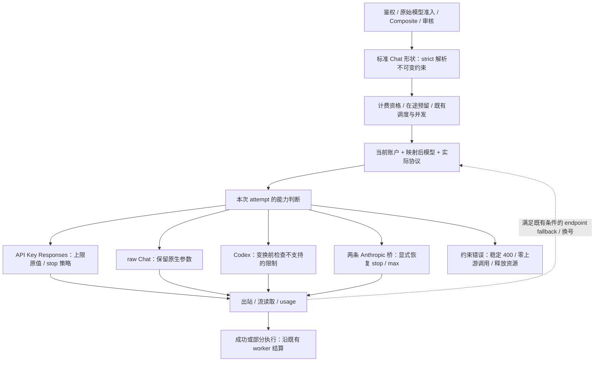

# Sub2API OpenAI 契约兼容性技术方案

> 版本：v3.3 · 2026-10-03 `cached_tokens` presence 修复版。
> 代码基线：`b735bd4b47bff5a9f2382e672632f8bc7dd70795`；相对 v2.0 基线 `b4a9452a68d494c85ee3a1da9bfc0128c2d1da9a` 复核相关差异。本次使用本地 HEAD，未拉取远端、合并上游或核对线上部署。
> 状态：已补齐当前工作区的约束策略、原值转换、文本 stop 接线、未版本化 Chat 别名 bypass，以及 Responses usage 的 `cached_tokens` presence 保留。部署模板及本机部署脚本默认启用 `strict/text`；后端无外部配置时仍可回退到 `legacy/reject`。修复后的真实 CC002 JSON/SSE 复测已完成并恢复 100% usage coverage；费用/幂等结算、完整协议分支和生产灰度仍未完成业务验收。工作区尚未提交，HEAD 不包含这些修改。修复说明见 [cached_tokens 缺失修复方案](SUB2API_CACHED_TOKENS_PRESENCE_REMEDIATION.md)，准确的实施范围见 §1.5，构建与部署结果见 [本机部署文档](LOCAL_SOURCE_HTTPS_DEPLOYMENT.md)。
> 规范：[架构与修改指南](ARCHITECTURE_AND_MODIFICATION_GUIDE.md)、[开发规范](DEVELOPMENT_RULES.md)、[Composite 分组](COMPOSITE_GROUPS.md)、[定制与上游同步指南](SUB2API_CUSTOMIZATION_AND_UPSTREAM_SYNC_GUIDE.md)。
> 写作参考：工作区 `tuotuo/vscode/docs/REF_AUTH_TECHNICAL_PLAN.md` 的业务流程、类型定义、关键代码及逐阶段检查门组织方式；不继承其技术栈、数据库设计和实施状态。

## 阅读导航

| 阅读目的 | 章节 |
| --- | --- |
| 五项问题是否解决、最新代码改变了什么 | §1 问题追踪与基线差异 |
| 请求如何选路、在哪个位置做约束判断 | §2 当前链路与能力边界 |
| 缓存为什么可能低、如何定位与复测 | §3 缓存身份、usage 与统计 |
| stop、tools、token 如何实施 | §4–§6 业务规则与关键代码 |
| 新增接口、文件所有权、资源与计费 | §7 实施落点和生命周期 |
| 配置、灰度、回滚和错误契约 | §8 配置与兼容 |
| 测试输入、断言、命令和完成标准 | §9 测试与验收 |
| 逐项执行顺序和阶段检查门 | §10 实施步骤 |

文中的 **现有源码节选** 表示基线实现；保留的 **拟新增设计** 和 **接线伪代码** 是设计说明，不保证与已实现类型逐字相同。实际落点及验证范围以 §1.5 为准，不能将整个设计矩阵标为完成。已有测试文件的存在不等于本次运行通过，文档检查也不等于五项业务验收。

## 1. 修订结论与范围

旧版针对早期订阅 OAuth → Codex Responses → Chat Completions 链路制定了五项补丁。当前项目已有多种账号、协议分流、稳定缓存身份、工具转换和 usage 处理，不能继续按旧版五项缺陷全部未解决来实施。

本方案继续以 `/v1/chat/completions` 及其 `/chat/completions` 别名为主要入口，重点解决实际转换分支的字段丢失、参数能力和结果语义。订阅业务仍使用现有 Codex 凭据链路；项目同时存在的 API Key、原生 Chat、Anthropic 等分支必须分别判断，不能将某一业务部署的凭据限制描述成全项目架构。

### 1.1 旧问题逐项处置

| 旧编号 | 旧判断 | 当前代码结论 | 修订后的工作 |
| --- | --- | --- | --- |
| 1 多轮缓存 | 客户端不传会话标识，缓存 key 就为空，需要新增派生 | **用户已确认升级到当前版本后解决**；已有 Chat prompt key 与独立调度种子机制。见 §3 | 关闭原故障的新增修复项，保留回归；本轮不修改缓存算法，不把用户确认写成本轮独立实测 |
| 2 重复请求缓存 | 没有本地响应缓存导致约 10% 命中，需要 dedup 保证接近 100% | **撤销该缺陷定义与补丁**。当前主路径没有旧方案设想的整响应缓存，但这不构成 OpenAI 契约缺陷；稳定 prompt cache 与回传能力已存在 | 使用上游真实 cached tokens 评估；取消本地响应重放及人为写满 cached tokens |
| 3 stop | Chat → Responses 未处理 stop | **转换分支仍有缺口**。DTO 有 `Stop`，转换器不读取；原生 Chat 分支须单独判断 | 增加分支能力检查；优先原生映射，Responses 分支可选受限文本截断，其他不支持的组合明确拒绝。见 §4 |
| 4 工具调用 400 | none/auto/required 全失败，且一定是上游拒绝 tools | **旧实测未在当前版本复现，来源尚未确认**。已有 strict 默认值、工具形状规范化、名称别名及调用 ID 处理；本地也能返回 400 | 复用既有诊断，按出站分支复测；另处理仍存在的指定工具被静默降为 auto 的风险。见 §5 |
| 5 token 上限/finish_reason | 统一用本地 tokenizer 截断即可完全兼容 | **上限缺口仍在，但结束原因映射已存在**。Codex 转换主动删除上限；Chat → Responses 还会把正数小上限抬至 128 | 支持路径保留原值，不支持路径明确能力边界；保留既有 incomplete → length 映射，不重写真实 usage。见 §6 |

用户提供的两组历史缓存结果为：多轮请求命中率 **10%**、token 命中率 **9.54%**；重复请求命中率 **10%**、token 命中率 **9.86%**。用户随后明确确认多轮缓存升级后已解决，因此 C1 按用户确认关闭原故障、保留回归；没有新的统计数值，不推算提升比例。C2 已按本方案完成修复后真实复测；字段完整性已恢复，但 token 命中率仍需按上游缓存覆盖率问题单独跟踪，不能把字段修复等同于命中率达标。

### 1.2 原始问题追踪与验收口径

| ID / 原始现象 | 现有机制与当前缺口 | 源码证据 | 本次验证状态 | 解决条件 |
| --- | --- | --- | --- | --- |
| C1 多轮缓存 10% / 9.54% | 已有稳定会话种子、prompt key 和缓存 usage；不新增缓存补丁 | §3 的 scheduling、prompt key、usage 转换器 | **用户确认升级后解决**；本轮没有独立真实上游统计 | 原故障关闭、保留回归；后续实测另列，不能伪造新的命中率 |
| C2 重复缓存 10% / 9.86% | 输入缓存和整响应重放不同；不引入整响应缓存伪造命中 | 同 C1 | 修复前 CC002 JSON/SSE 共 60 条请求均 HTTP 200；3 条响应缺失 `cached_tokens`，其中显式零可能在转换时被丢弃。修复后 JSON/SSE 各 30/30 HTTP 200，usage coverage 均 100%，显式零已保留；warm request hit rate 均 28/29（96.55%），token hit rate 约 64.44%/64.39%，仍低于 80% 工程目标 | 显式零可计算为有效未命中；上游真正未报告时仍保持 N/A，不伪造为 0。字段缺失已修复；剩余低 token 命中率单列为上游缓存覆盖率问题 |
| S1 stop 后内容未截断 | legacy 保持原行为；strict/text 的 JSON/SSE 文本模拟已接线 | §4、§2.3、§1.5 | strict/text 真实黑盒 JSON、数组、SSE 及别名测试通过；legacy 下 JSON 保留旧行为 | 支持路径返回 2xx 且不含停止串；不支持路径明确拒绝 |
| T1 none/auto/required 三项均 400 | 已有工具形状/strict/名称和 ID 转换；增加前置约束校验及指定函数规范化 | §5 的 transform、raw、Anthropic 分支 | `gpt-5.6-terra` 真实 none/auto/required 均 2xx；历史 400 未复现 | 继续按协议/账号分支复测，不能把一次 2xx 推广到所有上游 |
| L1 max_completion_tokens 返回 stop，期望 length | strict Responses 保留原值；Codex strict 在删除前拒绝上限；legacy 仍保留旧限制 | §6 的转换器、Codex 删除列表、回程映射 | Terra legacy `max_completion_tokens=1` 返回 stop 且输出 1207 tokens；strict/Codex 对显式上限明确拒绝 | 支持路径原值出站并映射真实 length；Codex 明确拒绝计能力边界，不伪装成功 |

**验收决策**：按真实能力验收。最终报告按“协议/映射模型/账号类型/配置”逐行记录通过、失败、不支持、未验证；不支持并明确拒绝不能计作原成功响应测试通过。没有原始样本时使用合成 fixture 验证本地缺口，但不得据此声称已经复现用户的同一次失败。缓存改善不设置臆造阈值，若业务另有阈值，需附其样本条件和统计依据后单独验收。

### 1.3 相对 v2.0 的相关代码增量

| 变化 | 当前依据（路径相对 `backend/internal/`） | 对本方案的影响 |
| --- | --- | --- |
| GPT-6.1 Sol 模型/缓存识别 | `service/openai_compat_prompt_cache_key.go`、`openai_codex_transform.go`、`openai_model_alias.go` | 缓存测试加入该模型及映射别名；只描述仓库已有识别，不据名称承诺账号可用性 |
| GPT-6.1 Sol 参数与工具限制 | `service/openai_gateway_request_body.go::validateGPT61SolCompatRequest`、`openai_gateway_chat_completions_raw.go`；`pkg/apicompat/chatcompletions_to_responses.go` | 禁用推理及 Chat-only 工具请求可能在本地返回 400；不能将这些错误归为 tools 格式故障 |
| Claude 5.5 分支校验扩大 | `pkg/apicompat/responses_to_anthropic_request.go`、`service/openai_gateway_chat_completions_anthropic_native.go` | 当前 Opus/Sonnet 5.5 强制工具选择被拒绝；Sonnet 还有采样/推理限制，需使用映射后模型判断 |
| Anthropic Chat 流式 usage | `service/openai_gateway_chat_completions_anthropic_native.go` | 按收到的 usage 存在性输出，不再依赖客户端 include_usage；同步缓存桶，防止外发与结算口径漂移 |
| Composite 账户归属限制 | `service/openai_gateway_scheduling.go`、`openai_account_scheduler.go` | account_model 路由只允许显式拥有该公共模型映射的账户；故障转移不能为了参数兼容绕过归属 |
| Chat 余额在途预留 | `handler/openai_chat_completions.go`、`gateway_inflight_reservation.go` | 校验早退、失败、取消和正常计费都必须正确交接/释放预留引用，见 §7.4 |

上述已提交基线增量本身没有 strict 策略或 stop 扫描器；本轮未提交实现另外列于 §1.5。旧转换 wrapper 仍有 128 floor，Codex 仍删除 token 上限，strict 用分支策略约束这些行为，不修改 Codex 远端能力的结论。

### 1.4 继续排除的设计

- 新增 `StablePromptCacheKey` 并塞入 `ExtractSessionID`：与已有分层派生重复，还会扩大到其他调用路径。
- 将整响应放进 Redis，并在重放时设置 `cached_tokens = prompt_tokens`：改变生成语义，混淆上游输入缓存与网关重放，也遗漏租户、鉴权、计费和保留期设计。
- 用可见文本 tokenizer 将 `completion_tokens` 重写为上限或截断后的计数：不能覆盖推理、工具及不可见 token，会污染结算和下游计费。
- 默认删除 tools/strict、把 function 工具改成 custom 工具、将所有 tools 400 统一改成 501：没有当前失败证据，也不保证语义等价。
- 五项新开关全部默认开启，以及虚构已存在的 `cache.RedisCache`、`SUB2API_*` 配置：当前并无这些方案接口，实施应沿用本仓库 service/repository 和 Viper 边界。

### 1.5 当前工作区实施进度（非真实上游验收）

以下路径相对 `backend/internal/`；详细设计章节保留作后续检查清单，不能反向覆盖本节的实际状态。

| 阶段 | 已实施的落点与行为 | 验证与剩余检查门 |
| --- | --- | --- |
| P0 基线 | 保留原始五项现象；C1 依用户确认关闭，C2/T1/原始 L1 请求仍缺真实复现资料 | 本地合成 fixture 不冒充原始失败请求 |
| P1 约束策略 | `pkg/apicompat/chat_contract.go` 保留 presence、max 优先级与工具引用；`service/openai_chat_contract.go` 在实际分支前校验；两个 Chat handler 对齐预留估算并单独返回本地参数错误 | parser、策略与配置测试通过；需要继续验证完整 handler 的预留交接及 fallback 组合 |
| P2 原生映射 | `ChatCompletionsToResponsesWithOptions` 隔离旧 floor；raw 处理双字段优先级；两条 Anthropic 桥恢复 stop/max 并校验最终 body；Codex strict 显式上限拒绝 | Responses 实际 mock 出站 none/auto/required 和小上限通过；两条 Anthropic 桥的完整真实出站仍待验收 |
| P3 文本模拟 | `pkg/apicompat/chat_stop_scanner.go` 与 `service/openai_chat_text_contract.go` 接入主 Chat JSON/SSE；buffered reader 支持可选 observer；命中/断连启动不可续期的绝对期限，超时取消并关闭 body | 跨 chunk、重叠、UTF-8、首字符命中、尾部 flush、length、content_filter、usage、意外工具/拒绝、持续心跳及断连合成测试通过；保留真实用量、不允许模拟模式跨号重放 |
| P4 回归/上游 | 已执行本地 Go、前端、部署、Codex 真实 strict/text 黑盒和 Terra 五类专项测试；新增 usage presence 回归；重建服务后已重跑 CC002 JSON/SSE | CC002 JSON/SSE 各 30/30 HTTP 200，usage coverage 100%，SSE 每条一个 `[DONE]`，无缺失 `cached_tokens`；warm request hit rate 均 96.55%，token hit rate 约 64.4%，低于 80% 工程目标，剩余为上游缓存命中覆盖率问题。费用、幂等结算、完整 fallback/Anthropic 分支和断连收尾仍未完成真实验收；缺 Docker 的 repository integration 自动跳过 |
| P5 灰度 | 配置及样例已落地；本机及部署模板以 `strict/text/30` 启动并完成隔离验证 | 真实缓存字段、费用/幂等结算及完整协议分支仍未完成业务验收 |

实际测试文件：`pkg/apicompat/chat_contract_test.go`、`pkg/apicompat/chatcompletions_responses_test.go`、`config/openai_chat_contract_test.go`、`service/openai_chat_text_contract_test.go`、`test/openai_contract_http_test.py`、`test/issue_regression_cases.py`。新增 `ResponsesInputTokensDetails`/`ChatTokenDetails` presence 保留，不添加数据库迁移，不改变缓存 key 算法或用可见文本重写 usage；另修复 `backend/internal/web/embed_on.go` 对 `/chat/completions` 的 API bypass。源码编译失败的缺失类型/函数已用完整控制器接线解决，不是空桩。独立说明见 [cached_tokens 缺失修复方案](SUB2API_CACHED_TOKENS_PRESENCE_REMEDIATION.md)。

实施边界：strict 的转换分支目前只接受可映射的 function 工具，非 function/分支专用工具约束明确拒绝；raw 保留原生扩展。文本模拟仅在 `strict/text` 且单 choice、普通文本、无可执行工具等前提下启用；意外工具、音频或 refusal 输出返回错误，不伪装为截断成功。收尾超时可能缺失终态 usage，不能补造用量或保证停止计费。有关拒绝只证明本地策略边界，不能证明上游永久不支持。

## 2. 当前链路与能力边界

路径均相对仓库根目录；链接从本文所在的 `docs/` 解析。定位以函数名为主，避免旧版本行号失效。

### 2.1 入站、路由和转发

```text
API Key 鉴权 → 客户端原始模型白名单 → Composite 解析/模型改写
  → 按具体平台选择 handler → 审核/配额/调度/并发
  → 按账号原生协议、端点能力和请求形状选择转发
      ├─ Codex 协议：Chat → Responses → Codex transform → 上游 SSE
      ├─ API Key Responses：Chat → Responses → 默认或自定义 Base URL
      ├─ 原生 Chat：按分支修改请求后转发 Chat Completions
      ├─ 原生 Anthropic：现有 Chat → Responses → Anthropic 链
      └─ Grok / OpenCode Go / 其他平台：各自已有分流
  → JSON 聚合或 SSE 转换 → 实际 usage → 既有异步记录与幂等结算
```

主要证据：

| 位置 | 当前职责 |
| --- | --- |
| [routes/gateway.go](../backend/internal/server/routes/gateway.go) · `RegisterGatewayRoutes` | 网关及别名；模型白名单在 Composite 改写之前；Chat 入口按平台选 handler |
| [handler/openai_chat_completions.go](../backend/internal/handler/openai_chat_completions.go) · `ChatCompletions` | 请求/模型/stream/service tier 校验、审核、计费资格、会话、账户调度与失败处理 |
| [service/openai_gateway_chat_completions.go](../backend/internal/service/openai_gateway_chat_completions.go) · `forwardAsChatCompletions` | 账号协议分流、Responses 形状兼容、模型映射、缓存 key 注入、Codex 转换与回程 |
| [openai_compat/upstream_capability.go](../backend/internal/pkg/openai_compat/upstream_capability.go) · `ResolveResponsesSupport` | `openai_responses_mode` 与探测结果；强制 Responses、强制 Chat、自动模式 |
| [service/openai_gateway_forward.go](../backend/internal/service/openai_gateway_forward.go) · `buildUpstreamRequest` | 按凭据选择 Codex、默认 Platform API 或经校验的自定义 Base URL；认证与会话头 |
| [service/openai_gateway_chat_completions_raw.go](../backend/internal/service/openai_gateway_chat_completions_raw.go) · `forwardAsRawChatCompletions` | 原生 Chat 分支，有自身模型/策略/平台处理，不能简单称为完全不修改 body |
| [service/openai_gateway_chat_completions_anthropic_native.go](../backend/internal/service/openai_gateway_chat_completions_anthropic_native.go) · `forwardChatCompletionsViaNativeAnthropic` | Chat → Responses → Anthropic，不能因为最终是 Anthropic 就假设 Chat stop 已保留 |
| [service/gateway_forward_as_chat_completions.go](../backend/internal/service/gateway_forward_as_chat_completions.go) · `GatewayService.ForwardAsChatCompletions` | Anthropic 平台组的另一条 Chat → Responses → Anthropic 链；与上行 CN/OpenCode 原生桥分别接线，返回 `ForwardResult` |

API Key 并非必定发往 `api.openai.com/v1/responses`。账号配置、端点探测、CN 协议和 OpenCode Go 原生协议都会改变路径；能力未知且 Responses 端点不受支持时还存在原生 Chat fallback。对任何参数的检查必须覆盖**最终实际转发分支及 fallback**。

`isResponsesShape` 表示 `/chat/completions` 收到有 `input`、无 `messages` 的请求。这条路径保留 Responses 形状，不应套用标准 Chat 的缓存派生或文本截断策略。原生 `/responses`、WebSocket、媒体接口也不能因共享函数而被自动纳入本方案。

### 2.2 Composite 不变量

遵守 [COMPOSITE_GROUPS.md](COMPOSITE_GROUPS.md) 的路由、具体平台归属与端点限制；其中“显式路由后直接内置检测”的概览省略了当前代码的账号模型归属解析。以 [composite_route_resolver.go](../backend/internal/service/composite_route_resolver.go) · `Resolve` 和架构指南 §4.3 为准：

1. 显式规则 → 已装配的账号模型归属 → 内置检测；归属歧义拒绝，归属查询失败仅对可识别模型允许检测兜底。
2. 显式规则按 exact、具体 endpoint、最长 prefix、较小 priority、较小 route ID 决胜，禁用规则不参与。
3. Chat 使用 `chat_completions` 路由域，保留原始模型白名单检查；分清公共模型、路由模型、账号上游模型和计费模型。
4. 参数能力判断在既有路由/调度边界内进行；不能为满足 stop/token 上限擅自跨平台换账号或绕过套餐、配额和渠道价格。
5. 具体平台继续贯穿计费、Ops 和报表。组合别名本身不创建价格或能力记录。

### 2.3 约束接入的数据流（拟新增设计）



图中解析器和策略为新增设计，调度、预留、出站和计费为既有机制。Responses 形状请求在进入 B 前排除。`GatewayService` 与 `OpenAIGatewayService` 的 handler 继续各自持有原生命周期，不合并成一个新网关。

| 实际分支 | 当前选择依据 | strict 接线要求 |
| --- | --- | --- |
| Codex Responses | `UsesOpenAICodexProtocol()` | 在 `applyCodexOAuthTransformWithOptions` 之前检查 stop/token；不能仅在 transform 之后检查已删除的字段 |
| API Key Responses | 账号协议、`ResolveResponsesSupport` 的覆盖/探测结果；unknown 当前先走 Responses | 使用原值选项转换；保持现有 endpoint fallback 条件，不能把参数 400 当作端点不支持 |
| raw Chat | CN 协议、OpenCode 原生协议、明确 Chat 能力或 endpoint fallback | 进入 raw 函数再次按原始约束和最终模型校验，保留现有 GPT-6/GPT-6.1 限制 |
| CN/OpenCode Anthropic 桥 | `OpenAIGatewayService.forwardChatCompletionsViaNativeAnthropic` | 将原始 stop/max 经 sidecar 传入 Anthropic DTO，不要求 Responses DTO 声明不存在的 stop |
| Anthropic 平台桥 | `GatewayService.ForwardAsChatCompletions` | 同样补 sidecar；保留该分支自己的模型映射、OAuth mimicry、认证和返回类型 |
| Responses 形状 / Grok / 其他独立协议 | 当前专用分流 | 不自动启用本方案的文本模拟；共享转换器新增选项默认兼容，回归验证不受影响 |

账号“支持 Responses 端点”不等于模型“支持所有字段”。strict 按本方案已知限制检查，其余原生字段透传后由真实上游校验；不能把探测布尔值包装成全参数能力认证。对 Responses stop 的拒绝不得主动改路由绕开既有调度；操作者可在已授权账户配置中选择原生支持路径。

请求形状解析在 handler 的既有基础校验/审核之后、预留和账户循环之前进行一次；service 入口仍可从原 body 解析，保障直接调用和测试不绕过校验。每次 attempt 生成独立策略和 body 副本，禁止把扫描器、改写后的 DTO 或账户能力结果复用于下一次尝试。

## 3. 缓存：保留已有能力，改为回归与观测

### 3.1 当前实现

| 环节 | 实际行为与源码 |
| --- | --- |
| 显式标识 | `ExtractSessionID` 在 [openai_gateway_scheduling.go](../backend/internal/service/openai_gateway_scheduling.go) 读取会话 header/body key；它返回空并不代表后续不会派生 |
| 调度粘性 | 同文件 `GenerateSessionHash` 缺显式标识时调用 [openai_content_session_seed.go](../backend/internal/service/openai_content_session_seed.go) · `deriveOpenAIContentSessionSeed`；支持 Chat/Responses 的模型、工具、开头 system/developer、instructions、首条 user 等种子 |
| 上游 prompt key | [openai_compat_prompt_cache_key.go](../backend/internal/service/openai_compat_prompt_cache_key.go) · `deriveCompatPromptCacheKey` 使用映射模型、reasoning effort、tool choice、tools/functions、system、首条 user 派生稳定 key；后续普通 user/assistant 轮次不会直接进入该种子 |
| 生效条件 | `forwardAsChatCompletions` 仅在无显式 key、标准 Chat 形状、Codex 协议或 OpenAI API Key、且 `shouldAutoInjectPromptCacheKeyForCompat` 命中时派生；当前含受支持 GPT-5/Codex 与 GPT-6 模型拼写，并非全部模型 |
| 隔离 | 自动派生的 OpenAI API Key body key 经 `isolateOpenAISessionID`；Codex 上游会话头使用 [openai_codex_account_identity.go](../backend/internal/service/openai_codex_account_identity.go) · `isolateOpenAIUpstreamSessionID`，加入 API Key 和可用的凭据身份命名空间；显式 key、body key、最终 header 不是同一个处理规则，不宣称所有字段都被统一改写 |
| usage | [responses_to_chatcompletions.go](../backend/internal/pkg/apicompat/responses_to_chatcompletions.go) · `chatUsageFromResponsesUsage` 保留缓存读/写、推理等明细；Chat SSE 回程当前强制 `IncludeUsage=true`，包括客户端未请求 stream options 的情况 |
| 计费 | [openai_gateway_usage.go](../backend/internal/service/openai_gateway_usage.go) · `RecordUsage` 分别处理普通输入、缓存读、缓存创建和输出，复用既有结算链路 |

调度 seed 与上游 prompt key 是不同用途，输入集合也不同。不能为了“统一 key”删除其中一个或改成全请求哈希；若发现 developer/instructions 等输入的行为差异，先在各自真实调用点复现，再决定是否需要定向修正。

源码测试证据（本次仅阅读，未执行）：

- [openai_compat_prompt_cache_key_test.go](../backend/internal/service/openai_compat_prompt_cache_key_test.go)：`StableAcrossLaterTurns`、`DiffersAcrossSessions`、映射模型族。
- [openai_gateway_chat_completions_test.go](../backend/internal/service/openai_gateway_chat_completions_test.go)：`APIKeyAutoDerivesStableIsolatedPromptCacheKey`、`ResponsesShapeDoesNotAutoDerivePromptCacheKey`、`StreamsUsageWithoutClientStreamOptions`、顶层终态 usage 和断连继续收集 usage。
- [openai_content_session_seed_test.go](../backend/internal/service/openai_content_session_seed_test.go)、[openai_gateway_service_session_isolation_test.go](../backend/internal/service/openai_gateway_service_session_isolation_test.go)、[openai_codex_account_identity_test.go](../backend/internal/service/openai_codex_account_identity_test.go)：内容种子与会话隔离。

### 3.2 更新后的验收方法

缓存不再设“超过旧版 10%”或“重复请求接近 100%”硬门槛。Prompt caching 复用的是输入前缀计算，仍会生成新回复；key 和相同请求都不保证命中。官方公开 API 的说明也不能直接当作 ChatGPT 内部 Codex 后端的 TTL 或最低长度承诺。依据：[OpenAI Prompt caching](https://developers.openai.com/api/docs/guides/prompt-caching)。

线上若需复测，固定代码版本、账号协议、映射后的模型、API Key、前缀内容和请求节奏，区分冷启动、预热后重复请求与多轮追加；记录账号切换、失败请求和 usage 缺失，避免将它们混入一个百分比。

- 请求命中率：有效 usage 样本中 `cached_tokens > 0` 的请求数 / 有效样本数。
- token 命中率：同一有效样本集的 `sum(cached_tokens) / sum(prompt_tokens)`；分母为零时记为不可计算。
- 单列 usage 缺失数量；缓存写入 tokens 不计为缓存读取命中；显式零值与未报告字段分别保留观测状态。
- 结构验收检查同一稳定前缀的派生值、显式标识优先级、跨 API Key 隔离，以及上游 → 下游 → 用量记录的值是否一致。

本方案不新增整响应缓存。未来若另有业务需求，应单独设计租户/Key/分组隔离、权限撤销、随机输出、工具、模型版本、计费、TTL 和数据保留；不得用 OpenAI `cached_tokens` 表示网关本地响应重放。

### 3.3 缓存身份的优先级与关键逻辑

以下为当前实现；两种 seed 的差异需保留在诊断中，不能声称它们已经统一。

| 身份/用途 | 输入与优先级 | 输出与注意事项 |
| --- | --- | --- |
| `ExtractSessionID` 显式标识 | `session-id` → `session_id` → `conversation_id` → `X-Session-Affinity` → `X-Session-Id` → `X-OpenCode-Session` → `X-Conversation-ID` → body `prompt_cache_key`；按第一个非空值 | 返回原始标识；Grok context 还有独立 header/previous_response_id 规则，本方案不迁移它们 |
| `GenerateSessionHash` 调度身份 | 显式标识为空才调用 `deriveOpenAIContentSessionSeed` | 内容 seed 包含模型、tools/functions、instructions、Chat 开头 system/developer、第一条 user；随后派生哈希并保留 legacy hash 兼容 |
| `deriveCompatPromptCacheKey` 上游 key | 规范化映射模型、reasoning_effort、tool_choice、tools/functions、所有 system 消息、第一条 user | `compat_cc_` 加 SHA256；当前不包含 developer、instructions、legacy function_call，不能将缺失项直接归因为缓存低 |
| API Key 自动派生隔离 | 满足自动注入条件且无显式标识 | `isolateOpenAISessionID(apiKeyID, key)`；显式 key 不自动套用相同 body 改写策略 |
| Codex 出站身份 | 平台 Key ID + 解析后的 OAuth 凭据命名空间 + 原标识 | `isolateOpenAIUpstreamSessionID`；shadow 使用实际凭据源；命名空间缺失时退回 Key 隔离 |
| 最终 HTTP `session_id` | `buildUpstreamRequest` 后，Chat 服务还调用 `generateSessionUUID(sessionKey)` | 必须检查最终 HTTP request，不能把 builder 中间值当作线上的最终 header；body key、conversation_id 和 session_id 的表示不必相同 |

当前派生中 JSON 对象经 `normalizeCompatSeedJSON` 规范化；数组顺序有意义。相同 key 不证明最终输入前缀相同，别名/系统提示变换、工具顺序和账户切换仍需检查。会话标识不是鉴权凭据，鉴权与资源归属继续由原链路执行。

**现有源码节选**（`openai_gateway_chat_completions.go`）：

```go
if promptCacheKey == "" && !isResponsesShape &&
    (account.UsesOpenAICodexProtocol() || account.IsOpenAIApiKey()) &&
    shouldAutoInjectPromptCacheKeyForCompat(upstreamModel) {
    promptCacheKey = deriveCompatPromptCacheKey(&chatReq, upstreamModel)
    compatPromptCacheInjected = promptCacheKey != ""
    if compatPromptCacheInjected && account.IsOpenAIApiKey() {
        promptCacheKey = isolateOpenAISessionID(getAPIKeyIDFromContext(c), promptCacheKey)
        compatPromptCacheTenantIsolated = true
    }
}
```

诊断顺序固定为：确认请求分支和映射模型 → 检查显式标识是否每轮变化 → 对比派生 key 和实际账户 → 对比最终出站稳定前缀 → 检查上游 usage → 检查回程及结算。新增诊断只记录 key/前缀摘要、来源枚举、计数和关联 ID，不记录正文或原始会话标识。工具定义/前缀摘要也不得作为高基数监控标签。

### 3.4 usage 与计费的逐层核对

```text
上游 Responses input_tokens / output_tokens / details
    → chatUsageFromResponsesUsage → 下游 prompt/completion/total + details
    → OpenAIForwardResult.Usage → RecordUsage → UsageBillingCommand
    → UsageBillingRepository.Apply（既有幂等结算）
```

以上两条输出边必须独立断言，不能以“客户端看到 cached_tokens”推断账单一致。`RecordUsage` 当前用 `max(input - cache_read - cache_creation, 0)` 得到普通输入桶；缓存写入和读取分别定价，不能将 `cache_write_tokens` 加进命中分子。Anthropic usage 先按已有 `mergeAnthropicUsage`、`syncAnthropicResponsesUsage`、`normalizeAnthropicEventUsageForResponses` 归一化，再进入回程。

**当前观测限制与修复**：`ResponsesInputTokensDetails` 和 `ChatTokenDetails` 现在保留 `cached_tokens` key 的 presence；`promptDetailsFromResponses` 不再丢弃上游明确的零值，Chat JSON/SSE 会输出 `cached_tokens: 0`。上游完全未报告该 key 时仍保持缺失并标为 unknown，不伪造为零。原始敏感响应不进普通日志；修复只改变协议 presence，不改变 `OpenAIUsage.CacheReadInputTokens` 或计费桶。真实 CC002 必须在重建部署后确认上游显式零和真正缺失两类样本。

### 3.5 缓存复测步骤与样本格式

1. 固定源码 SHA、部署配置、具体平台、凭据类型、API 路径、客户端模型、映射模型和受测账户池；固定平台 API Key 和并发度为 1。前缀长度按该受测上游实际能力选择，记录 tokenizer/计量依据，不统一假设内部 Codex 的最低长度或 TTL。
2. 重复请求：为本轮构造新的合成稳定前缀，先发 1 次预热，再发 20 次相同输入；不重放旧响应。预热不保证真正冷缓存，“冷启动”仅在可证实无可复用前缀时填写。
3. 多轮请求：另建合成会话，1 次初始请求后追加 10 轮 user/assistant，固定 system/tools，保留第一条 user；每轮等待完成，记录实际间隔、前缀长度及命中数据。单列追加内容带来的分母增长。
4. 每类至少重复 3 组；分别报告预热、暖请求、失败、换号和 usage 缺失数量。跨 Key 隔离和模型变化另建负向组，不混入主组命中率。
5. 样本字段为：`case_id, request_id, branch, account_ref, model, mapped_model, phase, elapsed_ms, status, usage_seen, cached_tokens_seen, prompt_tokens, cached_tokens, cache_write_tokens, key_digest, account_changed`。只使用脱敏账户引用。
6. 对同时有可信输入总量和缓存读取量的样本计算 §3.2 的两项比率；明确报告有效覆盖率 `有效样本数/成功样本数`。全部缺失或分母为零时填 N/A。另列上游显式零样本；unknown 不填零以美化或压低比率。

本流程产生的是当前条件下的可复算报告。若上游持续报告低命中，应继续定位前缀、账户和能力，C1/C2 保持未解决；结构回归通过只能证明网关未破坏已覆盖的身份与 usage。

## 4. stop：解决实际转换丢失，明确模拟范围

### 4.1 当前缺口

[types.go](../backend/internal/pkg/apicompat/types.go) 的 `ChatCompletionsRequest.Stop` 为 `json.RawMessage`，但 [chatcompletions_to_responses.go](../backend/internal/pkg/apicompat/chatcompletions_to_responses.go) · `ChatCompletionsToResponses` 不读取该字段，`ResponsesRequest` 也无 stop。当前两个 Chat 回程处理函数没有 stop 扫描器，因此该转换路径会丢失 stop。

原生 Chat 路径不经过上述 DTO 重建，是否支持由最终模型/上游决定；经 Responses 中转的原生 Anthropic 分支同样需要补显式映射。不能将这一缺陷推广为“所有入口都不支持 stop”。

### 4.2 拟实施行为

按 §8 的兼容策略灰度启用，先解析并保留原始 stop 选项，随后依据最终协议选择：

| 最终路径 | 严格策略下的处理 |
| --- | --- |
| 原生 Chat | 保留字段，遵守已确认的模型能力和上游错误；不重复截断 |
| 原生 Anthropic 的 Chat 桥 | 从原始 Chat 请求显式解析并写入 `AnthropicRequest.StopSeqs`，避免经 Responses 中转丢失；验证上游与回程终态 |
| Codex / API Key Responses 桥 | 默认拒绝不支持的 stop；仅显式启用网关文本模拟模式时接入下述扫描器 |
| Responses 形状兼容、其他平台/协议 | 使用其原有契约；扩展须独立验证，不能自动套用 |

解析接受字符串、字符串数组或 null/缺省；最多 4 条。空字符串、非字符串元素等无效输入返回 OpenAI 风格 400；空数组按无约束处理并固定测试。前述形状、数量及输出不含停止串的语义参考 [Chat Completions API](https://developers.openai.com/api/reference/resources/chat/subresources/completions/methods/create)，具体模型支持范围另行判断。

**可选文本模拟模式是网关扩展，不能承诺停止上游生成或节约上游费用。** 首期仅支持单 choice、普通文本输出、无可执行 tools/functions 的请求；structured output、音频、多 choice 或工具组合在模拟模式下明确拒绝，不得截断工具 JSON、推理字段或破坏 schema。无工具/工具禁用状态须按实际解析结果判定，不能只检查 `tools` 长度。

实现要求：

1. 纯扫描逻辑放 `apicompat`；service 在选定路径后传入请求级选项。通用 Responses → Chat 转换器默认保持现有行为，避免影响 Grok 等复用方。
2. 非流式对普通 `message.content` 按最早匹配位置截断，排除停止串；未命中保持原终态。命中仅覆盖正常文本结束为 `stop`，不把 failed/refusal/content_filter 伪装成成功。
3. 流式在已解析的文本 delta 上扫描，暂存可能构成停止串的后缀，支持跨 chunk、重叠串和 UTF-8；按累计输出位置裁定，不能按“先做 token 再做 stop”的固定顺序。
4. 命中后停止下发文本，按 §7.4 新增的绝对收尾期限继续读终态 usage，并复用既有资源生命周期；收到有效终态后只写一次 finish、已有 usage 和 `[DONE]`。不要提前写 `[DONE]` 后再补 usage。
5. 上游读取失败/缺失终态仍保留错误语义和已得到的 usage，不执行跨账号重放；客户端断开后复用原有资源清理并为模拟请求补有限收尾，不能新增无界后台 drain。
6. 下游和 `OpenAIForwardResult.Usage` 继续报告上游真实用量，不按截断后字符串重算。实际费用可能包含被网关隐藏的后续生成，须在启用说明中写明。

### 4.3 stop 参数解析（拟新增设计）

解析器归属 `apicompat`，不接触 Gin、账号、日志和网络；错误携带 `param=stop`，由 service/handler 映射为 §8.2 的响应。保留原始 `json.RawMessage`，缺省与 null 作为不同 presence 保存，但均无有效限制。空数组同样无有效限制，不触发 Responses 能力拒绝。

```go
// 拟新增设计：省略包/import；ParameterError 定义见 §7.1。
func ParseChatStop(raw json.RawMessage) ([]string, *ParameterError) {
    value := bytes.TrimSpace(raw)
    if len(value) == 0 || bytes.Equal(value, []byte("null")) {
        return nil, nil
    }
    invalid := func() ([]string, *ParameterError) {
        return nil, &ParameterError{
            Param: "stop", Code: "invalid_parameter",
            Message: "stop must be a non-empty string or an array of up to 4 non-empty strings",
        }
    }
    var stops []string
    if value[0] == '"' {
        var stop string
        if json.Unmarshal(value, &stop) != nil { return invalid() }
        stops = []string{stop}
    } else if value[0] == '[' {
        // 不能直接反序列化到 []string：JSON null 元素须显式拒绝。
        var items []json.RawMessage
        if json.Unmarshal(value, &items) != nil || len(items) > 4 { return invalid() }
        for _, item := range items {
            item = bytes.TrimSpace(item)
            if len(item) == 0 || item[0] != '"' { return invalid() }
            var stop string
            if json.Unmarshal(item, &stop) != nil { return invalid() }
            stops = append(stops, stop)
        }
    } else {
        return invalid()
    }
    for _, stop := range stops {
        if stop == "" || !utf8.ValidString(stop) { return invalid() }
    }
    return stops, nil
}
```

空格、换行等非空字符串是合法停止串，不得 `TrimSpace` 后改变匹配语义。重复停止串可保留（最多 4 项，按输入数量验证）；只对解码后的文本作大小写敏感的精确匹配，不做 Unicode 归一化或在 SSE 原始 JSON 字节中搜索。请求大小仍受现有入口限制。

### 4.4 增量扫描器与跨块语义（拟新增设计）

扫描器输入为完整解析后的文本 delta（有效 UTF-8）；SSE 帧拆分由现有 frame parser 负责。扫描器仅维护停止串、待定尾部、命中状态和累计已发字节数。`Push` 返回可安全下发的文本，`Finish` 仅在有效成功终态时释放未命中的尾部。

```go
// 拟新增设计：NewTextStopScanner 复制已校验 stops；每个请求独立创建。
type TextStopScanner struct {
    stops   []string
    pending string
    matched bool
}

func (s *TextStopScanner) Push(delta string) (string, bool) {
    if s.matched { return "", true }
    s.pending += delta
    return s.scan(false)
}

func (s *TextStopScanner) Finish() (string, bool) {
    if s.matched { return "", true }
    return s.scan(true)
}

func (s *TextStopScanner) scan(final bool) (string, bool) {
    text := s.pending
    for i := range text { // 只在 UTF-8 字符边界开始匹配。
        suffix := text[i:]
        partial := false
        for _, stop := range s.stops {
            if strings.HasPrefix(suffix, stop) {
                s.pending, s.matched = "", true
                return text[:i], true
            }
            if !final && len(suffix) < len(stop) && strings.HasPrefix(stop, suffix) {
                partial = true
            }
        }
        if partial {
            // 更早位置可能形成停止串时，不能先提交后面的完整匹配。
            s.pending = text[i:]
            return text[:i], false
        }
    }
    s.pending = ""
    return text, false
}
```

例如停止串为 `["abc", "b"]`，chunk 为 `"a" / "b" / "c"`：读到 `ab` 时必须保留从 a 开始的候选，不能先按 b 截断，否则分块与整段扫描结果不一致；若最终只有 `ab`，`Finish` 排除未完成的 abc 后在 b 截断。相同起点多个匹配产生相同截断位置，不需依赖数组顺序。待定尾部最多为最长停止串长度减 1 字节（另有当前 delta），不缓冲整段输出。

非流式和流式复用同一扫描规则：非流式将最终普通文本作为一次 `Push`，再调用 `Finish`；不对工具 arguments、reasoning_content、refusal 或音频字段扫描。未命中时保留原 finish_reason。

### 4.5 回程接线、终态与异常（拟新增设计）

适用前提：标准 Chat、`n` 缺省或等于 1、仅文本输出、无结构化 response_format、无有效可执行工具。工具已声明但 `tool_choice=none` 可视为禁用；历史 tool result 可以保留。modern/legacy 优先级先经 §5 校验；不能只看 `len(tools)`。请求满足前提也不证明实际返回一定纯文本，运行时遇到意外工具调用/音频等须停止模拟并报不兼容输出，不能吞掉工具或截断 JSON 后伪装成功。

service 向 `handleChatStreamingResponse` / `handleChatBufferedStreamingResponse` 传入新的请求级选项；原签名包装函数用零值选项调用新内部函数，Grok 等旧调用方保持不启用。纯 Responses→Chat 转换器不读取全局配置。

| 状态 | 事件 | 动作与下一状态 |
| --- | --- | --- |
| Active | 普通文本 delta | 转换后、SSE 序列化/静默拒绝检测之前执行 `Push`；只下发安全文本 |
| Active | 命中 stop | 隐藏停止串及后续文本；进入 Draining，启动绝对收尾计时；不发 finish/[DONE] |
| Active | 正常终态 | 用 `Finish` 处理尾部；若此时命中也按本地 stop 结束；保留真实 usage |
| Draining | 后续文本、心跳 | 不再下发正文，不重置收尾期限；继续提取 usage 和错误 |
| Active/Draining | completed 或非过滤类 incomplete | 仅普通文本命中时对客户端 finish_reason 设置 stop；未命中用现有映射。先 finish，后已有 usage chunk，最后一次 [DONE] |
| Active/Draining | failed、error、refusal、content_filter | 保留既有失败/拒绝/过滤语义，优先于本地 stop；不得覆盖为正常成功 |
| Active/Draining | EOF 无终态、读错误、收尾超时 | 返回已收到 usage 与非 failover 错误；不得调用成功 finalize 伪造 stop/[DONE] |
| 任意未终态 | 客户端断开 | 停止写下游；模拟请求启动同一有界收尾，先到的期限生效；到期取消上游并关闭 body |

正常终态携带 usage 时，以它修正此前累计值，沿用现有提取规则，不能把累计快照相加。上游明确终态但未报告 usage 时保留既有缺失诊断，不造一个零 usage；mock 和真实验收分别记录。首字符就命中时，空输出是合法结果，须跳过“空内容意味着静默拒绝”的自动重试；命中不得生成 `UpstreamFailoverError`。

接线顺序为：现有工具名称还原/SSE 解析 → 原始事件错误和 usage 处理 → Responses→Chat chunks → 文本扫描与 finish 决策 → 现有输出缓冲/拒绝检测 → SSE 序列化。命中导致的空 delta 不应写无意义文本块；role/ID/usage 仍按原契约输出。§7.4 定义收尾计时与取消所有权，§8 给出配置。

## 5. tools：复用已实现兼容，按证据定位剩余错误

### 5.1 已有能力与仍需关注的分支

- `convertChatToolsToResponses` 已将 function 定义转换到顶层 name/parameters，并用 `defaultStrictFalse` 在缺省时明确发送 `strict:false`，显式 true/false 保留；已有 `ToolStrict` 等测试。
- [openai_codex_transform.go](../backend/internal/service/openai_codex_transform.go) 已处理旧 functions/function_call、嵌套 function 定义、保留名称别名、tool choice 和续链调用 ID。`none/auto/required` 字符串在 `normalizeCodexToolChoice` 中不被改写。
- [openai_codex_transform_test.go](../backend/internal/service/openai_codex_transform_test.go) 已覆盖 known/legacy function choice、allowed_tools、调用 ID 配对等；这些源码测试不能替代真实账号的成功证据。
- **仍有语义风险**：缺失或未声明的指定 function、未知工具类型在 `normalizeCodexToolChoice` 中可能降为 `auto`；已有 `DowngradesMissingFunctionToolChoice` / `DowngradesUnknownToolChoice` 测试明确记录了当前行为。严格策略应在该变换前拒绝无效限制，不得静默放宽调用者约束。
- **本地 400 确实存在**：handler 的模型/service tier 校验、Codex transform 错误，以及 raw Chat 对特定 GPT-6 Sol/Luna 推理+工具组合的能力拒绝。不能从“收到 400”推断请求已到上游。

### 5.2 拟实施诊断和修复流程

1. 复用 [openai_gateway_cc_pipeline.go](../backend/internal/service/openai_gateway_cc_pipeline.go) · `readOpenAIUpstreamError`、`failoverOpenAIUpstreamHTTPError` 与既有 Ops 错误链。已有读取、响应体恢复和消息净化，不另建一套读响应流程。
2. 用合成 fixture 覆盖 none/auto/required、指定函数、legacy function_call、strict 缺省/true/false、多工具与 tool result 续链；同时检查实际发送的 URL、JSON 形状、调用 ID 和恢复后的工具名称。
3. 若当前版本仍失败，记录来源层（入口/转换/上游 HTTP/上游流终态）、具体平台、账号类型、协议、映射模型、HTTP status、受控 type/code 与请求关联 ID。工具名称、arguments、schema、正文和凭据不写普通日志；任意上游 message 不能仅截断后就视为安全。
4. 现有错误路径有受 `LogUpstreamErrorBody` 控制的 detail 捕获，**本方案不以开启它作为诊断前提，也不宣称旧链路已经实现全量正文脱敏**。新增诊断使用字段白名单并验证无敏感回显。
5. 严格策略先验证指定工具存在且形状正确，非法组合返回 OpenAI 风格 400；只对确实不支持的能力给出稳定、可操作的错误。不要将所有上游 400 改成 501，不要把 none 改成“删除所有工具历史”。
6. 只有失败 fixture 能证明转换问题时才修改相应转换器；响应缓存、function→custom 改写和通用 schema 删字段不属于默认修复。

真实上游验收按支持能力判定成功或明确拒绝；不能要求所有模型上的所有 tool_choice 一律 2xx。若历史故障无法复现，记录具体版本和测试组合，关闭该故障项，而非为旧假设新增代码。

### 5.3 工具选择规则与转换形状（拟新增设计）

先读取原始 tools/functions/tool_choice/function_call，避免 DTO 忽略未知类型后误判为“没有工具”。首期新增严格校验保证 function 工具的五种选择（缺省、none、auto、required、指定函数）；既有 `web_search` / `code_execution` / `x_search` 按实际分支映射能力处理。无法无损转换的类型/限制在转换分支返回 `unsupported_parameter`，raw Chat 保留原生形状交上游验证，不用全局白名单破坏透传。

| 输入 | strict 行为 | 必须断言 |
| --- | --- | --- |
| choice 缺省/null | 有工具时语义为 auto，无工具时语义为 none；可以保持字段省略 | 不将默认行为误写为当前转换器总会注入 auto |
| `none` | 保留定义与历史，禁止新工具调用；有效工具集合视为禁用 | 成功响应不包含新 tool_calls；违规上游响应标为契约失败，不伪造文本 |
| `auto` | 保留选择自由；没有工具时允许普通文本 | 文本或合法 tool_calls 均可通过，不能要求每次调用工具 |
| `required` | 至少一个可用工具；无工具时在出站前返回 400 | 支持路径须返回一个或多个合法调用；模型当前不支持强制调用则列为不支持 |
| 指定 function | 非空名称，必须存在于解析后的声明集合；不静默降为 auto | Responses 使用顶层 name，Chat 使用嵌套 function.name，Anthropic 使用 type=tool/name |
| `allowed_tools` | 原生透传及 Responses 形状保持既有边界；标准 Chat 转换首期明确拒绝该扩展策略 | 不套用 Codex 的 additional_tools 宽松规则到标准 Chat，不降为 auto；后续扩展单列 fixture |
| legacy `functions/function_call` | 保留既有 tools 合并；modern choice 非 null 时优先，否则转换 legacy；两者均需形状有效 | 合并后函数名唯一；冲突/重复名称返回字段级 400，不猜测目标函数 |
| strict 缺省/false/true | 复用 `defaultStrictFalse`；显式值不覆盖 | 缺省出站 strict=false；不得删除 schema 的 required/additionalProperties 来绕过错误 |

`required`/指定函数的 2xx 是必要但非充分条件，还需核对输出调用名称和 arguments JSON；选择约束未满足时验收失败。本期不自动补调用或重试“直到出现工具”，避免额外成本与语义变化。未知 schema 的完整合法性仍由上游负责，本地只验证声明/引用/形状，不新增通用 JSON Schema 验证器。

调用转换器前，将选定的有效 choice 写入局部副本；现代 choice 为 null 时清除该副本的 RawMessage，再按有效 legacy choice 转换。当前 converter 以 `len(req.ToolChoice) > 0` 判断优先级，若直接传入字面量 null，会遮蔽 legacy function_call，不能仅在解析器中计算了优先级而不接线。原始 RawJSONField 仍保留 null/presence，便于诊断与重试。

**现有实现的具体缺口**：`ChatCompletionsToResponses` 对非空 `ToolChoice` 直接赋值；Codex 分支随后会展开嵌套 function.name，但 API Key Responses 不经过该 Codex 规范化。故指定函数在该分支可能仍是 Chat 嵌套形状。应增加最终出站 fixture，在严格选项中统一 function choice 的 Responses 形状；该事实不证明原 none/auto/required 三项 400 的来源。

**合成请求与目标片段**（参数 schema 仅用于离线回归）：

```json
{
  "model": "test-model-alias",
  "messages": [{"role": "user", "content": "查询示例城市天气"}],
  "tools": [{"type": "function", "function": {
    "name": "get_weather",
    "parameters": {"type": "object", "properties": {"city": {"type": "string"}}, "required": ["city"]}
  }}],
  "tool_choice": {"type": "function", "function": {"name": "get_weather"}}
}
```

```json
{
  "tools": [{"type": "function", "name": "get_weather", "strict": false,
    "parameters": {"type": "object", "properties": {"city": {"type": "string"}}, "required": ["city"]}}],
  "tool_choice": {"type": "function", "name": "get_weather"}
}
```

第一段为 Chat 输入；第二段仅为 Responses 目标字段片段。Anthropic 目标 choice 为 `{"type":"tool","name":"get_weather"}`；none/auto/required 分别映射为既有 converter 的 none/auto/any。仅在当前模型支持该能力时发送；Claude 5.5 对 any/tool 的现有本地拒绝继续生效。

```go
// 拟新增设计：在 §7.1 的约束解析/声明校验之后调用。
// 仅展示指定 function 分支，其余枚举按上表转换。
func NamedFunctionChoiceForResponses(name string) (json.RawMessage, error) {
    return json.Marshal(struct {
        Type string `json:"type"`
        Name string `json:"name"`
    }{Type: "function", Name: name})
}
```

Codex 名称别名仍由 `setCodexToolNameReverse` / `restoreCodexToolNamesFromContext` 配对；校验原始名称在重命名前完成，选择与声明必须同步重命名。多轮 tool result 必须与前一轮 tool_call_id 配对；不能为通过 required 测试生成假的调用 ID。

### 5.4 400 的定位记录与修复闭环

| 来源层 | 典型证据 | 处理 |
| --- | --- | --- |
| ingress | model/service tier/新增字段解析失败，未进入上游 client | 修正请求或本地字段校验，记录零上游调用 |
| conversion / capability | 指定函数降级、GPT-6.1 Chat-only 工具限制、Claude 5.5 强制工具限制 | 定向修复可转换的形状；真实不支持组合明确保留错误 |
| upstream_http | mock/受控真实请求记录实际 endpoint 与 HTTP status | 复用 `readOpenAIUpstreamError` 的 body 回卷和既有 failover，不重复消费响应体 |
| upstream_terminal | HTTP 200 SSE 中的 failed/error | 作为业务失败而非 2xx 通过；按已经输出与 usage 状态收尾 |

新增观测字段限于 `request_id, failure_stage, branch, platform, account_type, mapped_model, http_status, error_code, tool_count, choice_kind`。上游 type/code 仅允许受控枚举，未知记为 unknown；message、函数名称/参数/schema、headers 不进入新增普通日志。已有 `LogUpstreamErrorBody` 不是本方案的启用前提。

每个失败 fixture 必须先证明真实出站形状或来源分支，再修改该分支，重跑同一 fixture 和相邻成功样例。原始数据不足时 T1 保持待复现，不能将新增严格拒绝包装成三项问题修复。

## 6. token 上限与 finish_reason：保留原值、拒绝虚假保证

### 6.1 源码确认的三件不同事情

1. `ChatCompletionsToResponses` 优先取 `max_completion_tokens`，其次 `max_tokens`；仅正数被转换，并统一用 `minMaxOutputTokens = 128` 抬高较小值。因此请求 16 可能实际发送 128。这是当前需要处理的精度问题，非单纯缺一个结束原因映射。
2. `applyCodexOAuthTransformWithOptions` 的 `openAICodexOAuthUnsupportedFields` 已含 `max_output_tokens` / `max_completion_tokens`，主动移除它们。旧版“准备新增 strip”的任务已经失效；代码本身不能证明远端永久不支持，但当前链路明确不会传递上限。
3. `responsesStatusToChatFinishReason` 和流式 `resToChatHandleCompleted` 已将 `incomplete + max_output_tokens` 映射成 `length`，并保留 content_filter/tool_calls。已有 [chatcompletions_responses_test.go](../backend/internal/pkg/apicompat/chatcompletions_responses_test.go) 的 `Incomplete`、`ResponseDoneIncomplete` 测试；不能把默认 stop 直接认定为映射 bug。

公开契约的 `max_completion_tokens` 包括可见输出和推理 token，本地对字符串计数无法严格模拟。依据：[Chat Completions 参数契约](https://developers.openai.com/api/reference/resources/chat/subresources/completions/methods/create)。仓库虽有 `tiktoken-go/tokenizer v0.8.0`，依赖存在不等于能准确控制这些上游 token。

### 6.2 拟实施方案

| 最终路径 | 严格策略下的目标行为 |
| --- | --- |
| 已确认支持限制的原生 Chat | 按该模型支持的参数发送原始合法值，保留原生 finish_reason/usage |
| API Key Responses 桥 | 将合法上限原值映射到 max_output_tokens；若上游有最低值约束，明确拒绝低于约束的值，不能静默提高 |
| Codex 协议桥 | 在删除参数前检测显式上限，返回 400 `invalid_request_error`，指出当前路径不能严格执行该限制；不新增官方 Key、不自动跨平台改路由 |
| 经中转的原生 Anthropic | 在该分支按原始请求恢复合法 max_tokens，保留模型限制与 thinking 预算校验；不让 Responses 的 128 floor 无条件影响它 |

实施时给 Chat 转换添加显式选项或分支专用转换入口，让旧调用方保持兼容；不要直接修改全局 `minMaxOutputTokens`，其还被 Anthropic 等转换器及测试使用。解析需区分缺省/null、零、负数、非整数和溢出；两个字段同时存在时保持明确优先级，但任何非法字段不得被另一个字段掩盖。

保留现有“上游真实终态 → finish_reason”的映射。自然结束、工具调用、内容过滤和错误不能因为本地计数恰好达到阈值就被改为 length；`completion_tokens` 不要求等于请求上限。

如未来确需可见文本长度限制，应作为**单独命名、默认关闭的网关扩展**设计，说明不限制推理/上游成本、不代替 max_completion_tokens。本版不把它列为完全兼容的解决方案，也不再设计 stop/max_tokens 的统一强制后处理管线。

### 6.3 参数解析与原值保留（拟新增设计）

| 输入状态 | 规则 |
| --- | --- |
| 缺省 / null | 保存不同 presence；均表示无有效上限，不触发 Codex 能力拒绝 |
| 正整数 | 先逐字段校验，再按非 null `max_completion_tokens` 优先于 `max_tokens` 选择；保留来源字段用于错误 param |
| 0、负数、字符串、布尔、数组、小数、超出 Go int 范围 | `invalid_parameter`；另一个合法字段不能掩盖错误 |
| 两个字段均合法 | 现代字段优先；raw strict 出站仅保留所选字段，避免交给未知上游重新裁定冲突；legacy 不变 |
| 上游模型有明确最小/最大值 | 不静默 clamp；在已知校验或上游响应中明确拒绝，并保留实际约束证据 |

解析直接在 raw JSON map 中进行，用十进制整数字面量和 `strconv.ParseInt(..., 10, strconv.IntSize)` 做溢出检查，不经 float64。`1.0`、`1e2` 在本期严格策略下按非整数字面量拒绝，与现有 `*int` DTO 解码能力一致；文档不声称这是所有官方 SDK 的通用限制。先校验两字段，再选择 effective 值，避免 map 遍历顺序决定报错：固定先现代字段、再 legacy 字段。

**拟新增转换选项**：旧 `ChatCompletionsToResponses(req)` 保留原行为，委托新 `ChatCompletionsToResponsesWithOptions(req, ChatToResponsesOptions{})`。strict 的 service 显式传 `PreserveMaxOutputTokens=true` 与经过解析的值，其他平台或原生 Responses 调用方不会因共享函数被全局改变。

```go
// 拟新增设计：用该分支替换原转换器中 maxTokens 的 floor 逻辑。
type ChatToResponsesOptions struct {
    PreserveMaxOutputTokens bool
    NormalizeFunctionChoice bool
}

// out 为本次请求独立构建的 ResponsesRequest。
if maxTokens > 0 {
    value := maxTokens
    if !opts.PreserveMaxOutputTokens && value < minMaxOutputTokens {
        value = minMaxOutputTokens // 仅旧调用方保留原 floor。
    }
    out.MaxOutputTokens = &value
}
```

实际 effective 值写回请求的局部副本，仅保留优先字段；修改不触碰 handler 保存的原 body、审计快照或重试输入。正数 1/16/127/128 是回归边界，不是承诺任意远端模型都接受这些值。

### 6.4 两条 Anthropic 桥的 stop/max 恢复（拟新增设计）

两个入口都在完成当前模型选择之后、`json.Marshal(anthropicReq)` 之前执行；`ChatToResponsesOptions` 避免中间 floor，sidecar 再显式恢复 stop/max。缺省 max 保留 `ResponsesToAnthropicRequest` 当前默认 8192，不能将未提供上限改成 0。

```go
// 接线伪代码：constraints 已校验，strictPlan 已按映射模型检查。
responsesReq, err := apicompat.ChatCompletionsToResponsesWithOptions(
    &localChatReq,
    apicompat.ChatToResponsesOptions{
        PreserveMaxOutputTokens: true,
        NormalizeFunctionChoice: true,
    },
)
if err != nil { return nil, err }
responsesReq.Model = mappedModel
anthropicReq, err := apicompat.ResponsesToAnthropicRequest(responsesReq)
if err != nil { return nil, err }
anthropicReq.StopSeqs = append([]string(nil), constraints.StopSequences...)
if constraints.EffectiveMax != nil {
    anthropicReq.MaxTokens = *constraints.EffectiveMax
}
// 继续原有 thinking/model 校验、mimicry、cache_control、认证、出站链。
```

校验不止停在 DTO：原生 request builder 还可能规范化模型/thinking 预算，因此集成 fixture 必须断言最终 HTTP body 的 stop_sequences/max_tokens。若下游规范化会抬高显式上限，strict 应按已有模型限制拒绝该冲突，不能在最后强行压低 max 后制造无效 thinking 预算。未确认能保持“可见输出+推理”总量语义的模型只列条件支持，不凭字段同名认证兼容。

### 6.5 终态的判定依据

| 真实事件/状态 | Chat 对外结果 | 不允许的推断 |
| --- | --- | --- |
| Responses incomplete / max_output_tokens | length（现有非流式/流式均有映射） | 不要求可见文本 token 或 completion_tokens 恰好等于限制 |
| completed，普通文本自然结束 | stop | 设置了 max 参数不等于一定耗尽预算 |
| completed，合法工具调用 | tool_calls | 不为满足 length 测试覆盖工具终态 |
| content_filter、failed/error | 保留过滤或失败契约 | 不用本地截断或累计 token 伪造正常结束 |
| 本地文本 stop 命中、上游有效普通终态 | stop，usage 保留上游值 | 不将隐藏文本的 token 扣掉，也不宣称减少上游费用 |
| EOF / [DONE] 但 Responses 缺有效终态 | 转换路径按现有缺终态错误收尾 | 不调用默认 finish=stop 掩盖未完成；raw Chat 的原生完成条件另行保留 |

L1 复测用足以耗尽小预算的合成任务，并记录真实终态；若自然结束，标为未触发上限而非映射失败。Codex strict 的预出站 400 是已知限制，不是 L1 成功。上游限制字段被移除的现状来自本地代码，不表示远端永久拒绝该字段。

## 7. 实施边界与文件所有权

以下是后续代码任务的落点，本次文档修订不创建这些新代码或配置。

| 工作 | 拟落点与复用要求 |
| --- | --- |
| 请求约束解析 | 在 `backend/internal/pkg/apicompat/` 新增独立纯解析/校验文件及测试；保留 presence、RawMessage、原始限制与错误字段，不依赖 Redis/Gin |
| 能力和策略选择 | 在 `backend/internal/service/` 添加小型策略 helper，由 `forwardAsChatCompletions` 及实际受影响分支调用；重试/fallback 每次都按最终分支核对 |
| stop 文本扫描 | `apicompat` 独立扫描器；在 `handleChatStreamingResponse` / `handleChatBufferedStreamingResponse` 接线，明确请求级启用，不改变共享转换器默认语义 |
| token 原值与 Anthropic 映射 | `chatcompletions_to_responses.go` 的显式转换选项和原生 Anthropic 桥接点；保留旧调用方行为后再逐项迁移 |
| 工具限制验证 | 复用现有 Codex tools/choice 转换与名称映射；先校验后变换，不另建通用工具协议 |
| 诊断 | 复用 `openai_gateway_cc_pipeline.go`、既有日志/Ops 和 `backend/internal/util/logredact/`；如需新分类器只扩充稳定字段 |
| 配置 | `backend/internal/config/config.go` 与 `deploy/config.example.yaml`、`deploy/.env.example` 同步；不直接从业务函数读取环境变量 |
| 计费与并发 | 复用 handler → `OpenAIForwardResult` → usage worker → 既有幂等结算；不新增独立扣费或缓存命中免鉴权通道 |

不新增数据库表、Redis 整响应缓存、前端开关页面或依赖。若实施时证明确实需要，应另行扩展范围、迁移/配置说明与对应 Gate，不能由本表推断已经获得产品支持。

### 7.1 纯协议层接口（拟新增设计）

路径约定：下列代码块为拟议接口，落到 `backend/internal/pkg/apicompat/chat_contract.go`，不是当前 API 或可直接导入的包成员。类型保存解析事实，不持有账号、Gin、配置、并发锁或计费对象。

```go
type FieldPresence uint8
const (
    FieldAbsent FieldPresence = iota
    FieldNull
    FieldValue
)

type RawJSONField struct {
    Presence FieldPresence
    Raw      json.RawMessage // 自有副本，不能引用可被重试修改的缓冲区。
}

type ParameterError struct {
    Param   string
    Code    string // invalid_parameter / unsupported_parameter
    Message string // 固定模板，不拼接敏感输入。
}
func (e *ParameterError) Error() string { return e.Message }

type ChatConstraints struct {
    Stop                RawJSONField
    StopSequences       []string
    MaxTokens           RawJSONField
    MaxCompletionTokens RawJSONField
    EffectiveMax        *int
    EffectiveMaxParam   string
    ToolChoice          RawJSONField
    FunctionCall        RawJSONField
    ToolPolicy          ChatToolPolicy
    ChoiceCount         int // 直接从原 body 读取 n；当前 Chat DTO 没有 n。
    TextSimulationOK    bool
}

type ChatToolPolicy struct {
    Kind                string // none / auto / required / function / branch_specific
    FunctionName        string
    DeclaredFunctionNames []string
    HasExecutableTools  bool
    HasUnmappedTools    bool
}

// 拟议签名：只负责标准 Chat 的约束；形状识别由调用方在调用前完成。
// func ParseChatConstraints(body []byte) (*ChatConstraints, *ParameterError)
// func ChatCompletionsToResponsesWithOptions(req *ChatCompletionsRequest,
//     opts ChatToResponsesOptions) (*ResponsesRequest, error)
// func NewTextStopScanner(stops []string) *TextStopScanner
```

`ParseChatConstraints` 固定检查顺序：raw 对象/字段 presence → stop → max_completion_tokens → max_tokens → 工具声明/选择 → 模拟前提。`n`、`modalities`、`response_format` 从 raw map 读取；`n` 缺省/null 按 1 判断，非 null 值须为正整数，非法值返回字段错误。模拟仅接受 modalities 缺省/null 或恰为 `["text"]`，response_format 缺省/null 或 `{"type":"text"}`；任何其他格式标记不适合模拟，不依赖 DTO 忽略字段。`TextSimulationOK` 是这些已校验事实的派生结果，不表示上游能力。

stop 可用性只由有效序列决定，token 可用性只由非 nil effective 值决定。缺省/null 信息用于错误、回归和不丢失原意；不能靠 `omitempty` 逆推出请求是否显式传参。新类型只在内部使用，不增加客户端 JSON 字段。

### 7.2 service 分支策略与接线（拟新增设计）

策略归属 `backend/internal/service/openai_chat_contract.go`；两种 gateway service 共享纯判断 helper，各自负责写响应和生命周期。不得让 apicompat 反向依赖 service。

```go
type chatContractBranch string
const (
    contractRawChat      chatContractBranch = "raw_chat"
    contractResponses   chatContractBranch = "responses"
    contractCodex       chatContractBranch = "codex"
    contractAnthropic   chatContractBranch = "anthropic"
)

type chatContractPlan struct {
    Branch          chatContractBranch
    PreserveMax     bool
    NativeStop      bool
    SimulateStop    bool
    NormalizeChoice bool
}

// 接线伪代码：helper 不发 HTTP，不自行换账号，不修改原 constraints。
// func resolveChatContractPlan(policy, stopMode string,
//     branch chatContractBranch, mappedModel string,
//     constraints *apicompat.ChatConstraints) (chatContractPlan, *apicompat.ParameterError)
```

行为固定为：legacy 返回零值选项；strict 原生 Chat 保留 stop/所选 max，原生 Anthropic 恢复字段；API Key Responses 保留 max 原值；Codex 有显式 max 则拒绝；两类 Responses 有有效 stop 时仅在 text 模式且符合前提时模拟，否则拒绝。已有模型限制优先保留，raw 中的未知原生扩展由原路径处理；不得为了进入模拟把有工具请求先删掉工具。

调用顺序必须是：确定实际协议及映射模型 → 解析/取得不可变约束 → 策略及已有模型校验 → 请求局部副本转换 → Codex/原生变换 → 最终出站 body 核对 → 获取上游响应。纯字段错误在 handler 预留前尽早返回；账户相关不支持错误在本次账户出站前返回，响应只写一次且不触发故障转移。新本地契约错误以 `ParameterError` 识别，不能作为账户健康失败处罚或包装成上游可重试错误。

### 7.3 拟新增/修改文件与调用者

下表路径均相对 `backend/internal/`；**拟新增**文件当前不存在，其余为现有落点。测试和文档同步属于每阶段产物，不等到最后集中补齐。

| 状态 / 文件 | 具体职责与调用者 |
| --- | --- |
| 拟新增 `pkg/apicompat/chat_contract.go`、`chat_contract_test.go` | presence、stop/max/tool 约束解析；由两个 Chat handler 和受测 service 入口调用 |
| 拟新增 `pkg/apicompat/chat_stop_scanner.go`、`chat_stop_scanner_test.go` | §4 扫描器；只处理普通文本，不读网络 |
| 修改 `pkg/apicompat/types.go`、`pkg/apicompat/responses_to_chatcompletions.go`、`pkg/apicompat/chatcompletions_responses_bridge.go`、`pkg/apicompat/chatcompletions_responses_test.go` | 保留 `cached_tokens` presence（包括显式零）并覆盖 JSON/SSE/round-trip；不改变旧转换器的参数 floor |
| 修改 `pkg/apicompat/chatcompletions_to_responses.go`、`pkg/apicompat/chatcompletions_responses_test.go` | 显式选项、原值 max、指定 function choice；保留无选项调用的旧 floor 行为 |
| 拟新增 `service/openai_chat_contract.go`、`openai_chat_contract_test.go` | 分支策略、字段级错误写出适配、模拟回程选项、收尾控制器；复用 config，不读环境变量 |
| 修改 `handler/openai_chat_completions.go`、`gateway_handler_chat_completions.go` | 严格字段预校验、错误类别与既有资源收尾；避免每次重试共享可变状态 |
| 修改 `service/openai_gateway_chat_completions.go`、`openai_gateway_chat_completions_raw.go` | 主分支与 fallback 重新检查、Responses JSON/SSE 接线、部分 usage 返回 |
| 修改 `service/openai_gateway_chat_completions_anthropic_native.go`、`gateway_forward_as_chat_completions.go` | 两个 Anthropic 桥显式 stop/max 映射；保留各自模型及凭据链 |
| 测试按影响扩充 `service/openai_gateway_chat_completions_test.go`、`openai_gateway_chat_completions_raw_test.go`、`openai_gateway_anthropic_native_pump_test.go` | 实际出站 JSON、上下游终态、断连与超时、接线不遗漏 |
| 修改 `config/config.go` 及相邻 config 测试 | §8 配置结构、默认值、环境绑定、枚举/范围校验 |

另同步 `deploy/config.example.yaml`、`deploy/.env.example`；检查实际 Compose 配置是否显式映射环境变量。后续每个代码阶段在架构指南 §11 逐文件记录实际变更（包括新增测试），不能直接复制本表把未修改文件算作已实现。

### 7.4 资源生命周期、有限收尾与计费交接

**现有事实**：`detachUpstreamContext` 使用 `context.WithoutCancel`，本身不提供截止时间；Responses 流读取的 `StreamDataIntervalTimeout` 默认 180 秒且允许 0 禁用。即使间隔超时开启，上游持续发心跳/数据也可能不断维持连接。不能以当前间隔检查证明 stop 后绝对有界。

**拟新增收尾控制**：仅为启用文本模拟的请求创建独立上游 cancel 和收尾控制器。第一次 stop 命中或客户端断开时启动一次绝对 deadline，默认 30 秒（§8）；后续 delta/心跳/重复命中不得延期。若请求另有更早的有效 deadline，以更早者为准。到期由控制器取消本请求 upstream context 并关闭本请求 body，唤醒同步 scanner 和异步 pump。计时回调不写 Gin、不计费、不再创建 drain goroutine；所有结束路径停止 timer，关闭已有 pump，并以一次性状态收口防止与终态竞争。主读取线程根据“终态已接收/期限已到”状态决定成功或超时，不让 timer 在已成功完成后改写结果。

| 资源 | 当前/拟议所有者 | 必须释放的路径 |
| --- | --- | --- |
| 用户并发槽位 | 既有 handler defer | 参数/能力拒绝、无账户、上游失败、客户端取消、成功 |
| 账户槽位 | 既有本次 attempt 的 release | 每次 attempt 结束；合法 fallback 不重复占用；不改变已有调度规则 |
| HTTP body / upstream cancel | 对应 forward service 的 defer | 出站失败、终态、读异常、超时、提前返回；新 deadline 必须能唤醒阻塞读取 |
| scanner/pump/timer | 本次模拟请求 | 终态、断连收尾到期、异常；不复用给下次 attempt |
| 在途预留 handler 引用 | `reserveInflightBalance` 返回的 `inflightRelease` | handler defer 调用；没有计费任务时即释放 |
| 在途预留计费引用 | 既有 `submit*UsageRecordTask` 交接 | worker 完成实际余额缓存更新/清理后释放；不能在提交任务前提前释放所有引用 |

在途预留开关关闭、订阅模式及当前定义的故障降级会返回 no-op，保留现行语义；本期不改 fail-open/未定价策略。`requestMaxOutputTokens` 当前先读 `max_tokens` 再读 `max_completion_tokens`，与 Chat 转换优先级不同。strict Chat 预校验后，用 `constraints.EffectiveMax` 覆盖本次 `InflightEstimateRequest.MaxTokens`，保持估算与最终选值一致；不全局改这个多协议共享 helper 的顺序。预留只是费用估算，不等于限制上游实际 token。

回程超时/失败必须将已获得的 usage 放回 `OpenAIForwardResult`（Anthropic 平台使用其 `ForwardResult`），让既有 handler 的“err + partial result”计费路径执行。服务层在成功和部分失败返回前都填入已知的计费模型、实际 service tier/reasoning 信息；当前某些字段只在 `handleErr == nil` 时补齐，新增异常路径要补针对性回归，不能丢元数据导致错误定价。不重写真实用量，不建立第二套扣费，现有 cyber policy 等专门账务规则保持原判断。

局部 stop 命中、已向客户端输出、或者新模拟收尾失败均不得触发跨账户重放。即使没有下发可见文本，命中后上游已经执行，也不能以“空输出”重试。未知完整 usage 时按已收到值和原计费规则处理并记录缺失，不能补成零或按请求上限估算为最终账单。

## 8. 配置、兼容与回滚设计

旧版 `SUB2API_RESPONSE_CACHE_*`、`SUB2API_STABLE_CACHE_KEY_ENABLED`、`SUB2API_CLIENT_MAX_TOKENS_ENABLED` 等名称从部署方案中撤销，**当前项目并不因此获得这些环境变量**。

以下配置已在当前工作区实现类型、Viper 默认值/环境读取、启动校验和测试，并同步到 YAML、`.env` 及四套 Compose 样例；部署旧二进制时仅设置变量不会生效：

| 配置键 | 默认值 | 行为 |
| --- | --- | --- |
| `gateway.openai_chat_contract.policy` | `legacy` | `legacy` 保持当前转换；`strict` 对本文已定义的不支持限制明确返回错误，支持路径保留原值 |
| `gateway.openai_chat_contract.stop_mode` | `reject` | strict 下 `reject` 拒绝无原生支持的 stop；`text` 仅开放 §4 的受限模拟；原生路径仍优先原生映射 |
| `gateway.openai_chat_contract.drain_timeout_seconds` | `30` | 仅文本模拟请求使用；从首次 stop 命中或客户端断开起的绝对收尾期限，范围 1–300 秒，不允许 0 禁用 |

非法枚举在启动校验时失败；配置按进程启动读取，需要重启，不假称热更新。strict 的范围是本文覆盖的字段与分支，不能宣传为完整 OpenAI 全协议认证；legacy 状态也不能标为缺口已修复。

先在隔离实例/指定受测账号池启用 strict，验证客户端错误处理后再扩大发布。回滚时将 policy 恢复 legacy 并重启，必要时回退已验证 commit；这样会恢复原有参数丢失限制，运维记录应明确。stop_mode 仅控制新模拟，不关闭既有缓存身份与 usage 能力。本方案无数据库迁移，仍应按同步指南保留部署版本与配置快照。

### 8.1 配置类型、环境变量和生效边界（已实施）

```go
type OpenAIChatContractConfig struct {
    Policy              string `mapstructure:"policy"`
    StopMode            string `mapstructure:"stop_mode"`
    DrainTimeoutSeconds int    `mapstructure:"drain_timeout_seconds"`
}
// 已接入 GatewayConfig、默认值、环境读取和启动校验；service 不读取 os.Getenv。
```

```yaml
# 当前工作区部署配置；启用 strict/text 以使契约策略生效。
gateway:
  openai_chat_contract:
    policy: strict
    stop_mode: text
    drain_timeout_seconds: 30
```

对应环境变量为 `GATEWAY_OPENAI_CHAT_CONTRACT_POLICY`、`GATEWAY_OPENAI_CHAT_CONTRACT_STOP_MODE`、`GATEWAY_OPENAI_CHAT_CONTRACT_DRAIN_TIMEOUT_SECONDS`。已通过实际 `Load` 环境读取测试。全部非秘密、进程启动读取、修改需要重启；非法枚举/范围启动失败。legacy + text 组合不启用模拟，不能因 stop_mode 单独改变默认行为。

全局配置不提供账号级灰度开关；“指定账号池灰度”指部署独立实例并使用已限定分组/账户的测试 Key，不发明不存在的 per-account 配置。先 strict/reject 验证错误和原生修复，再 strict/text 验证限定场景，最后扩大实例流量。观察请求错误来源、stop 命中/收尾超时、缺失 usage、延迟、账户切换和结算异常；任一出现不符合矩阵的退化即回退该批实例，无数据库回滚步骤。

### 8.2 对外错误契约（拟新增设计）

公共 URL、认证方式、成功 JSON/SSE 结构保持原协议。新增字段级错误仍使用 OpenAI error 对象，不套面板 envelope；示例消息为固定模板，不回显 schema 或请求内容。

```json
{
  "error": {
    "type": "invalid_request_error",
    "code": "unsupported_parameter",
    "param": "max_completion_tokens",
    "message": "The selected upstream path cannot enforce max_completion_tokens."
  }
}
```

| 情况 | HTTP / SSE 行为 | 错误类别与副作用 |
| --- | --- | --- |
| stop/max/choice 非法 | 出站前 HTTP 400 | invalid_request_error / invalid_parameter / 对应 param；不扣生成费用、不换账户 |
| 当前路径不支持约束 | 出站前 HTTP 400 | invalid_request_error / unsupported_parameter；不作为上游健康故障 |
| 上游 HTTP 错误 | 保留当前状态映射与透传规则 | 不统一改 501；新本地枚举不覆盖原上游错误 |
| 新模拟收尾超时或意外混合输出，尚未写响应 | HTTP 502 error 对象 | type=upstream_error，code=chat_contract_drain_timeout 或 chat_contract_unexpected_output，param=null |
| 同上，已写 SSE | 使用现有 Chat 流错误写法发送一次 error 对象后关闭；HTTP 不能改写 | 保留部分 usage 供结算，不再发成功 finish/[DONE]，不重放 |

新 helper 扩展本地错误的 code/param，并复用当前“已经告知客户端”判断；不全局替换 `writeChatCompletionsError` 导致其他平台错误结构改变。上游普通失败继续走已有链路，本节新增的两个流错误码仅用于本方案新增行为。断开的客户端不再写任何错误事件。

## 9. 测试与验收

### 9.1 后续实现必须补充或保留的矩阵

| 范围 | 可观察结果与必测边界 |
| --- | --- |
| 缓存回归 | 稳定前缀多轮同派生 key；显式 header/body 优先级；映射模型；自动派生 API Key 隔离；Codex 换账号会话头；Responses 形状不误注入；cached/cache-write/reasoning usage 不丢失 |
| stop 原生映射 | raw Chat 保留 stop；原生 Anthropic 桥不经 Responses 丢失；上游明确不支持时保留可操作错误 |
| stop 模拟 | 单/多停止串、首字符命中、跨 chunk、重叠、UTF-8、结尾残留、未命中；JSON 与任意分块 SSE 输出一致；非法/工具/schema/多 choice 组合先拒绝 |
| token 参数 | 1/16/127/128、正常大值、零/负数/null/缺省/非整数/溢出、两字段优先级；支持路径实际出站不抬高；Codex strict 拒绝且上游调用次数为零 |
| 工具 | none/auto/required、指定 function、legacy、strict true/false、名称别名还原、并行调用 ID/结果关联；allowed_tools 按 §5.3 验证原路径保留/转换路径拒绝；未声明 choice strict 返回 400，不能变 auto |
| 终态与计费 | incomplete→length、自然 stop、tool_calls、content_filter、failed、缺终态；停止下发后仍收 usage；上游真实用量不改写；部分失败按既有结算规则处理且不重复扣费 |
| 断连与重试 | 文本输出后不换账号重放；stop 命中后读超时；客户端断开；响应体/并发槽位回收；usage/finish/[DONE] 各一次且有序 |
| 分支与安全 | Codex、API Key Responses、raw fallback、Anthropic 桥、Responses 形状；Composite 原始模型准入及具体平台计费；日志含恶意错误回显仍不泄露凭据/正文 |
| 配置与回滚 | 缺省 legacy、strict/reject、strict/text、非法枚举、关闭后原行为、现有缓存不受影响 |
| 预留与有限收尾 | strict 双 max 参数估算优先级一致；校验早退/拒绝/失败/成功均释放预留；worker 引用正常交接；间隔超时关闭及持续心跳均不能突破模拟收尾期限 |

fixture 必须是合成/脱敏数据；不能用降低断言、删除原生分支用例或统一允许错误来获得通过。修改旧 floor/choice 测试时，要增加 strict/legacy 分别验证的用例并说明语义变化。

### 9.2 命令与 Gate

以下从 **sub2api 仓库根目录**执行；Go 模块在 `backend/`，不沿用旧方案的本机版本目录或根目录 `go test ./backend/...`。

本次包含协议转换代码和独立修复文档；已执行 `go test ./internal/pkg/apicompat -count=1` 与服务层缓存/usage 定向测试，并在重建服务后完成 CC002 JSON/SSE 各 30 次真实复测。Go 全量 Gate 仍需按开发规范 §17 记录其既有 service 外部账户/OAuth 场景阻塞；架构索引 Gate、文档路径/链接/Markdown 结构和 `git diff --check` 仍需核对。

后续代码实施的定向回归入口（不是本次已运行结果）：

```bash
(cd backend && go test ./internal/pkg/apicompat -count=1)
(cd backend && go test -tags=unit ./internal/service -run 'Test(ForwardAsChatCompletions|ForwardAsRawChatCompletions|HandleChatStreamingResponse|ShouldAutoInjectPromptCacheKeyForCompat|DeriveCompatPromptCacheKey|ApplyCodexOAuthTransform|NormalizeCodexToolChoice|GPT61Sol|CCStreamingFromNativeAnthropic|CCBufferedFromNativeAnthropic)' -count=1)
```

上述正则仅为已存在测试的入口，不自动覆盖拟新增测试。P1–P3 必须把新增测试实际名称加入运行集合，并在 `go test -list` 中确认命中；不能将 `[no tests to run]` 视为验证通过。handler 预留/校验、config、两条 Anthropic 桥和共享转换器按实际改动补相邻定向测试，全量 Gate 仍必须执行。

代码合入还须完成开发规范要求的 Go Gate、受影响网关/计费集成和架构索引：

```bash
make -C backend test-unit
make -C backend test
make -C backend build
make -C backend test-integration
make check-architecture-index
# 仅在暂存本次明确路径后执行
python3 tools/check_architecture_index.py --staged
```

使用 `backend/go.mod` 及 CI 要求的 Go 工具链，不能降版本绕过失败。定向 mock 测试只能证明本地契约；真实 Codex、第三方 API、数据库与 Redis 验收须记录各自环境和结果，不能用编译成功替代。未影响前端时无需机械执行前端全套。

### 9.3 完成标准

- [ ] 已有缓存能力无回退；显式零 presence 不丢失；真实复测记录有效样本/缺失 usage/冷暖状态，不设置虚构命中率门槛。
- [ ] strict 下 stop 要么原生保留、要么按明确启用的文本模拟生效、要么在转发前明确拒绝；不得静默丢弃。
- [ ] 支持 token 上限的分支发送原值；不支持分支不伪装成严格执行；真实 usage 和正确终态映射保留。
- [ ] tools 三项分别有当前复测状态；受支持组合满足选择语义，非法/不支持组合有明确错误且无静默降级；不支持不计原成功用例通过。
- [ ] SSE 终态、断连、重试、幂等结算与 Composite 不变量通过受影响回归。
- [ ] 配置默认值、灰度、回滚、实际 Gate 和架构变更索引完整；未执行项明确标注。

### 9.4 可直接实现的用例与断言

| 编号 | 输入/上游 fixture | 核心断言 |
| --- | --- | --- |
| C-01 | 同一 Chat 前缀追加 10 轮；工具/映射模型不变 | 自动派生 key 稳定；检查最终 request header/body；内容改变产生的 key 差异按 §3.3 而非猜测 |
| C-02 | 相同输入、不同平台 Key；Codex shadow/换凭据 | 自动派生 API Key key 隔离；Codex 出站身份按实际凭据隔离；显式 key 单独断言，不要求所有 body key 都改变 |
| C-03 | 上游 input=1000、cached=600、output=20；write 明细另设非零/显式零/缺失 | 下游 prompt=1000、completion=20、total=1020；缓存桶与结算一致；presence unknown 不擅自填零 |
| C-04 | Responses `input_tokens_details.cached_tokens` 分别为 0、正数、缺失；JSON 与 SSE 终态 | 显式零输出 `cached_tokens:0`，正数原样保留，缺失仍缺失；反向 round-trip 不丢 presence |
| S-01 | stop=`["<END>"]`；delta=`"甲<"/"EN"/"D>乙"` | 拼接输出仅为“甲”，无停止串；真实 usage 不减少，finish=stop 一次 |
| S-02 | stop=`["abc","b"]`；任意拆分 abc 或 ab | abc 输出空；终态 ab 输出 a；数组顺序与 chunk 边界不影响最早截断位置 |
| S-03 | 首字符命中、无匹配、仅有未完成停止前缀、中文/emoji | 命中不触发静默拒绝重试；正常终态 flush 安全文本；JSON 与 SSE 等价 |
| S-04 | stop=`""`、`[null]`、超过 4 项、非字符串 | 400/invalid_parameter/stop；无上游调用，无预留残留；空数组/null 无约束 |
| S-05 | stop 命中后上游持续心跳、断连、失败或 content_filter | 收尾不被心跳延长；过滤/失败不改成 stop；无多次 [DONE]、资源泄漏或跨账号重放 |
| T-01 | §5.3 合成工具，choice 分别为 none/auto/required；JSON/SSE | 支持路径均 2xx；none 无调用、auto 文本或合法调用、required 至少一个合法调用；200 SSE failed 仍失败 |
| T-02 | 指定已声明/未声明函数、重复函数名、legacy、strict 三态 | 最终 Responses choice 为顶层 name；声明引用一致；非法约束不变 auto；strict 原意保留 |
| T-03 | GPT-6.1 Sol Chat-only + tools；Claude 5.5 + required | 当前本地能力拒绝可定位，零上游调用；结果标不支持，不降低原三项断言 |
| L-01 | 上限 1/16/127/128；modern/legacy 冲突；null/零/负数/小数/溢出 | strict 支持路径出站值不抬高；legacy 保留旧 floor；非法字段不能被另一个合法字段掩盖 |
| L-02 | 上游 incomplete/max_output_tokens，及 completed 自然结束 | 前者 length、后者 stop；均保留真实 usage；Codex strict 显式上限预出站拒绝 |
| B-01 | Responses 能力 unknown 返回既有 endpoint-not-supported 状态，再 raw fallback | 第二分支按原始约束复核；沿用模型限制，不跨组/跨平台；无未授权重试 |
| B-02 | 两条 Anthropic 桥、mapped alias、mimicry/thinking 正常化 | 最终 HTTP stop_sequences/max_tokens 保持约束，归一化冲突明确拒绝 |
| R-01 | capability 拒绝、网络错误、部分 usage、worker 入队成功/失败、客户端断开 | handler/worker 预留引用与账户/用户并发均归还；实际结算最多一次，费用元数据不因 error 丢失 |

请求样例中的 `test-model-alias`、模型 fixture 和 token 数均为合成测试输入，不能原样作为真实账号可用性承诺。真实复测必须填受测模型/账号和具体协议，保留 secret 占位符，不将抓包提交仓库。

### 9.5 实际验收记录模板

每条记录至少包含：问题 ID、源码 SHA、时间、协议分支、账号类型/脱敏引用、客户端/上游模型、policy/stop_mode、样本数、是否触发目标条件、实际 HTTP/流终态、关键断言、结果、限制、关联测试/报告位置。

| 问题 | 本次文档交付状态 | 后续业务结果栏 |
| --- | --- | --- |
| C1 | 用户已确认升级后解决；本轮没有独立统计 | 后续仅做回归，记录数据来源，不虚构改善比例 |
| C2 | 修复前 JSON/SSE 各 30 次中有 3 条 usage 缺失；presence 修复已通过合成回归 | 修复后 JSON/SSE 各 30/30 HTTP 200，usage coverage 100%，无缺失 `cached_tokens`；warm request hit rate 均 96.55%，token hit rate 约 64.44%/64.39%，低于 80% 目标的部分属于上游缓存覆盖率，不是字段缺失。显式零进入有效未命中分母，真正缺失仍列为 unknown |
| S1 | strict/text 真实 JSON/SSE 截断通过；legacy JSON 保留旧行为 | 模拟通过证据见 strict/text 报告；模拟费用限制和其他协议分支仍需保留 |
| T1 | Terra 真实 none/auto/required 分别 2xx；历史 400 未复现 | 三项分别记录为当前受测分支通过，不推广到未测协议/账号 |
| L1 | Terra legacy 真实上限请求返回 stop/超额 usage；Codex strict 显式上限明确拒绝 | 支持路径和 Codex 能力边界分别记录；不能把拒绝计为原成功用例通过 |

关闭问题需附当前复测证据；“未验证”“不支持”不能折算成通过百分比。纯文档检查结果见 §10.3，与本表业务结果分开记录。

## 10. 实施顺序、风险与文档维护

### 10.1 实施顺序

本次工作区已完成 P1–P3 的代码接线、配置和本地检查门，并补充了 `cached_tokens` presence 修复及 P4 的修复后 CC002 真实验收记录。CC002 字段完整性已通过：JSON/SSE 各 30/30 成功且 usage coverage 100%；token hit rate 约 64.4% 的剩余差距仍是上游缓存覆盖率问题。费用/幂等结算、完整 fallback/Anthropic 分支和生产灰度仍是后续门禁；各阶段继续同步实际文件清单、领域文档及架构索引，不能用局部真实通过覆盖未验收项。

#### P0 — 基线、证据与失败复现

| 任务 | 落点 / 交付物 | 验证与结束条件 |
| --- | --- | --- |
| 0.1 锁定源码及当前改动 | 本文头部、架构指南修订记录；记录 HEAD、工作区和相对旧基线差异 | 与实际 Git 一致，无虚构远端刷新或线上版本 |
| 0.2 追踪五项问题 | §1.2、§9.5；原始请求缺失项明确标记 | 每项有证据、缺口、目标和当前状态 |
| 0.3 构造失败 fixture | 后续在 §7.3 的相邻测试中添加合成请求/响应 | 区分实际转换缺口、本地拒绝和上游错误；不得降低断言 |
| 0.4 锁定分支矩阵 | §2.3 与实际 routes/handler/service | 覆盖两个 Anthropic 桥、raw fallback、Responses 形状和共享调用方 |

检查门：本次文档可通过链接、符号、结构和 diff 检查；后续代码开工前还要完成 0.3 的可运行 fixture。P0 文档完成不代表 0.3 已运行。

#### P1 — 请求约束、策略和配置

依赖 P0；目标是使校验/能力拒绝可单独测试，legacy 部署行为保持原样。

| 任务 | 落点 / 交付物 | 验证与结束条件 |
| --- | --- | --- |
| 1.1 实现纯解析 | 拟新增 `apicompat/chat_contract.go` 与测试；§7.1 类型 | presence、stop、两个 max、tools/choice、n/输出模式表驱动覆盖 |
| 1.2 实现策略 helper | 拟新增 `service/openai_chat_contract.go` 与测试 | 四分支 × legacy/strict × stop mode；无出站/调度副作用 |
| 1.3 接入配置 | `config/config.go`、样例及实际环境绑定 | 部署模板 strict/text/30；后端无外部配置时可回退 legacy/reject/30；非法值失败；环境变量实际生效 |
| 1.4 接入入口和早退 | 两个 Chat handler、实际 service 分支入口 | 错误只写一次；上游调用为零；不处罚账户健康；资源/预留释放 |
| 1.5 对齐估算与重试状态 | Chat strict 的 effective max、每次 attempt 独立 plan | 双 max 优先级一致；重试不复用已消费扫描器/已改写 body |

检查门：S-04、T-02 的非法输入部分、L-01 的解析部分、R-01 早退分支通过；配置及架构索引 Gate 通过。strict 新能力只能按已实现分支声明，不能在此阶段开放尚未接线的 text 模式。

#### P2 — 原生映射与工具限制修复

依赖 P1；目标是支持路径原值出站，不支持路径可操作地失败。

| 任务 | 落点 / 交付物 | 验证与结束条件 |
| --- | --- | --- |
| 2.1 新转换选项 | `chatcompletions_to_responses.go` 与相邻测试 | strict max 不抬高；旧 wrapper 保持 floor；指定 function 形状正确 |
| 2.2 两条 Anthropic 桥 | §7.3 两个 service 文件 | 最终 HTTP stop/max 正确；thinking/mimicry 冲突不静默改上限 |
| 2.3 Codex 变换前校验 | 主 Chat service 调用 transform 前 | 显式上限/无模拟 stop 按策略拒绝，非法指定工具不进入降级 auto |
| 2.4 raw 与 endpoint fallback | raw 入口及主链 fallback | 两次能力判断均依据原约束；保留最新 GPT/Claude 模型限制和 Composite 归属 |
| 2.5 回程和费用回归 | Responses/Anthropic 回程、真实 usage 及 partial result 元数据 | L-02、T-01/T-02、B-01/B-02、R-01；上游失败不变正常 finish |

检查门：实际出站 body 的 fixture 通过，受支持原生场景和共享旧调用方通过相邻测试；Go、受影响集成和架构索引 Gate 完成。不得仅测纯转换器就宣称已修复出站参数。

#### P3 — 显式启用的文本 stop 模拟

依赖 P1/P2；目标是限定场景下 JSON/SSE 等价、使用量真实且收尾有界。

| 任务 | 落点 / 交付物 | 验证与结束条件 |
| --- | --- | --- |
| 3.1 实现纯扫描器 | 拟新增 `apicompat/chat_stop_scanner.go` 与测试 | S-01/S-02/S-03；对短字符串枚举全部 chunk 分割，对比整段最早匹配 |
| 3.2 接入两种回程 | Responses buffered/streaming 的请求级选项 | 不泄露停止串；首字符命中不触发静默拒绝重试；不改变 Grok 旧调用 |
| 3.3 绝对期限与生命周期 | §7.4 的每请求控制器、cancel/body/pump/timer 收尾 | 间隔超时=0、持续心跳、客户端断开都按 deadline 退出；无 goroutine 泄漏 |
| 3.4 终态和 usage | 按 §4.5 状态表接线，部分结果回传 handler | 失败/过滤优先、无提前 [DONE]、无虚构 usage、无错误定价和重复结算 |
| 3.5 开放 text 配置 | 仅完整接线后允许 strict/text | 不支持工具/schema/多 choice 的请求先拒绝，意外混合上游输出有稳定错误 |

检查门：S-01–S-05 与 R-01 全部通过；控制器并发部分补 `-race` 定向测试；Go/集成/架构 Gate 通过。首次 stop 命中前的普通请求超时仍沿用既有机制，不扩大本期承诺。

#### P4 — 真实上游验收

依赖已完成的 P2/P3；只在具备隔离受测账户和必要测试授权的环境执行，不使用生产用户正文。

| 任务 | 落点 / 交付物 | 验证与结束条件 |
| --- | --- | --- |
| 4.1 缓存复测 | §3.5 样本与公式、§9.5 报告、独立 presence 修复方案 | 先确认显式零/缺失分类，再报告 C1/C2 冷暖/有效覆盖率/换号；不承诺固定命中率 |
| 4.2 工具与停止复测 | 按真实协议/模型分别运行 T-01、S1、L1 场景 | 记录 HTTP 及流终态；auto 不强制工具，length 必须实际耗尽预算 |
| 4.3 账务与中断 | 隔离 PostgreSQL/Redis、现有 usage/预留链 | 实际 usage、一次结算、引用释放；不能由 mock 代替集成通过 |
| 4.4 记录限制 | §1.2 与 §9.5 状态回填 | 不支持/失败/未验证均单列；有实测证据才关闭原问题 |

检查门：已承诺支持的分支有对应证据；缺少上游条件的条目保持未验证，不能标记完整业务验收完成。

#### P5 — 灰度与回滚演练

依赖 P4 对本次拟上线分支的结果；全局配置按独立实例灰度，不新增账户级开关。

| 任务 | 落点 / 交付物 | 验证与结束条件 |
| --- | --- | --- |
| 5.1 保存基线 | 源码 SHA、构建版本、配置快照、受测分组和报告 | 可恢复原版本与 legacy 配置，不存凭据于仓库 |
| 5.2 分步启用 | legacy 基线 → strict/reject → strict/text | 按 §8.1 观察错误来源、延迟、usage/计费及 stop 收尾 |
| 5.3 回滚演练 | policy 恢复 legacy 并重启；必要时恢复已验证构建 | 新行为停止，缓存身份能力仍在；说明恢复了旧 stop/token 缺口 |
| 5.4 文档交付 | 本文实施状态、架构正文/索引、实际验证报告 | Gate 与运行证据一致；不把计划配置写成旧版本可用 |

检查门：部署版本可追溯、回滚实际演练完成，观察到的异常有处置记录后才扩大启用。

### 10.2 主要风险

| 风险 | 处理 |
| --- | --- |
| strict 使过去静默接受的请求变成 400 | 部署模板默认 strict，明确旧客户端可回滚到 legacy；严格契约验收在 strict 下完成 |
| 共享函数影响其他平台或入站形状 | 请求级显式选项，记录最终分支；覆盖 fallback、Grok 复用和原生 Anthropic 桥 |
| 本地 stop 后上游继续生成、终态迟到 | 明示模拟与费用边界，有界收尾；不提前伪造 usage 或完成事件 |
| 上游模型能力和 token 最小值变化 | 按账号/模型/协议复测，原值转发或明确拒绝，不凭旧版本数字永久硬编码 |
| 诊断读取改变错误/重试流程或泄露正文 | 复用既有响应体读取与 Ops 路径，新增结构化字段白名单，测试敏感回显 |

### 10.3 本次验证记录与 Git 流程

本次修改范围包括契约策略/转换/stop 接线、`cached_tokens` presence 修复、前端 API bypass、配置样例、测试脚本和验收记录；未新增数据库迁移或整响应缓存。源码、现有测试、公开契约和本地路径已核对；本轮已通过 `go test ./internal/pkg/apicompat -count=1`、服务层缓存/usage 定向测试、重建部署后的 CC002 JSON/SSE 复测（各 30/30，usage coverage 100%）、`make check-architecture-index` 和 `git diff --check`。`make -C backend test-unit` 仍被既有 service 外部账户/OAuth 错误场景阻塞；费用/幂等结算、完整协议分支和生产灰度仍未完成，§9.3 保持部分未验收。

按 [同步指南](SUB2API_CUSTOMIZATION_AND_UPSTREAM_SYNC_GUIDE.md) 的功能分支约束在 `feature/openai-contract-plan-refresh-v3` 分支维护。按本次任务锁定本地最新 HEAD 的要求，没有执行远端拉取/上游合并。提交时只暂存本次明确的文档路径；本次不自动提交、推送或创建 PR，若后续进入远端流程则推送 origin 功能分支并经 PR/对应 Gate 合入 main。

公开资料于本次任务中检索并打开核对：[Chat Completions 创建请求](https://developers.openai.com/api/reference/resources/chat/subresources/completions/methods/create)、[Prompt caching](https://developers.openai.com/api/docs/guides/prompt-caching)。OpenAI Docs 的核对用于区分公开参数语义和内部 Codex 路径，不以公开文档推断订阅账号的可用性或缓存保证。

后续实现每阶段同步本文的状态、源码证据、实际验证和限制，并按开发规范 §19 在架构指南 §11 新增文件级索引。本文继续撤销 v1.0 的失效补丁，并更新 v2.0 的证据和实施粒度；不引用 maas 的规范、本机 `sub2api-0.2.8` 路径或不存在的 deliverables 落点。
